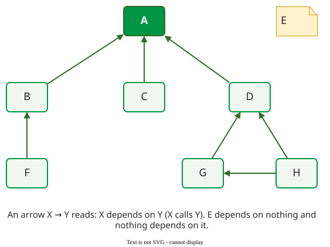
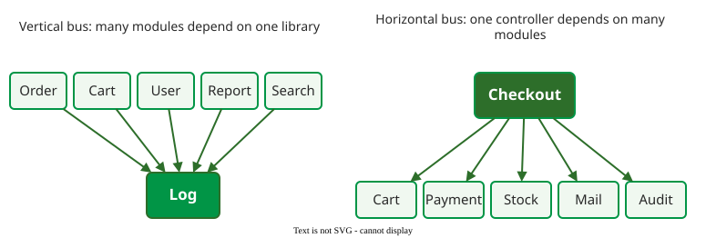

# Design Structure Matrix

A **design structure matrix** (DSM) is a square matrix with the system's elements (files, classes, modules) in the same order along the rows and the columns, and a mark wherever one element depends on another . It shows structure that a dependency graph hides once the system has more than a few dozen elements.

## 1. Reading a DSM

This handbook uses the convention of MacCormack et al.: a mark in **row i, column j** means element i depends on element j, for example i calls a function in j . Read along a row to see what an element needs; read down a column to see who needs it. Some tools and the DSMweb tutorials use the transpose, with columns depending on rows. Both carry the same information, so the first thing to check on any DSM is which convention it uses: read with the wrong one, every "depends on" becomes "is needed by".

## 2. Worked example: from graph to matrix

In this graph (the lecture example), B, C and D depend on A, F depends on B, G and H depend on D, and H also depends on G. E is unconnected.

_The dependency graph. An arrow X → Y means X depends on Y._

Put the elements in the order A E B C D F G H, one row and one column each, and mark row X, column Y for every arrow X → Y. The diagonal is shown as ".".

| | A | E | B | C | D | F | G | H |
|---|:-:|:-:|:-:|:-:|:-:|:-:|:-:|:-:|
| **A** | . | | | | | | | |
| **E** | | . | | | | | | |
| **B** | X | | . | | | | | |
| **C** | X | | | . | | | | |
| **D** | X | | | | . | | | |
| **F** | | | X | | | . | | |
| **G** | | | | | X | | . | |
| **H** | | | | | X | | X | . |

Every mark is below the diagonal: each element depends only on elements listed before it. The order reads as layers from the bottom up: A and E first, then B, C and D, then F and G, then H, which needs G. Column A has three marks, so a change to A can affect three elements directly.

## 3. Three patterns between two elements

Between any two elements there are three possibilities . **Independent**: no mark either way; they can be built and changed in parallel. **Dependent**: a mark on one side only, so one must come first. **Coupled**: marks on both sides, a cycle; neither can change without checking the other. Good structure has many independent and dependent pairs and few coupled ones.

## 4. Layering and violations

When the rows follow the intended layers, a mark above the diagonal is a dependency the other way, from a lower layer up to a higher one: a **layering violation**. In the example, suppose E (bottom layer) starts calling G (third layer). The mark lands in row E, column G, above the diagonal. Now a change to G can break E, so the layering no longer protects the lower layers.

## 5. Buses

Two element types stand out . A **vertical bus** is an element that many others depend on, such as a logging or error-handling library: a column with marks in many rows. MacCormack et al. count a file as a vertical bus when the share of files calling it is above a "bus threshold"; they started at 10% and varied it, noting that there is no right value. A **horizontal bus** depends on many others, such as a controller: a full row. MacCormack et al. found 14 vertical buses in Linux against 2 in the first open-source Mozilla; buses are usually designed early, have stable interfaces and save duplicated effort.

_Vertical and horizontal buses in graph form; in the DSM they are a full column and a full row._

## When to use it — and when not

Use a DSM to check an architecture against its intended layers, find cycles and find hidden coupling in systems with hundreds of elements. Tools that extract one from code include Lattix, Structure101 and NDepend. Do not use a DSM alone to judge how hard a change is; it shows which dependencies exist, not how often they carry changes ([Propagation Cost](propagation-cost.md)).

## Limitations

A DSM shows one kind of dependency at a time, usually static calls; MacCormack et al. used function calls between source files. Dynamic dispatch, shared data and configuration can couple elements without a mark. Aspects can do the same: in Ribeiro and Sousa's DSMs of an aspect-oriented system, aspects modularized crosscutting concerns but reduced class modularity, until design rules were made explicit modules .

## How solid is this?

- **Where it comes from.** DSMs began in engineering project planning  and were applied to software structure by MacCormack et al. and Sullivan et al. .
- **What is contested.** Which dependencies to record; MacCormack et al. argue the choice is a "lens", and different lenses show different structures .

---

### References



---

{: .highlight }
**Disclaimer:** AI is used for text summarization, polishing and explaining. Authors have verified all facts and claims. In case of an error, feel free to file an issue.
