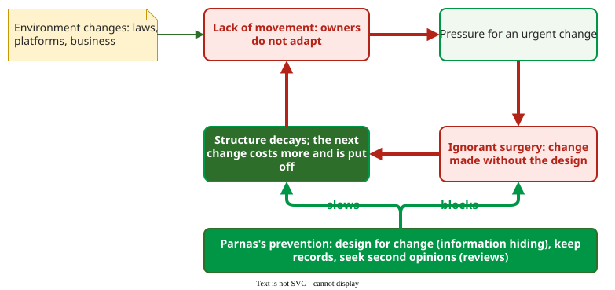

# Software Evolution and Aging

**Software evolution** is the continuing change of a program after its first release; Lehman showed that a program used in the real world must keep changing, and Parnas showed how the changes themselves make it age .

## 1. Programs that must change

Lehman sorts programs by how they relate to the world . An **S-program** is fully defined by its specification, such as a sorting routine. A **P-program** solves a real problem only approximately, such as a chess program. An **E-program** is embedded in the world it serves, and using it changes that world: an operating system or a payroll system. E-programs are where maintenance cost comes from. Lehman quotes an estimate that of US programming spending in 1977, some 70% went on maintenance and about 30% on development .

The changes themselves come in four kinds : **corrective** (fixing discovered failures), **adaptive** (keeping the software usable in a changed environment, such as a new operating system or law), **perfective** (improving it, for example adding features or improving performance) and **preventive** (fixing latent faults or structure before they cause failures, such as refactoring).

## 2. Lehman's first two laws

From statistical models of the release history of large systems, Lehman stated laws of program evolution: five by 1980, eight in his 1996 revision . The first two:

- **Law I, continuing change.** A program used in a real-world environment must be continually adapted, or it becomes progressively less satisfactory.
- **Law II, increasing complexity.** As a program evolves, its complexity increases unless work is done to maintain or reduce it.

Together: change is unavoidable, and every change costs structure unless restored. **Technical debt** is the extra cost of future changes caused by shortcuts in the structure now. Its **principal** is the cost of repairing the shortcut, which static-analysis tools report as remediation cost (see [Measuring Maintainability](measurement.md)) . Its **interest** is the extra cost each later change pays meanwhile; it rises because complexity grows, as Law II says .

## 3. Parnas's two causes of aging

Parnas names two causes of software aging . **Lack of movement** is the owners' failure to modify the product to meet changing needs. **Ignorant surgery** is aging caused by the changes themselves, made by people who do not understand the original design. Together they form a "one-two punch": neglect builds pressure for an urgent change, and the urgent change is made without the design.

_Parnas's aging loop. His preventive measures cut the loop where the changes are made._ 

## 4. Worked example: a payroll system

A payroll system (constructed example) has this history. A new tax law takes effect, and the update ships nine months late. That is **lack of movement**. Under deadline, a contractor adds the new rate as a special case inside the report module instead of the tax module. That is **ignorant surgery**: the code works, but the tax rule now lives in two places. The design document still describes one tax module, so the next developer changes only that one, and the reports come out wrong.

Parnas's prescriptions map onto each step . **Design for change** would have hidden the tax rules behind one module interface. **Keep records** would have kept the design document true. **Second opinions**, meaning design and code reviews, would have caught the special case. For a system that has already aged, he lists remedies: retroactive documentation, retroactive modularization, amputation of code not worth saving, and major surgery that removes redundant parts and gratuitous dependencies.

## When to use it — and when not

Use Lehman and Parnas to argue for maintenance budget before it is needed: they explain why a system that is not changing is ageing too. Do not use the laws to predict numbers for one project; they describe statistical regularities across large, long-lived systems.

## Limitations

The 70% figure is a single national estimate from the 1970s, quoted by Lehman, not a measurement of modern projects. The laws were formed on a few large systems. The other six laws are self-regulation (III), conservation of organisational stability (IV), conservation of familiarity (V), continuing growth (VI), declining quality (VII) and feedback system (VIII): the evolution process is a multi-loop feedback system and has to be treated as one to be improved .

Breivold et al. separate maintainability, about fine-grained, short-term, localized changes, from **evolvability**, about coarse-grained, long-term, radical functional or structural changes . Evolvability needs architecture-level analysis such as a [design structure matrix](dsm.md), explained later.

## How solid is this?

- **Where it comes from.** Lehman's statistical studies of the evolution of large systems  and Parnas's 1994 essay .
- **What is contested.** Whether the laws still hold for small, fast-released systems; Lehman himself stated that they only apply once a system and its organisation are well established .

---

### References



---

{: .highlight }
**Disclaimer:** AI is used for text summarization, polishing and explaining. Authors have verified all facts and claims. In case of an error, feel free to file an issue.
