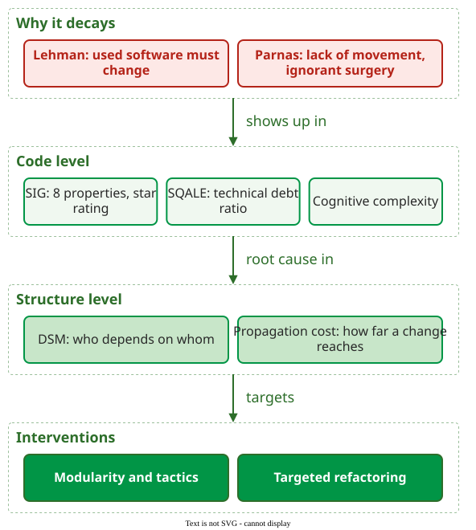

# Maintainability

**Maintainability** is the degree of effectiveness and efficiency with which a product or system can be modified by the intended maintainers . Its five sub-characteristics, modularity, reusability, analysability, modifiability and testability, are defined on the [ISO/IEC 25010](../../define/foundations/iso25010.md) page. It is a matter of degree, judged by the cost of each change, not a pass or fail property.

_The section in one picture: why software decays, where the decay shows in the code, where its root cause sits in the structure, and what fixes it._

## The pages at a glance

| Question | Main idea | Page |
|---|---|---|
| Why does software decay? | Used software must keep changing (Lehman), and changes made without the design age it (Parnas) | [Software Evolution and Aging](evolution.md) |
| How do we rate the code? | SIG rates 8 code properties against a benchmark; SQALE prices the debt | [Measuring Maintainability](measurement.md) |
| How do I rate Python code? | Radon's MI, and its output turned into unit-complexity and unit-size profiles | [Rating Python Code with Radon](radon.md) |
| Which code is hard to read? | Cognitive complexity charges for nesting, which cyclomatic complexity ignores | [Cognitive Complexity](cognitive-complexity.md) |
| Why is modularity worth paying for? | Each independent module is an option to change it alone | [Modularity and Its Value](modularity.md) |
| How do we see the structure? | A design structure matrix (DSM) lists who depends on whom | [Design Structure Matrix](dsm.md) |
| How do we improve the structure? | Partitioning, clustering, tearing and banding reorder the DSM | [DSM Operations](dsm-operations.md) |
| How far does a change reach? | Propagation cost: the share of the system a change can touch | [Propagation Cost](propagation-cost.md) |
| Does restructuring pay? | Mozilla, Windows 7, ABB and automatic refactoring at four companies | [Refactoring Case Studies](cases.md) |
| Where do I refactor my repository? | Complexity × churn hotspots, a DSM of the modules, then one target | [Worked Case: Where to Refactor Click](worked-case.md) |

## Reading order

Read top to bottom. The evolution page explains why maintenance never stops, the next three pages measure the code, and the four after them measure and improve the structure. The case studies show the effect of both, and the worked case applies all of them to one repository. Code metrics that maintainability models reuse, such as cyclomatic complexity, are defined in [Measurement](../../define/measurement/index.md); the Maintainability Index formula, as radon computes it, is on [Rating Python Code with Radon](radon.md).

## How solid is this?

- **Where it comes from.** ISO/IEC 25010 for the definitions , Lehman and Parnas for evolution , the SIG model , and MacCormack et al. for the design structure matrix .
- **What is contested.** Whether any single number measures maintainability: Ardito et al. found 174 maintainability metrics in the literature, and over 75% were used by only one paper .

---

### References



### Acknowledgments

The lectures behind this area took early inspiration from the *Analysis of Software Artifacts* course of Eduardo Miranda and Claire Le Goues (Carnegie Mellon University). The pages here are original, written from the literature review; any errors are ours.

---

{: .highlight }
**Disclaimer:** AI is used for text summarization, polishing and explaining. Authors have verified all facts and claims. In case of an error, feel free to file an issue.
