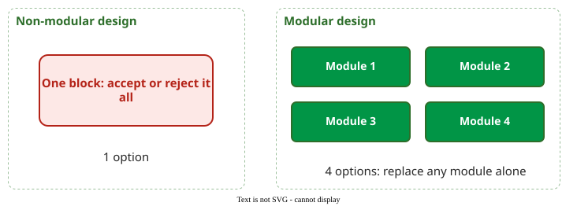
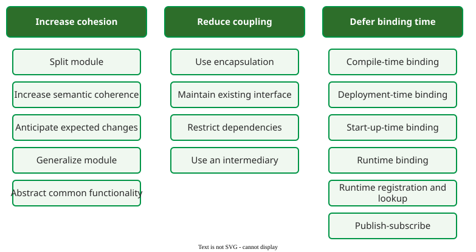

# Modularity and Its Value

**Modularity** is the degree to which a system is composed of discrete components such that a change to one component has minimal impact on others . A modular design is valuable because each module is an option: it can be improved or replaced without redesigning the rest .

## 1. Coupling and cohesion

Two properties decide how modular a design is. **Coupling** is how much modules depend on each other; the goal is low coupling, so that a change stays inside one module. **Cohesion** is how strongly the elements inside one module belong together; the goal is high cohesion, so that each module has one reason to change. Splitting a module can raise or lower coupling: a split along a real seam removes dependencies, a split through the middle of a tight cluster turns internal calls into new cross-module ones. A [design structure matrix](dsm.md) makes both visible: cohesive modules show as dense blocks on the diagonal, coupling as marks outside the blocks. Class-level measures of both, CBO for coupling (how many other classes a class uses or is used by) and LCOM for cohesion (how many method pairs share no attribute), are on the [object-oriented metrics](../../define/measurement/oo-metrics.md) page.

## 2. Modules as options

Sullivan et al. applied Baldwin and Clark's real-options theory to software . An option is the right, but not the obligation, to make an investment; it can pay off and never has to lose. A design that can only be replaced as a whole gives one option: accept or reject everything. A design of independent modules gives one option per module, because each can be redesigned and swapped alone. The **net option value** (NOV) of a module is the expected payoff of searching for a better version and substituting it, minus the cost of the search and the cost of changing the modules that can see it. Options are worth most when the future is uncertain, because then the chance that a better replacement exists is high.

_More modules, more independent options._ 

## 3. Worked example: Parnas's KWIC

Parnas compared two designs of KWIC, a program that builds a keyword-in-context index. The **processing-step** design has one module per step (input, circular shift, alphabetizing, output), and all of them share the same data formats. The **information-hiding** design gives each module a decision likely to change, such as how lines are stored, and hides it behind an interface. A change to the line storage format touches every module in the first design and one module in the second.

Sullivan et al. put numbers on this under stated, illustrative assumptions . The modules' NOVs summed to 0.26 for the processing-step design and 1.56 for the information-hiding design, in units of the base system's value. A design's value is the base system plus its options, 1 + ΣNOV: 1 + 1.56 = 2.56 times an unmodularised version for information hiding, against 1 + 0.26 = 1.26 for the processing-step design. Its options alone were worth six times as much (1.56 / 0.26), while the total values differ about twofold (2.56 / 1.26 ≈ 2.0).

## 4. Tactics that create modularity

Bogner et al. use 15 modifiability tactics in three groups . **Increase cohesion** localises changes: split a module, increase semantic coherence, anticipate expected changes, generalise a module, abstract common functionality. **Reduce coupling** stops ripple effects: use encapsulation, maintain existing interfaces, restrict dependencies, use an intermediary. **Defer binding time** adds flexibility by fixing a choice at compile, deployment, start-up or run time, including runtime registration and publish-subscribe.

_Modifiability tactics as used by Bogner et al._ 

## When to use it — and when not

Use the options argument when deciding whether to pay for an interface now: it is worth paying where requirements are uncertain. Do not split stable, tightly related code just to raise the module count; each new interface has a cost.

## Limitations

The NOV numbers rest on parameters that are hard to estimate. Sullivan et al. call their own analysis illustrative and say that strongly justified estimates for real options in software remain an open challenge .

## How solid is this?

- **Where it comes from.** Parnas's KWIC comparison and its options-based reanalysis ; the tactic catalogue used by Bogner et al. .
- **What is contested.** Whether option values can be measured in practice; the qualitative conclusion, that information hiding pays, is widely accepted.

---

### References



---

{: .highlight }
**Disclaimer:** AI is used for text summarization, polishing and explaining. Authors have verified all facts and claims. In case of an error, feel free to file an issue.
