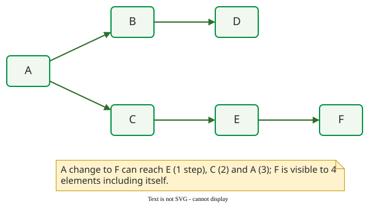

# Propagation Cost

**Propagation cost** (PC) is the share of a system's elements that could be affected, on average, when one element changes, counting both direct dependencies and chains of indirect ones . It turns a [design structure matrix](dsm.md) into one number for how far changes can ripple.

## 1. From the DSM to the visibility matrix

Let $$M$$ be the DSM with $$m_{ij} = 1$$ when element $$i$$ depends on element $$j$$. The square $$M^2$$ has a non-zero entry where $$i$$ reaches $$j$$ in two steps, $$M^3$$ in three, and so on. MacCormack et al. add these powers, including $$M^0 = I$$ so that every element reaches itself, and set every non-zero entry to 1 :

$$V = \text{binary}\Big(\sum_{n=0}^{N} M^n\Big), \qquad PC = \frac{1}{N^2}\sum_{i=1}^{N}\sum_{j=1}^{N} v_{ij}$$

Here $$N$$ is the number of elements, raising $$M$$ up to the $$N$$-th power covers the longest possible chain, and binary(·) sets every non-zero entry to 1. A row sum of $$V$$ is an element's fan-out visibility: the elements it depends on, directly or indirectly, itself included, so a change in any of them can affect it. A column sum is its fan-in visibility: the elements that depend on it, so a change to it can reach them. PC is the average of either, divided by $$N$$.

## 2. Worked example

MacCormack et al. use six elements: A depends on B and C, B on D, C on E, and E on F .



_The example system. A change to F can reach E, C and A._

The direct marks are A→B, A→C, B→D, C→E and E→F. $$M^2$$ adds A→D, A→E and C→F; $$M^3$$ adds A→F; $$M^4$$ is zero. With the diagonal, the visibility matrix is:

| | A | B | C | D | E | F | Row sum |
|---|:-:|:-:|:-:|:-:|:-:|:-:|:-:|
| **A** | 1 | 1 | 1 | 1 | 1 | 1 | 6 |
| **B** | | 1 | | 1 | | | 2 |
| **C** | | | 1 | | 1 | 1 | 3 |
| **D** | | | | 1 | | | 1 |
| **E** | | | | | 1 | 1 | 2 |
| **F** | | | | | | 1 | 1 |

The ones add up to 15, so $$PC = 15/36 = 41.7\%$$: a change to a random element can, on average, reach 41.7% of the system. The column sums (1, 2, 2, 3, 3, 4) give the same 15. The same computation on the eight-element [DSM example](dsm.md), in the order A E B C D F G H, gives row sums 1, 1, 2, 2, 2, 3, 3, 4 and $$PC = 18/64 = 28.1\%$$; adding the single violating dependency E→G raises E's row sum to 4 and PC to $$21/64 = 32.8\%$$. These values were computed with a short script and checked by hand.

## 3. Mozilla against Linux

MacCormack et al. compared the first open-source Mozilla (April 1998) with Linux 2.1.105, a version of similar size :

| | Mozilla, Apr 1998 | Linux 2.1.105 | Mozilla, Dec 1998 | Linux 2.1.88 |
|---|:-:|:-:|:-:|:-:|
| Source files | 1,684 | 1,678 | 1,508 | 1,538 |
| Dependencies | 6,717 | 9,110 | 3,037 | 8,519 |
| Propagation cost | 17.35% | 5.82% | 2.78% | 5.65% |

```vega-lite
{
  "$schema": "https://vega.github.io/schema/vega-lite/v5.json",
  "width": 420, "height": 200,
  "data": {"values": [
    {"v": "Mozilla, Apr 1998", "pc": 17.35, "o": 1},
    {"v": "Linux 2.1.105", "pc": 5.82, "o": 2},
    {"v": "Mozilla, Dec 1998", "pc": 2.78, "o": 3},
    {"v": "Linux 2.1.88", "pc": 5.65, "o": 4}]},
  "layer": [
    {"mark": {"type": "bar", "cornerRadiusEnd": 4},
     "encoding": {"y": {"field": "v", "type": "nominal", "sort": {"field": "o"}, "title": null},
                  "x": {"field": "pc", "type": "quantitative", "title": "Propagation cost (%)", "scale": {"domain": [0, 20]}},
                  "color": {"condition": {"test": "datum.v == 'Mozilla, Apr 1998'", "value": "#b42318"}, "value": "#019546"}}},
    {"mark": {"type": "text", "align": "left", "dx": 4, "fontSize": 13},
     "encoding": {"y": {"field": "v", "type": "nominal", "sort": {"field": "o"}}, "x": {"field": "pc", "type": "quantitative"}, "text": {"field": "pc"}}}
  ],
  "config": {"font": "Tahoma, sans-serif", "axis": {"labelFontSize": 13, "titleFontSize": 13}, "view": {"stroke": null}}
}
```

_Propagation cost before and after Mozilla's redesign, with the Linux version closest in size to each._ 

Linux had more dependencies, and a higher density (dependencies divided by the number of file pairs, $$N^2$$): about 3.2 per 1,000 pairs (9,110 / 1,678²) against Mozilla's 2.4 (6,717 / 1,684²). Yet it had a third of Mozilla's propagation cost: the count of dependencies does not decide coupling, their pattern does. After a deliberate redesign in late 1998, Mozilla's propagation cost fell from 17.35% to 2.78%, 84% lower (the paper says a change could reach "80% fewer" files), and it was then below Linux. The authors conclude that the tight coupling was not forced by what a browser does but came from how it was built and designed.

## 4. Computing it for a Python project

`pydeps mypackage --show-deps --no-output --no-show` prints each module's imports as JSON. This script (tested with pydeps 3.0.9) builds the matrix, its transitive closure and PC; on a package with five modules, `cart`, `pricing`, `tax`, `report_a` and `report_b`, where `cart` imports `pricing` and `pricing` imports `tax`, it gives 8/25 = 32%. The package's `__init__` is not counted.

```python
import json, subprocess, sys
pkg = sys.argv[1]
cmd = ["pydeps", pkg, "--show-deps", "--no-output", "--no-show"]
deps = json.loads(subprocess.check_output(cmd))
names = sorted(m for m in deps if m.startswith(pkg + "."))
n = len(names)
imports = [deps[m].get("imports", []) for m in names]
reach = [[i == j or names[j] in imports[i] for j in range(n)]
         for i in range(n)]
for k in range(n):
    for i in range(n):
        if reach[i][k]:
            reach[i] = [a or b for a, b in zip(reach[i], reach[k])]
print("PC =", sum(map(sum, reach)), "/", n * n)
```

## 5. What propagation cost misses

**Not every dependency carries change.** Geipel and Schweitzer followed co-changes in the history of 35 open-source Java projects . In the chart, the **age-only reference** is what the most active 10% would carry if dependencies differed only in age: older dependencies have had more time to collect co-changes, so the reference lets each gain co-changes in proportion to its age: a dependency twice as old is expected to carry twice the co-changes. A dependency raised the chance that two classes changed together to between about 15% and 60%, against under 5% without one in all but one project. Yet in all but three projects more than half the dependencies never carried a single change, and in most projects the most active 10% of dependencies carried over half of all change propagation.

```vega-lite
{
  "$schema": "https://vega.github.io/schema/vega-lite/v5.json",
  "width": 420, "height": 180,
  "data": {"values": [
    {"p": "eclipse", "s": "Observed", "v": 70.02}, {"p": "eclipse", "s": "Age-only reference", "v": 19.96},
    {"p": "findbugs", "s": "Observed", "v": 64.91}, {"p": "findbugs", "s": "Age-only reference", "v": 21.42},
    {"p": "hibernate", "s": "Observed", "v": 58.59}, {"p": "hibernate", "s": "Age-only reference", "v": 19.46},
    {"p": "jedit", "s": "Observed", "v": 41.80}, {"p": "jedit", "s": "Age-only reference", "v": 15.62},
    {"p": "jazilla", "s": "Observed", "v": 22.02}, {"p": "jazilla", "s": "Age-only reference", "v": 36.44}]},
  "mark": {"type": "bar", "cornerRadiusEnd": 3},
  "encoding": {
    "y": {"field": "p", "type": "nominal", "title": null, "sort": null},
    "yOffset": {"field": "s"},
    "x": {"field": "v", "type": "quantitative", "title": "Share of co-changes carried by the most active 10% of dependencies (%)", "scale": {"domain": [0, 80]}},
    "color": {"field": "s", "type": "nominal", "scale": {"domain": ["Observed", "Age-only reference"], "range": ["#1f5fa8", "#c99700"]}, "legend": {"title": null, "orient": "bottom"}}},
  "config": {"font": "Tahoma, sans-serif", "axis": {"labelFontSize": 12, "titleFontSize": 12}, "view": {"stroke": null}}
}
```

_Five of the 35 projects. In most projects the observed share is above 50%; jedit is below it, and in jazilla it is even lower than the age-only reference._ 

**Not every dependency is equally strong.** Nord et al. found that PC stayed at 33% before and after a system was turned into a strictly layered design, although the change shielded upper layers. The analyst gives each dependency a strength from the tactics applied to it: 0.1 when tactics such as encapsulation shield it, 0.5 when some tactics are used but are not enough, 1 when nothing stops a change. A path costs as much as its weakest link, the smallest strength along it; parallel paths between two elements are then added (SUM), averaged (AVG) or the largest is taken (MAX). Three paths of 0.1, 0.1 and 0.5 give 0.7, 0.23 or 0.5. They replace the visibility matrix's 0s and 1s; PC went, before → after, SUM 24% → 13%, AVG 18% → 13% and MAX 23% → 13% .

**Buses inflate it.** A logging library used everywhere adds to every element's visibility, though its stable interface rarely passes change on .

## When to use it — and when not

Use propagation cost to compare versions or similar designs. Do not set it as a target to minimise: an interface introduced to hide a decision adds an element and can raise PC while making change easier.

## Limitations

PC treats dependencies as equal, ignoring cohesion. Values depend on what counts as a dependency and on the level (files, classes, packages) at which the DSM is built.

## How solid is this?

- **Where it comes from.** MacCormack, Rusnak and Baldwin , with corrections from change histories  and from architectural tactics .
- **What is contested.** The paper itself reports Linux's propagation cost as 5.82% in its table and 5.16% in its text; the comparison holds either way.

---

### References



---

{: .highlight }
**Disclaimer:** AI is used for text summarization, polishing and explaining. Authors have verified all facts and claims. In case of an error, feel free to file an issue.
