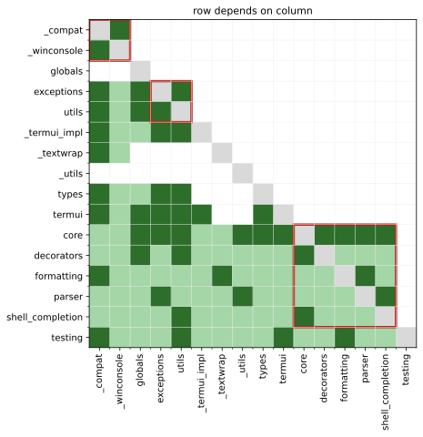

# Worked Case: Where to Refactor Click

This worked case takes a real Python repository and its Git history and decides where a limited refactoring budget goes: which file, which function, what target, and how to check the result. It uses the measures from [Rating Python Code with Radon](radon.md), [Design Structure Matrix](dsm.md), [DSM Operations](dsm-operations.md) and [Propagation Cost](propagation-cost.md); the theory stays there.

**Example: Click.** [Click](https://github.com/pallets/click) is a widely used library for building command-line interfaces. Its package `src/click` has 17 Python files and 12,930 lines (`ls src/click/*.py | wc -l` and `wc -l src/click/*.py`) at commit `2247b35` (4 October 2026, version 8.6.0.dev). Suppose its maintainers can spend about a week on refactoring before the next release (constructed premise; the code, history and numbers are real). The question: where does that week pay most? _(Every command was run for this page with Python 3.12.9, radon 6.0.1, pydeps 3.0.9, flake8 7.5.0, xenon 0.9.3 and matplotlib 3.11.2 on a fresh clone; every script is run from the repository root unless stated.)_

## 1. Scan the whole repository

On your own system the input is the repository itself: clone it, check out the release you are assessing, and run the tools over the package folder, not over tests or vendored code.

```bash
git clone https://github.com/pallets/click && cd click && git checkout 2247b35
radon cc -a src/click | tail -2          # every function, method and class
radon cc -nc -s src/click                # only blocks rated C or worse
radon mi -s src/click                    # one Maintainability Index per file
```

```text
643 blocks (classes, functions, methods) analyzed.
Average complexity: A (3.244167962674961)

src/click/core.py
    M 3614:4 Option.get_help_extra - E (35)
    M 370:4 Context.__init__ - D (28)
    M 1515:4 Command.main - C (19)
    ...                                    (29 blocks in all, 14 of them in core.py)

src/click/core.py - C (0.00)
src/click/types.py - B (16.38)
...                                        (the other 15 files are A)
```

**Decision point: is there anything to act on?** Criterion: any function in the moderate band or worse of the SIG model (the Software Improvement Group's benchmark, on [Measuring Maintainability](measurement.md)), cyclomatic complexity (CC) above 10 , which is radon's C or worse. The average is not the criterion: an A of 3.24 over 643 blocks hides 29 blocks above 10. Nor is the Maintainability Index: `core.py` scores 0.00 because radon clamps the index at 0 for a 4,038-line file, so it ranks nothing inside that file. There is work to do, and most of it is in one file.

## 2. Find the hotspots: complexity × change

Complex code that nobody touches costs little; complex code that changes every month costs on every change. A **hotspot** is code that is both complex and frequently changed (practitioner rule of thumb, popularised by Adam Tornhill's book *Your Code as a Crime Scene*, a practitioner source; the evidence is in *How solid is this?*). The input is the version history: `git log --numstat` prints, for every commit, the lines added and deleted per file. This script, `hotspots.py`, counts commits and churned lines per file over the last two years and multiplies the commit count by the file's summed CC. `--no-renames` keeps a renamed file's lines under its plain path; with rename detection on, git prints `{old => new}.py` paths, which the `.py` filter would silently drop. Churn is printed as a cross-check but left out of the score, because one bulk edit can add thousands of lines while counting as one commit:

```python
import collections, json, subprocess, sys
src, since = sys.argv[1], sys.argv[2]          # e.g. src/click 2024-10-01
log = subprocess.check_output(["git", "log", f"--since={since}", "--no-merges", "--no-renames",
                               "--numstat", "--format=", "--", src], text=True)
commits, churn = collections.Counter(), collections.Counter()
for line in log.splitlines():
    if line.strip():
        added, deleted, path = line.split("\t")
        if path.endswith(".py") and added != "-":
            commits[path] += 1
            churn[path] += int(added) + int(deleted)
cc = json.loads(subprocess.check_output(["radon", "cc", "-j", src]))
print(f"{'file':28} {'commits':>7} {'churn':>6} {'sum CC':>6} {'max CC':>6} {'score':>7}")
rows = []
for path, blocks in cc.items():
    fs = [b["complexity"] for b in blocks if b["type"] != "class"]
    rows.append((commits[path] * sum(fs), path, max(fs, default=0), sum(fs)))
for score, path, mx, total in sorted(rows, reverse=True)[:6]:
    print(f"{path:28} {commits[path]:7} {churn[path]:6} {total:6} {mx:6} {score:7}")
```

```text
$ python hotspots.py src/click 2024-10-01
file                         commits  churn sum CC max CC   score
src/click/core.py                 99   3247    642     35   63558
src/click/_termui_impl.py         34   1181    176     19    5984
src/click/types.py                24   1028    198     18    4752
src/click/termui.py               29    582    112     21    3248
src/click/shell_completion.py      22    420     83     10    1826
src/click/testing.py              18    611     79     19    1422
```

**Decision point: which file?** Criterion: the highest score, if it stands clearly above the rest. `core.py` was touched by 99 of the 217 commits in the window (`git log --since=2024-10-01 --no-merges --oneline -- src/click | wc -l`) and scores ten times the next file, so the search continues inside it.

Inside the file, `git log -L <start>,<end>:<file>` lists the commits that changed a given line range. `function_churn.py` feeds it the `lineno` and `endline` of each C-or-worse function from `radon cc -j`, so it counts the commits that touched each function's current lines:

```python
import json, subprocess, sys
path, since = sys.argv[1], sys.argv[2]         # e.g. src/click/core.py 2024-10-01
blocks = json.loads(subprocess.check_output(["radon", "cc", "-j", "-nc", path]))[path]
print(f"{'function':32} {'CC':>3} {'lines':>5} {'commits':>7}")
for b in blocks:
    if b["type"] == "class":
        continue
    rng = f"{b['lineno']},{b['endline']}:{path}"     # the function's lines today
    log = subprocess.check_output(["git", "log", f"--since={since}", "--no-merges",
                                   "-s", "--format=%h", "-L", rng], text=True)
    name = f"{b.get('classname') or ''}.{b['name']}".lstrip(".")
    print(f"{name:32} {b['complexity']:3} {b['endline'] - b['lineno'] + 1:5} "
          f"{len(log.split()):7}")
```

```text
$ python function_churn.py src/click/core.py 2024-10-01
function                          CC lines commits
Option.get_help_extra             35    83       5
Context.__init__                  28   175       2
Command.main                      19   135       2
Option._parse_decls               18    66       4
Option.consume_value              18    55       7
Command.get_params                17    55       2
Parameter.handle_parse_result     17    87      13
Command.shell_complete            15    46       1
Group.__init__                    14    53       2
Parameter.process_value           14    65       7
Option._validate                  13    21       1
Parameter.__init__                12    82      10
Parameter.consume_value           11    47       8
Option._resolve_lazy_default      11    23       1
```

Ranked by CC × commits:

| Function in `core.py` | CC | Lines | Commits | CC × commits |
|---|:-:|:-:|:-:|:-:|
| `Parameter.handle_parse_result` | 17 | 87 | 13 | 221 |
| `Option.get_help_extra` | 35 | 83 | 5 | 175 |
| `Option.consume_value` | 18 | 55 | 7 | 126 |
| `Parameter.__init__` | 12 | 82 | 10 | 120 |
| `Parameter.process_value` | 14 | 65 | 7 | 98 |
| `Parameter.consume_value` | 11 | 47 | 8 | 88 |
| `Context.__init__` (excluded: below 5 commits) | 28 | 175 | 2 | 56 |

**Decision point: which function?** Criterion: CC above 10 and at least five commits in the window, ranked by CC × commits. `handle_parse_result` comes first: 13 commits, three of them titled "Fix …" (default handling, dual-option arbitration, parameter source during conversion). `get_help_extra` is the most complex function but changed five times; `Context.__init__` is long and complex but changed twice, so it is left alone.

## 3. Check the structure around the hotspot

A function refactor is local. Before choosing it, check that the file is not stuck in a dependency cycle that a local fix cannot reach. In this section, a **cycle block** is a group of modules that all reach each other (not a radon block), a **mark** is one dependency in the matrix, and the **visibility matrix** records who reaches whom, directly or through others. The input is the import graph: `pydeps click --show-deps --no-output --no-show` prints each module's imports as JSON without importing the code. The script below, `dsm.py`, builds the [design structure matrix](dsm.md) (row depends on column), partitions it with Tarjan's strongly connected components algorithm , the partitioning step on [DSM Operations](dsm-operations.md), computes [propagation cost](propagation-cost.md) and draws the heatmap. An optional third argument names edges to drop.

```python
import json, subprocess, sys
import matplotlib.pyplot as plt

pkg, out = sys.argv[1], sys.argv[2]     # run from the folder that holds the package
drop = {tuple(l.split()) for l in open(sys.argv[3])} if len(sys.argv) > 3 else set()
cmd = ["pydeps", pkg, "--show-deps", "--no-output", "--no-show"]
deps = json.loads(subprocess.check_output(cmd))
names = sorted(m for m in deps if m.startswith(pkg + "."))   # skip __init__
idx = {m: i for i, m in enumerate(names)}
short = lambda m: m.split(".", 1)[1]
edges = {i: [idx[d] for d in deps[m].get("imports", [])
             if d in idx and (short(m), short(d)) not in drop]
         for m, i in idx.items()}       # row i depends on column j

# Tarjan: strongly connected components, emitted dependencies-first
low, num, stack, sccs = {}, {}, [], []
def visit(v):
    num[v] = low[v] = len(num); stack.append(v)
    for w in edges[v]:
        if w not in num:
            visit(w); low[v] = min(low[v], low[w])
        elif w in stack:
            low[v] = min(low[v], num[w])
    if low[v] == num[v]:
        scc = []
        while True:
            w = stack.pop(); scc.append(w)
            if w == v: break
        sccs.append(sorted(scc))
for v in range(len(names)):
    if v not in num: visit(v)
order = [v for scc in sccs for v in scc]
pos = {v: k for k, v in enumerate(order)}
above = sum(pos[j] > pos[i] for i in edges for j in edges[i])
label = lambda v: short(names[v])
for scc in sccs:
    print(("BLOCK " if len(scc) > 1 else "      ") + " ".join(map(label, scc)))
print("marks:", sum(map(len, edges.values())), "above diagonal:", above)

# visibility matrix (Warshall) and propagation cost
n = len(names)
reach = [[i == j or j in edges[i] for j in range(n)] for i in range(n)]
for k in range(n):
    for i in range(n):
        if reach[i][k]:
            reach[i] = [a or b for a, b in zip(reach[i], reach[k])]
print(f"PC = {sum(map(sum, reach))}/{n*n} = {sum(map(sum, reach))/n/n:.1%}")

# heatmap in partitioned order: dark = direct, light = indirect, grey = self
grid = [[3 if i == j else 2 if j in edges[i] else 1 if reach[i][j] else 0
         for j in order] for i in order]
fig, ax = plt.subplots(figsize=(6.5, 6.5))
ax.imshow(grid, cmap=plt.matplotlib.colors.ListedColormap(
    ["#ffffff", "#a5d6a7", "#2D6E2A", "#d9d9d9"]), vmin=0, vmax=3)
ax.set_xticks([k - .5 for k in range(1, n)], minor=True)
ax.set_yticks([k - .5 for k in range(1, n)], minor=True)
ax.grid(which="minor", color="#eeeeee", lw=.5)
labels = [label(v) for v in order]
ax.set_xticks(range(n), labels, rotation=90); ax.set_yticks(range(n), labels)
k = 0
for scc in sccs:                        # outline each cycle block
    if len(scc) > 1:
        ax.add_patch(plt.Rectangle((k - .5, k - .5), len(scc), len(scc),
                                   fill=False, ec="#b42318", lw=2.5))
    k += len(scc)
ax.set_title("row depends on column", fontsize=11)
fig.savefig(out, bbox_inches="tight")
```

Run on every import, it reports one cycle block of 11 of the 16 modules, 22 of 52 marks above the diagonal and a propagation cost of 189/256 = 73.8%. But pydeps also counts imports under `if TYPE_CHECKING:`, which exist only for the type checker and never run. `typeonly.py` lists them; on Click it prints six pairs, such as `exceptions core` and `types core`:

```python
import ast, pathlib, sys
# print "importer imported" for relative imports found ONLY under `if TYPE_CHECKING:`
for f in sorted(pathlib.Path(sys.argv[1]).glob("*.py")):
    runtime, typed = set(), set()
    def walk(nodes, typing):
        for n in nodes:
            if isinstance(n, ast.If) and "TYPE_CHECKING" in ast.unparse(n.test):
                walk(n.body, True); walk(n.orelse, typing); continue
            if isinstance(n, ast.ImportFrom) and n.level == 1:
                mods = [n.module] if n.module else [a.name for a in n.names]
                (typed if typing else runtime).update(mods)
            walk(ast.iter_child_nodes(n), typing)
    walk(ast.parse(f.read_text()).body, False)
    for m in sorted(typed - runtime):
        print(f.stem, m)
```

Saving them and dropping those six pairs (run in `src`, where the package folder is):

```text
$ cd src
$ python typeonly.py click > typeonly.txt
$ python dsm.py click click-dsm.svg typeonly.txt
BLOCK _compat _winconsole
      globals
BLOCK exceptions utils
      _termui_impl
      _textwrap
      _utils
      types
      termui
BLOCK core decorators formatting parser shell_completion
      testing
marks: 46 above diagonal: 8
PC = 130/256 = 50.8%
```



_Click's runtime import DSM in partitioned order. Dark green: direct import; light green: indirect reach only; grey diagonal: a module and itself, counted as reached in propagation cost; red outline: cycle blocks. Generated by `dsm.py` with matplotlib, not drawn by hand._

**Decision point: restructure, or refactor locally?** Criterion: restructure as a project of its own only when the hotspot sits in a cycle block that no cheap **tear** (removing one dependency to break a cycle) can break, because every tear would move public interfaces. Otherwise tear as few marks as possible, the cheapest first ([DSM Operations](dsm-operations.md)), and refactor locally. The large cycle block remains, but each of its cycles closes through an import made lazily inside a function, which is how Click keeps these modules importable: `decorators` imports `core` at the top, while `core` imports `decorators` only inside methods such as `Group.command`. That is a design choice, not decay. One closing import is different: `parser` imports `shell_completion` lazily, inside its module-level `__getattr__`, only to serve a deprecated alias, `parser.split_arg_string`, which the code already announces will be removed in Click 9.0. Adding `parser shell_completion` to the drop list shrinks the cycle block to `core decorators shell_completion` and propagation cost to 44.1%. So the structure needs no project of its own: the cheapest tear is already scheduled, and the hotspot can be fixed locally.

## 4. Refactor and verify

`handle_parse_result` does three things: it reads the value, warns about deprecated parameters, and decides which of several options sharing one variable name "wins" the slot. The last two were extracted into `_warn_if_deprecated` and `_wins_slot` on a scratch branch (42 lines added, 33 removed). The three methods after the change, lines 2929–3024 of `core.py`:

```python
    def _warn_if_deprecated(self, value: t.Any, source: ParameterSource) -> None:
        """Warn when the user explicitly set a deprecated parameter."""
        if (
            self.deprecated
            and value is not UNSET
            and source < ParameterSource.DEFAULT_MAP
        ):
            message = _(
                "DeprecationWarning: The {param_type} {name!r} is deprecated."
                "{extra_message}"
            ).format(
                param_type=self.param_type_name,
                name=self.spec,
                extra_message=_format_deprecated_suffix(self.deprecated),
            )
            echo(style(message, fg="red"), err=True)

    def _wins_slot(
        self,
        source: ParameterSource,
        existing_value: t.Any,
        existing_source: ParameterSource | None,
        existing_default_explicit: bool,
    ) -> bool:
        """Arbitrate the slot when several parameters target the same variable
        name (feature-switch groups). See: https://github.com/pallets/click/issues/3403
        """
        if existing_value is UNSET or existing_source is None:
            return existing_value is UNSET
        if source != existing_source:
            return source < existing_source
        auto_would_downgrade_explicit = (
            source == ParameterSource.DEFAULT
            and existing_default_explicit
            and not self._default_explicit
        )
        return not auto_would_downgrade_explicit

    def handle_parse_result(
        self, ctx: Context, opts: cabc.Mapping[str, t.Any], args: list[str]
    ) -> tuple[t.Any, list[str]]:
        """Process the value produced by the parser from user input.

        Always process the value through the Parameter's :attr:`type`, wherever it
        comes from.

        If the parameter is deprecated, this method warn the user about it. But only if
        the value has been explicitly set by the user (and as such, is not coming from
        a default).

        :meta private:
        """
        # Capture the slot's existing state before we mutate
        # ``_parameter_source`` so the write decision below can compare our
        # incoming source against the source of the option that already wrote
        # the slot (if any).
        existing_value = ctx.params.get(self.name, UNSET)
        existing_source = ctx.get_parameter_source(self.name)
        existing_default_explicit = ctx._param_default_explicit.get(self.name, False)

        with augment_usage_errors(ctx, param=self):
            value, source = self.consume_value(ctx, opts)

            # Record the source before processing so eager callbacks and type
            # conversion can inspect it. Restored after arbitration if this
            # option loses a feature-switch group.
            ctx.set_parameter_source(self.name, source)

            self._warn_if_deprecated(value, source)

            # Process the value through the parameter's type.
            try:
                value = self.process_value(ctx, value)
            except Exception:
                if not ctx.resilient_parsing:
                    raise
                # In resilient parsing mode, we do not want to fail the command if the
                # value is incompatible with the parameter type, so we reset the value
                # to UNSET, which will be interpreted as a missing value.
                value = UNSET

        if self._wins_slot(
            source, existing_value, existing_source, existing_default_explicit
        ):
            if self.expose_value:
                ctx.params[self.name] = value
                ctx._param_default_explicit[self.name] = self._default_explicit
        elif existing_source is not None:
            # Lost arbitration; restore the winning option's source.
            ctx.set_parameter_source(self.name, existing_source)
        # else: ctx.params[self.name] was populated by code that bypassed
        # handle_parse_result (from another option's callback for example). Keep
        # the provisional source recorded before process_value so downstream
        # lookups don't return ``None``.

        return value, args
```

Radon on the result:

```text
$ radon cc -s src/click/core.py | grep -E 'handle_parse_result|_wins_slot|_warn_if'
    M 2946:4 Parameter._wins_slot - B (6)
    M 2967:4 Parameter.handle_parse_result - B (6)
    M 2929:4 Parameter._warn_if_deprecated - A (4)
```

The arbitration rule was rewritten as early returns, so it needs more than a reading to be trusted. `equiv.py` compares the old Boolean expression with the new function over every combination of their five inputs: the incoming source (one of the five `ParameterSource` values, an integer enum from PROMPT = 1 to DEFAULT = 5), the slot's existing value (unset or set: 2), the existing source (none or one of the five: 6), and the two "default was explicit" flags (2 each), so 5 × 2 × 6 × 2 × 2 = 240 cases:

```python
from itertools import product
UNSET, DEFAULT = object(), 5        # ParameterSource: PROMPT=1 ... DEFAULT=5
def old(src, ev, es, ede, de):
    slot_empty = ev is UNSET
    more_explicit = es is not None and src < es
    same_source = es is not None and src == es
    downgrade = same_source and src == DEFAULT and ede and not de
    return slot_empty or more_explicit or (same_source and not downgrade)
def new(src, ev, es, ede, de):
    if ev is UNSET or es is None:
        return ev is UNSET
    if src != es:
        return src < es
    return not (src == DEFAULT and ede and not de)
cases = list(product(range(1, 6), [UNSET, "x"], [None, *range(1, 6)], [0, 1], [0, 1]))
diff = [c for c in cases if old(*c) != new(*c)]
print(len(cases), "combinations,", len(diff), "differences")
```

```text
$ python equiv.py
240 combinations, 0 differences
```

The project's own test suite must also pass unchanged (`pytest`); it was not run for this page.

## 5. The artifact: a refactoring decision record

| Field | Entry |
|---|---|
| System, version | Click, `src/click`, commit `2247b35` |
| Evidence | Average CC 3.24 (A); 29 blocks > 10; hotspot `core.py` (99 commits, score 63,558); function `handle_parse_result` CC 17, 13 commits, 3 fixes |
| Structure | Runtime cycle block {core, decorators, formatting, parser, shell_completion}, PC 50.8%; tear `parser → shell_completion` with the 9.0 alias removal (PC 44.1%) |
| Decision | Extract `_warn_if_deprecated` and `_wins_slot` from `handle_parse_result` |
| Target | No block in the change above CC 10 |
| Verification | Radon (6, 6, 4); equivalence check (0 differences); test suite unchanged; gate below |
| Not now | `get_help_extra` (CC 35, 5 commits): next candidate; `Context.__init__` (2 commits): leave |
| Review | Rerun the hotspot script after the next release |

The gate holds the line while the debt is paid. Today `xenon --max-absolute E --max-modules B --max-average A src/click` passes (exit 0); once the two E-rated blocks, `get_help_extra` and `TextWrapper._wrap_chunks` (CC 31), are split, lower `--max-absolute` to D. How such gates work is on [Size and Complexity Metrics](../../define/measurement/examples.md).

## Common mistakes

1. **Choosing by the average or the MI.** Click averages A while 29 blocks exceed 10, and its biggest file has an MI of 0. Spot it: the decision cites one number for the whole repository.
2. **Mixing tools.** `flake8 --max-complexity 10` reports `get_help_extra` at 22, radon at 35, because flake8's mccabe does not count Boolean operators. Spot it: two numbers for one function. Use one tool for thresholds and gates.
3. **Treating every import as coupling.** Type-only imports raised propagation cost from 50.8% to 73.8% here. Spot it: a cycle whose back-edges all sit under `if TYPE_CHECKING:`.
4. **Trusting raw churn.** A reformatting or licence-header commit touches every file and inflates every count. Spot it: sort commits by lines changed and look at the top ones before scoring.
5. **Refactoring complex but stable code.** `Context.__init__` has CC 28 and changed twice in two years. Spot it: high CC, few commits.

## How solid is this?

- **Where it comes from.** The CC bands from SIG ; DSM, partitioning and propagation cost from MacCormack et al. and Yassine ; the tools' documentation . All numbers were printed by the runs described.
- **What is contested.** The hotspot score is a practitioner heuristic, not a validated model. Its basis: Nagappan and Ball found that churn measures relative to size and time predicted the defect density of Windows Server 2003, separating fault-prone from other binaries with 89% accuracy, while absolute churn predicted poorly . And not every dependency carries change , so a cycle in the DSM is a candidate, not a verdict.
- **What we do not hold.** A study showing that refactoring hotspots first pays more than another order.

---

### References



---

{: .highlight }
**Disclaimer:** AI is used for text summarization, polishing and explaining. Authors have verified all facts and claims. In case of an error, feel free to file an issue.
