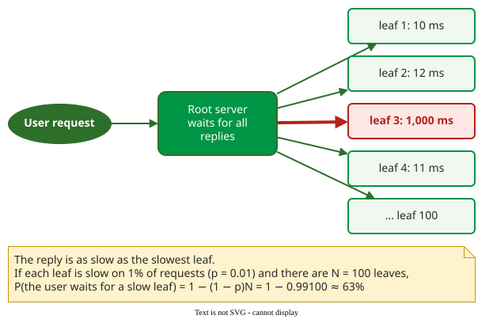
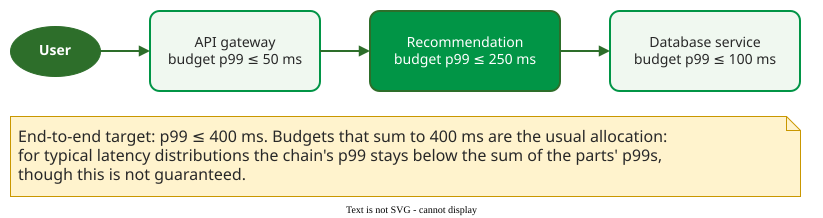

# Tail Latency at Scale

**Tail latency** is the response time at a high percentile, such as the 99th or 99.9th: the delay the slowest 1% or 0.1% of requests see. In services that split each request over many servers, the tail of each server becomes the typical experience of the user .

## 1. Fan-out turns rare delays into common ones

A search request at a large service is split by a root server into sub-requests to many leaf servers, and the reply waits for the last of them. If each leaf is slow on a fraction *p* of requests, independently, a request that touches *N* leaves is slow with probability

**P(slow) = 1 − (1 − p)<sup>N</sup>**

Here *N* counts leaf servers and *p* is a probability; the letters mean other things on the other pages.



_With p = 1% and N = 100, 63% of user requests wait for at least one slow leaf._ 

For example, the formula gives these shares:

| Leaves N | Each leaf slow on | Requests that are slow |
|---|---|---|
| 1 | 1% | 1% |
| 10 | 1% | 9.6% |
| 100 | 1% | 63% |
| 2,000 | 0.01% | 18% |

```vega-lite
{
  "$schema": "https://vega.github.io/schema/vega-lite/v5.json",
  "width": 420, "height": 200,
  "data": {"sequence": {"start": 1, "stop": 2001, "step": 20, "as": "n"}},
  "transform": [
    {"fold": ["1 in 100", "1 in 1,000", "1 in 10,000"], "as": ["leaf", "dummy"]},
    {"calculate": "datum.leaf == '1 in 100' ? 0.01 : (datum.leaf == '1 in 1,000' ? 0.001 : 0.0001)", "as": "p"},
    {"calculate": "1 - pow(1 - datum.p, datum.n)", "as": "slow"}],
  "mark": {"type": "line", "strokeWidth": 3},
  "encoding": {
    "x": {"field": "n", "type": "quantitative", "title": "leaf servers per request", "scale": {"domain": [0, 2000]}},
    "y": {"field": "slow", "type": "quantitative", "title": "share of slow user requests", "axis": {"format": "%"}, "scale": {"domain": [0, 1]}},
    "color": {"field": "leaf", "type": "nominal", "title": "each leaf slow", "scale": {"domain": ["1 in 100", "1 in 1,000", "1 in 10,000"], "range": ["#b42318", "#c99700", "#019546"]}, "legend": {"orient": "right", "symbolStrokeWidth": 3}},
    "strokeDash": {"field": "leaf", "type": "nominal", "title": "each leaf slow", "scale": {"domain": ["1 in 100", "1 in 1,000", "1 in 10,000"], "range": [[1, 0], [8, 4], [2, 3]]}}},
  "config": {"font": "Tahoma, sans-serif", "view": {"stroke": null}}
}
```

_Even a leaf that is slow once in 10,000 requests makes almost one user request in five slow at 2,000 leaves. After Dean and Barroso's figure 1._ 

Measurements from a real Google service show the same effect: one leaf answered in 1 ms at the median and 10 ms at the 99th percentile, but waiting for all leaves took 40 ms at the median and 140 ms at the 99th percentile .

## 2. Tolerate the tail instead of removing it

Some variability (garbage collection, background jobs, shared machines) cannot be engineered away, so Dean and Barroso mask it with redundancy .

- **Hedged requests** send a second copy to another replica if the first has not answered after a short delay, and use whichever reply arrives first. In a BigTable benchmark reading 1,000 values from 100 servers, hedging after 10 ms cut the 99.9th-percentile latency from 1,800 ms to 74 ms while sending 2% more requests. Waiting until the 95th-percentile expected latency before hedging limits the extra load to about 5%.
- **Tied requests** go to two servers at once, and the one that starts work tells the other to cancel; in one file-system test this cut median latency by 16% and the 99.9th percentile by nearly 40%.
- **Good-enough results** return an answer once most leaves have replied, when a missing leaf rarely holds the best result.

## 3. Budget latency along the call chain

In a service-oriented system, the end-to-end target is divided into per-service budgets, each owned by one team and monitored as a service-level objective (SLO), much as Jewell's performance budget divides response time among components .



_A 400 ms end-to-end p99 target divided among three services. Error budgets and burn rates are on [From FIO to SLO](../reliability/slo-bridge.md)._

## When to use it — and when not

- Use the fan-out formula when a request touches many servers, to decide which percentile each server must meet.
- Use hedging only for idempotent requests (reads, or writes that are safe to repeat); a duplicated payment is not a latency fix.

## Limitations

The formula assumes leaves are slow independently. A cause shared by many leaves at once, such as a network or a bad request, makes slow replies cluster, and redundancy helps less.

## How solid is this?

- **Where it comes from.** Dean and Barroso's article reports Google's production techniques and measurements .
- **What is not general.** The hedging and tied-request numbers come from specific Google benchmarks; the size of the gain depends on how much of the delay is local to one server.

---

### References



---

{: .highlight }
**Disclaimer:** AI is used for text summarization, polishing and explaining. Authors have verified all facts and claims. In case of an error, feel free to file an issue.
