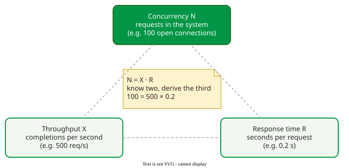

# Performance Measurement

**Performance measurement** records three quantities of a running system (throughput, response time and concurrency) over an observation window, and summarizes them in a way that reflects what users actually wait. Little's law ties the three together .

## 1. Three metrics, one law

**Throughput** *X* is completions per second; **response time** *R* is the time one request spends in the system, queuing included; **concurrency** *N* is the number of requests in the system at once, waiting or being served. (Of *M* users in total, *N* have a request in the system and *M* − *N* are thinking.) Little's law states that, averaged over any window in which requests are neither created nor lost inside the system,

**N = X · R**

whatever the arrival pattern, the number of servers or the queue discipline . Two of the quantities give the third, and a measurement that breaks the law is broken .



_The performance triangle. A load balancer showing 100 open connections at a mean response time of 0.2 s is serving 100 / 0.2 = 500 requests per second._ 

## 2. Averaging rates: the harmonic mean

Two benchmark runs process the same workload at 30 and 20 transactions per hour. The average is not 25: the slower run lasts longer, so it weighs more. With the same work *J* in each run, the total time is *J*/30 + *J*/20, and the mean rate is 2 / (1/30 + 1/20) = **24 transactions per hour**, the harmonic mean. The arithmetic mean is right only for runs of equal time .

## 3. Percentiles describe users; means do not

Response times have a long right tail, so the mean mixes fast and very slow requests . For example, two services both report a mean of 1.0 s:

- In service A every request takes between 0.8 and 1.2 s.
- In service B 90% of requests take 0.5 s and 10% take 5.5 s, and 0.9 × 0.5 + 0.1 × 5.5 = 1.0 s.

The mean cannot tell them apart. The **p95** can. Here a percentile is meant in the usual nearest-rank sense: p95 is the smallest response time that at least 95% of requests do not exceed. It is about 1.2 s for A and 5.5 s for B. Note that B's p90 is still 0.5 s: a percentile p*k* shows a slow group only if that group is more than (100 − *k*)% of requests, and B's slow group is exactly 10%. That is why targets name a high percentile, such as p95 or p99, and why a reported change of a few percent may be noise rather than improvement .

## 4. Throughput saturates; response time keeps climbing

As users are added, throughput first rises with load, then flattens when the busiest resource is saturated; response time stays flat at first, then grows steadily, because every extra user only waits longer in the queue. With *M* users who each think *Z* seconds between requests, the **interactive response time law** links the curves: *R* = *M* / *X* − *Z* .

```vega-lite
{
  "$schema": "https://vega.github.io/schema/vega-lite/v5.json",
  "data": {"values": [
    {"n":1,"X":0.62,"R":0.60},{"n":2,"X":1.16,"R":0.72},{"n":3,"X":1.59,"R":0.88},{"n":4,"X":1.92,"R":1.08},
    {"n":5,"X":2.15,"R":1.32},{"n":6,"X":2.30,"R":1.61},{"n":7,"X":2.39,"R":1.93},{"n":8,"X":2.44,"R":2.27},
    {"n":9,"X":2.47,"R":2.64},{"n":10,"X":2.49,"R":3.02},{"n":11,"X":2.49,"R":3.41},{"n":12,"X":2.50,"R":3.81}]},
  "hconcat": [
    {"width": 260, "height": 180, "title": "Throughput X (requests/s)",
     "mark": {"type": "line", "point": true, "color": "#019546", "strokeWidth": 3},
     "encoding": {"x": {"field": "n", "type": "quantitative", "title": "users M", "scale": {"domain": [0, 12]}},
                  "y": {"field": "X", "type": "quantitative", "title": null, "scale": {"domain": [0, 3]}}}},
    {"width": 260, "height": 180, "title": "Response time R (s)",
     "mark": {"type": "line", "point": true, "color": "#b42318", "strokeWidth": 3},
     "encoding": {"x": {"field": "n", "type": "quantitative", "title": "users M", "scale": {"domain": [0, 12]}},
                  "y": {"field": "R", "type": "quantitative", "title": null, "scale": {"domain": [0, 4]}}}}
  ],
  "config": {"font": "Tahoma, sans-serif", "view": {"stroke": null}}
}
```

_A two-tier service (application 0.2 s and database 0.4 s of work per request, users thinking Z = 1 s between requests), computed with mean-value analysis (MVA), a recursion that gives throughput and response time for each number of users. MVA is explained later; here take the curve as given. At M = 12 users, MVA gives X = 2.50 requests/s, and indeed R = 12 / 2.50 − 1 = 3.8 s. Throughput approaches 1/0.4 = 2.5 requests/s, the database's limit; past the knee at (0.2 + 0.4 + 1) / 0.4 = 4 users, where the two limits cross (derived on Queuing Networks and MVA; the curve bends gradually, X ≈ 1.9 at M = 4), extra users mainly wait. The model is worked through on [Queuing Networks and MVA](../queuing/networks.md)._

Past saturation, thrashing (time spent on overhead such as paging or retries instead of work) can make throughput *fall* while response time explodes: the **buckle zone**, where the system spends more effort managing load than doing work .

## When to use it — and when not

- Report percentiles in every load test and dashboard, stating window, percentile and request type.
- Do not compare means across releases or mix request types in one number.

## Limitations

Percentiles cannot be averaged: the mean of hourly p99s is not the day's p99. Little's law needs a stable window.

## How solid is this?

- **Where it comes from.** Little's law ; the harmonic mean .
- **What is a rule of thumb.** Wilson's advice (report p90; changes under 10% may be noise) is practitioner guidance ; targets often use p95 or p99 to cover more of the tail.
- **What we do not hold.** The "buckle zone" source.

---

### References



---

{: .highlight }
**Disclaimer:** AI is used for text summarization, polishing and explaining. Authors have verified all facts and claims. In case of an error, feel free to file an issue.
