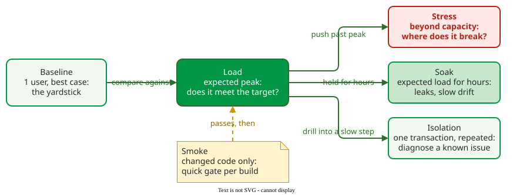

# Performance Testing

**Performance testing** runs a system under a controlled, realistic workload and measures response times, throughput and resource use, to check that it meets stated targets and to find where it stops meeting them. Functional tests ask whether the answer is right; performance tests ask whether it arrives in time .

## 1. Six test types, six questions

Molyneaux distinguishes six types of performance test .

_How the six test types relate: a smoke test gates each build; the load test is then pushed into stress, held for a soak, or narrowed to isolation._ 

| Type | Load | Question |
|---|---|---|
| Baseline | one user, best case | What is the response time with no contention? |
| Load | the expected peak | Does the system meet its targets at that peak? |
| Stress | past the expected peak | Where does it break, and how does it fail? |
| Soak | the expected load for hours | Do memory leaks or slow drift appear over time? |
| Smoke | the changed code only | Did this build make a known path slower? |
| Isolation | one transaction, repeated | Which step of a slow transaction is slow? |

## 2. Write the target as a percentile under a stated load

A target needs a measure, a threshold and a load. "Average response time under 2 s" fails twice: an average hides slow requests, and no load is named. Everett states a *maximum* time per transaction group ; in practice it is set at a percentile, such as "no slower than 3 s for 95% of requests", because a long run's absolute maximum is one outlier. For example, "with 500 active users, 95% of searches complete within 3 s and no request fails" names all three.

## 3. Make the test environment and workload like production

Results transfer only when the test matches production: the same hardware class and configuration, realistic data, and a **workload model**. A practitioner checklist characterises the workload in six items, each from production data:

- **Variation over time:** find the daily, weekly and seasonal peaks and how far they sit above the mean. Everett's shop has two: 2,000 active users browsing at weekday lunchtime and 500 buying on Saturday morning, so it needs two workload plans .
- **Mix:** list transaction types, rates and shares; each peak plan adds the other peak's groups at about 10% of their peak users, and key transactions rarely exceed 20 .
- **Behaviour:** measure think time between a user's requests and pacing, the interval between a scripted user's iterations.
- **Users:** count active users with open sessions; truly simultaneous requests are rare .
- **Data volumes:** size inputs and the database as in production, never empty.
- **Background load:** include batch jobs, other applications and network traffic.

The access log gives the mix, peak rate and think times; the interactive response time law, users = throughput × (response time + think time), turns them into users ([Worked Case: Load Testing a Catalogue Service](worked-case.md)).

## 4. Run each test in three phases

Each run ramps users up to the peak, holds the peak while measuring, and ramps down to check that resources are released. Many systems fail during ramp-up rather than at the peak, because allocating sessions, threads and memory is harder than steady processing . Measure only the steady phase, and compare every result against the baseline.

## 5. Read the curves, not just the numbers

The shape of the response-time curve during a run points to a cause.

| Pattern during a run | Likely cause |
|---|---|
| Rises, then flattens as load levels off | normal saturation of one resource |
| Keeps rising at constant load | a leak: memory, connections, file handles |
| Becomes erratic | contention or garbage-collection pauses |

Malik and colleagues automatically reduced thousands of counters to 5–20 "performance signature" counters and flagged deviations from a baseline with 95% average precision .

## When to use it — and when not

- Run a load test before every release that changes a hot path (code that runs on most requests), and a smoke test on every build.
- Run stress and soak tests before launches and capacity changes.
- Do not trust results from an environment unlike production.

## Limitations

A test shows behavior only for the workload it models: an unmodeled transaction mix or traffic spike remains untested. Few coverage measures exist for load tests; the main one counts only the share of likely workload states that a test visits .

## How solid is this?

- **Where it comes from.** Practitioner books  and a survey of 147 load-testing papers and tools .
- **What is contested.** Molyneaux's figure that moving from release-time validation to performance-driven development cuts defects escaping to production from about 30% to 5% is an experience estimate, not a study result .
- **What supports targeting.** At AT&T, 93% of performance-related problems found in architecture reviews sat in the 30% of projects judged weakest : risk reviews tell you where to test hardest.

---

### References



---

{: .highlight }
**Disclaimer:** AI is used for text summarization, polishing and explaining. Authors have verified all facts and claims. In case of an error, feel free to file an issue.
