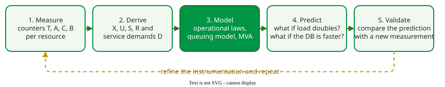

# Capacity Planning

**Capacity planning** predicts how much load a system can carry while still meeting its response-time targets, and when, under a growth forecast, more or faster resources will be needed. It turns measured service demands into a model and the model into a decision .

## 1. A loop, not a one-off calculation

_The capacity-planning loop. Each pass improves the instrumentation and the model._ 

Measure counters per resource over a busy window; derive throughput, utilization and service demands with the [operational laws](operational-laws.md); model the system with a [queuing model](models.md) or [MVA](networks.md); predict the what-ifs; and validate the prediction against the next measurement.

## 2. Worked example: how many users can one server carry?

A web service runs on one server. Measurement gives a service demand of *D* = 0.4 s per request, and users think *Z* = 30 s between requests. The team wants utilization at most 75%, to stay left of the hockey-stick bend.

1. **Throughput at the target.** From the utilization law, *X* = *U* / *D* = 0.75 / 0.4 = 1.875 requests/s.
2. **Response time at that utilization.** As an open M/M/1 estimate, *R* ≈ *D* / (1 − *U*) = 0.4 / 0.25 = 1.6 s. The open formula assumes arrivals that keep coming however slow the server is; real users slow down when responses do, so for a closed workload the estimate errs on the pessimistic side.
3. **Users.** From the interactive response time law, the number of users is *M* = *X* · (*R* + *Z*) = 1.875 × 31.6 ≈ **59 users**.

As an optional check, not meant to be done by hand, a closed MVA model of the same server run for 59 users gives *R* = 1.40 s and *U* = 75%, so the estimate is sound, and slightly pessimistic. The knee lies at *M*\* = (*D* + *Z*) / *D* = 30.4 / 0.4 = 76 users; beyond it, each extra user mainly adds waiting.

To carry 120 users under the same 75% rule, combine the three steps into one formula: *M* = (*U*/*D*) · (*D*/(1 − *U*) + *Z*) = *U*/(1 − *U*) + *U* *Z* / *D* = 3 + 22.5 / *D*. Setting *M* ≥ 120 requires *D* ≤ 22.5 / 117 ≈ **0.19 s**. Halving the demand to 0.2 s is not quite enough: it gives *X* = 3.75 req/s, *R* = 0.8 s and *M* ≈ 115 users (knee 151). A second identical server sharing one queue doubles the throughput at 75%, *X* = 2 × 0.75 / 0.4 = 3.75 req/s; by the M/M/2 formula on [Queuing Models](models.md), *a* = 1.5, *E*c = 2.25 / (2 × 0.25) = 4.5 and Pwait = 4.5 / (1 + 1.5 + 4.5) ≈ 0.64, so *W*q = 0.64 × 0.4 / 0.5 ≈ 0.51 s, *R* ≈ 0.91 s and *M* ≈ 3.75 × 30.91 ≈ 116 users. So the team must cut the demand to 0.19 s or below, or add a server and accept slightly higher utilization.

## 3. Growth: when will we run out?

If demand grows exponentially at a continuous rate *g* per month, it doubles every ln 2 / *g* months, for example ln 2 / 0.1 ≈ 7 months at *g* = 0.1; Gunther reports doubling periods as short as six months for fast-growing web services, much faster than hardware procurement cycles . For clusters, fit the [Universal Scalability Law](../performance/scalability.md) to throughput at four or more load levels to see whether more nodes will help at all.

## 4. Every bounded resource is a queue

Capacity is limited by whichever queue saturates first, so size resources so that their utilizations rise together: in a **balanced** system no resource sits idle while another is saturated . The usual software resources map onto standard models.

| Resource | Model | What capacity planning sets |
|---|---|---|
| Thread pool | M/M/c | the pool size c |
| Database connection pool | M/M/c/c: *c* connections and no waiting places, so a request is refused when all are busy | the pool size, and what happens to rejected requests |
| Auto-scaled cloud service | M/G/m/m+r: *m* servers that scaling changes, and *r* waiting places | the scaling threshold and the buffer r  |

When routing, priorities, batching or finite buffers make analytic models unwieldy, simulate the network instead, for example with JMT .

## When to use it — and when not

- Use it before launches, before expected growth, and whenever a resource's measured utilization trends above the 70% rule of thumb of [Queuing Models](models.md).
- Do not plan from a single average: plan for the peak window and check percentiles with a load test.

## Limitations

The prediction is only as good as the measured demands and the growth forecast; a new feature that changes the transaction mix invalidates both. Scaling decisions also take time to act (a new virtual machine needs minutes), while queues grow in seconds.

## How solid is this?

- **Where it comes from.** Gunther's tactical approach , the operational laws , and Liu's balanced-system principle .
- **What is checked here.** The 59-user estimate and the MVA check were recomputed for this page; the example is constructed, not measured.

---

### References



---

{: .highlight }
**Disclaimer:** AI is used for text summarization, polishing and explaining. Authors have verified all facts and claims. In case of an error, feel free to file an issue.
