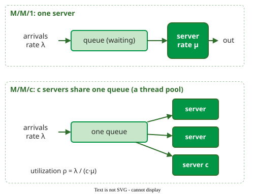

# Queuing Models

A **queuing model** predicts the mean waiting time, response time and queue length of a resource from its arrival rate, service rate and number of servers, under stated assumptions about how inter-arrival and service times are distributed . Its central lesson is that response time grows sharply, not linearly, as utilization approaches 100%.



_A single server, and a pool of c servers fed from one queue, such as a thread pool._ 

## 1. M/M/1: the hockey stick

Plotted against utilization, response time stays nearly flat and then bends sharply upwards, like a hockey stick lying on its blade. With exponential inter-arrival and service times and one server (written M/M/1), let *S* = 1/μ be the mean service time and ρ the utilization, the same quantity written *U* on [Operational Laws](operational-laws.md). The mean response time *R*, the mean wait in the queue before service starts *W*<sub>q</sub> = *R* − *S*, and the mean number in the system *N* are

**R = S / (1 − ρ)**,  **W<sub>q</sub> = ρ S / (1 − ρ)**  and  **N = ρ / (1 − ρ)**

| Utilization ρ | 50% | 75% | 80% | 90% | 99% |
|---|---|---|---|---|---|
| Response time *R* | 2 *S* | 4 *S* | 5 *S* | 10 *S* | 100 *S* |

For example, an API server with *S* = 20 ms at ρ = 60% answers in 20 / 0.4 = 50 ms on average, with 1.5 requests in the system. If load grows by half, to ρ = 90%, response time quadruples to 200 ms. Below 67% utilization response time stays within three times the service time. The **rule of thumb** used on these pages is to keep utilization at about 70%, left of the bend (the capacity example uses 75%) .

```vega-lite
{
  "$schema": "https://vega.github.io/schema/vega-lite/v5.json",
  "width": 420, "height": 230,
  "data": {"values": [
    {"u":0.05,"c":"1 server (M/M/1)","R":1.05},{"u":0.05,"c":"4 servers (M/M/4)","R":1.00},
    {"u":0.1,"c":"1 server (M/M/1)","R":1.11},{"u":0.1,"c":"4 servers (M/M/4)","R":1.00},
    {"u":0.2,"c":"1 server (M/M/1)","R":1.25},{"u":0.2,"c":"4 servers (M/M/4)","R":1.00},
    {"u":0.3,"c":"1 server (M/M/1)","R":1.43},{"u":0.3,"c":"4 servers (M/M/4)","R":1.01},
    {"u":0.4,"c":"1 server (M/M/1)","R":1.67},{"u":0.4,"c":"4 servers (M/M/4)","R":1.04},
    {"u":0.5,"c":"1 server (M/M/1)","R":2.00},{"u":0.5,"c":"4 servers (M/M/4)","R":1.09},
    {"u":0.6,"c":"1 server (M/M/1)","R":2.50},{"u":0.6,"c":"4 servers (M/M/4)","R":1.18},
    {"u":0.7,"c":"1 server (M/M/1)","R":3.33},{"u":0.7,"c":"4 servers (M/M/4)","R":1.36},
    {"u":0.75,"c":"1 server (M/M/1)","R":4.00},{"u":0.75,"c":"4 servers (M/M/4)","R":1.51},
    {"u":0.8,"c":"1 server (M/M/1)","R":5.00},{"u":0.8,"c":"4 servers (M/M/4)","R":1.75},
    {"u":0.85,"c":"1 server (M/M/1)","R":6.67},{"u":0.85,"c":"4 servers (M/M/4)","R":2.15},
    {"u":0.9,"c":"1 server (M/M/1)","R":10.00},{"u":0.9,"c":"4 servers (M/M/4)","R":2.97},
    {"u":0.92,"c":"1 server (M/M/1)","R":12.50},{"u":0.92,"c":"4 servers (M/M/4)","R":3.59},
    {"u":0.94,"c":"1 server (M/M/1)","R":16.67},{"u":0.94,"c":"4 servers (M/M/4)","R":4.63},
    {"u":0.95,"c":"1 server (M/M/1)","R":20.00},{"u":0.95,"c":"4 servers (M/M/4)","R":5.46}]},
  "mark": {"type": "line", "strokeWidth": 3},
  "encoding": {
    "x": {"field": "u", "type": "quantitative", "title": "utilization of each server", "axis": {"format": "%"}, "scale": {"domain": [0, 1]}},
    "y": {"field": "R", "type": "quantitative", "title": "response time (× service time)", "scale": {"domain": [0, 21]}},
    "color": {"field": "c", "type": "nominal", "title": null, "scale": {"domain": ["1 server (M/M/1)", "4 servers (M/M/4)"], "range": ["#b42318", "#019546"]}, "legend": {"orient": "top", "symbolStrokeWidth": 3}},
    "strokeDash": {"field": "c", "type": "nominal", "title": null, "scale": {"domain": ["1 server (M/M/1)", "4 servers (M/M/4)"], "range": [[6, 4], [1, 0]]}}},
  "config": {"font": "Tahoma, sans-serif", "view": {"stroke": null}}
}
```

_Mean response time as each server gets busier. A pool of four servers sharing one queue bends much later than a single server._

On a real system, λ is the request count per second at the resource in a busy window, and *S* = *B*/*C* is its busy time over completions, both measured as on [Operational Laws](operational-laws.md); for a pool, *c* is the configured pool size.

## 2. The mean hides a long tail

In an M/M/1 queue the response time of a single request is exponentially distributed with mean *R*: a request takes longer than time *t* with probability e<sup>−t/R</sup>. So 37% of requests take longer than the mean, and the p95 is *R* · ln 20 ≈ 3 *R*. At ρ = 90%, where *R* = 10 *S*, one request in twenty takes about 30 service times.

## 3. M/M/c: share one queue among c servers

With *c* servers fed from one queue, each at utilization ρ = λ / (*c* μ), a request waits only when all *c* are busy. In words, the **Erlang C formula** gives that probability as the weight of the "all busy" states divided by the weight of all states. With the offered load *a* = λ/μ = *c*ρ (the average number of busy servers) :

**P<sub>wait</sub> = E<sub>c</sub> / (Σ<sub>k=0..c−1</sub> a<sup>k</sup>/k! + E<sub>c</sub>)**, where **E<sub>c</sub> = a<sup>c</sup> / (c! (1 − ρ))**, and then **W<sub>q</sub> = P<sub>wait</sub> · S / (c (1 − ρ))** and **R = S + W<sub>q</sub>**.

For example, four servers at ρ = 0.75 give *a* = 3; the sum is 1 + 3 + 4.5 + 4.5 = 13 and *E*<sub>c</sub> = 81 / (24 × 0.25) = 13.5, so P<sub>wait</sub> = 13.5 / 26.5 ≈ 0.51 and *W*<sub>q</sub> = 0.51 *S* / (4 × 0.25) ≈ 0.51 *S*, giving *R* ≈ 1.51 *S*. Two consequences follow. First, a pool can run each server busier for the same response time: *R* reaches 3 *S* at 67% utilization with one server, 82% with two, 90% with four and 95% with eight. Second, one shared queue beats separate queues: four separate M/M/1 servers at 75% each make requests wait 3 *S* on average, while one queue feeding the same four servers cuts the wait to about 0.5 *S*.

## 4. When the assumptions fail

The letter M is a convenient assumption, not a fact. Variability drives waiting: with constant service times (M/D/1) the mean wait is half the M/M/1 value, and with more variable service times it grows beyond it. Khazaei and colleagues showed that modelling cloud servers as M/M/m, when task durations are highly variable, underestimates waiting and blocking; they used M/G/m/m+r instead: general service times, *m* servers (the *c* of the other models), and room for *m* + *r* requests, that is *r* waiting places . A finite capacity turns overload into **rejected** requests rather than unbounded waiting; M/M/c/c, with no waiting places at all, models a connection pool that refuses a request when all *c* connections are in use.

## When to use it — and when not

- Use M/M/1 and M/M/c for back-of-the-envelope estimates of a single resource, and to explain the utilization rule of thumb of section 1.
- Do not use them as precise predictions for multi-tier systems; use [Queuing Networks and MVA](networks.md) or measurement.

## Limitations

The formulas describe a steady state at a fixed arrival rate. Bursts, warm-up, and service times that change with load (caches, garbage collection) are outside them; simulate or measure instead.

## How solid is this?

- **Where it comes from.** The M/M/1 and M/M/c results are standard queuing theory ; the 70% rule of thumb follows from *R* = *S*/(1 − ρ) .
- **What is assumed.** Exponential times are rarely exact; the formulas are most useful for the shape of the curve, not its precise values.

---

### References



---

{: .highlight }
**Disclaimer:** AI is used for text summarization, polishing and explaining. Authors have verified all facts and claims. In case of an error, feel free to file an issue.
