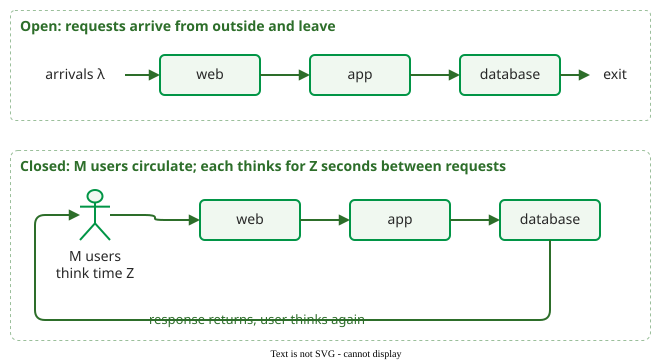

# Queuing Networks and MVA

A **queuing network** models a system as several queues that a request visits in turn, such as a web tier, an application tier and a database. **Mean-value analysis (MVA)** computes the network's throughput and mean response time for any number of users from just the service demand at each resource .

## 1. Open and closed networks

In an **open** network, requests arrive from outside at a rate that does not depend on the system, and leave when served. In a **closed** network, a fixed number *M* of users circulate: each sends a request, waits for the reply, thinks for *Z* seconds, and sends the next. A slower closed system receives fewer requests, as in most interactive applications and load tests .

_The same three tiers as an open and as a closed network._

## 2. Bounds you can compute in one line

Let *D* = Σ*D*k be the total service demand of one request, summed over all resources, and *D*max the largest single *D*k. For *M* users with think time *Z* :

- Throughput is at most min(*M* / (*D* + *Z*), 1 / *D*max).
- Response time is at least max(*D*, *M* · *D*max − *Z*).
- The two limits cross at *M*\* = (*D* + *Z*) / *D*max users, the knee where queuing starts to dominate.

For example, an application server with 0.2 s and a database with 0.4 s of demand per request, and users thinking 1 s: *D* = 0.6 s, *D*max = 0.4 s, so throughput can never exceed 2.5 requests/s and the knee lies at *M*\* = 1.6 / 0.4 = **4 users**.

## 3. Mean-value analysis

MVA rests on the **arrival theorem**: in a closed network, a request arriving at a resource sees, on average, the queue the network would have with one user fewer . That gives a recursion over *n* = 1, 2, …, *M* users. *Q*k(*n*) is the mean number of requests at resource *k* with *n* users, and the recursion starts from empty queues, *Q*k(0) = 0:

1. Residence time at each resource: *R*k(*n*) = *D*k · (1 + *Q*k(*n* − 1)).
2. Throughput: *X*(*n*) = *n* / (*Z* + Σ *R*k(*n*)).
3. Queue length, by Little's law: *Q*k(*n*) = *X*(*n*) · *R*k(*n*).

Applied to the example above (times in seconds):

| Users *n* | *R*app | *R*db | *R* | *X* (req/s) | *Q*app | *Q*db |
|---|---|---|---|---|---|---|
| 1 | 0.200 | 0.400 | 0.600 | 0.625 | 0.125 | 0.250 |
| 2 | 0.225 | 0.500 | 0.725 | 1.159 | 0.261 | 0.580 |
| 3 | 0.252 | 0.632 | 0.884 | 1.592 | 0.402 | 1.006 |
| 4 | 0.280 | 0.802 | 1.083 | 1.921 | 0.538 | 1.541 |
| 5 | 0.308 | 1.016 | 1.324 | 2.151 | 0.662 | 2.187 |
| 6 | 0.332 | 1.275 | 1.607 | 2.301 | 0.765 | 2.934 |
| 7 | 0.353 | 1.573 | 1.926 | 2.392 | 0.844 | 3.764 |
| 8 | 0.369 | 1.905 | 2.274 | 2.443 | 0.901 | 4.656 |
| 9 | 0.380 | 2.262 | 2.642 | 2.471 | 0.940 | 5.590 |
| 10 | 0.388 | 2.636 | 3.024 | 2.485 | 0.964 | 6.551 |

At 10 users throughput is within 1% of the 2.5 req/s ceiling, the response time has reached the bound *M* · *D*max − *Z* = 10 × 0.4 − 1 = 3 s, and nearly all the waiting is at the database. This is the curve plotted on [Performance Measurement](../performance/measurement.md). For dozens of users and resources the recursion is run by a script or tool rather than by hand. Tools such as JMT and PDQ implement the same recursion for many resources and request classes .

## When to use it — and when not

- Use the bounds first: they show the bottleneck and the knee.
- Use MVA to predict response time for a planned number of users.
- Do not use it where queue sizes are capped.

## Limitations

Exact MVA assumes a "product-form" network: no blocking, service demands that do not change with load, and standard queue disciplines. Real software has bounded thread pools and connection limits, where a full downstream queue stalls the upstream one; modelling that needs finite-capacity networks or simulation .

## How solid is this?

- **Where it comes from.** MVA and the arrival theorem are Reiser and Lavenberg's ; the bounds follow from the operational laws .
- **What is exact.** The bounds hold for any closed system; the MVA values are exact only for product-form networks and approximate otherwise.

---

### References



---

{: .highlight }
**Disclaimer:** AI is used for text summarization, polishing and explaining. Authors have verified all facts and claims. In case of an error, feel free to file an issue.
