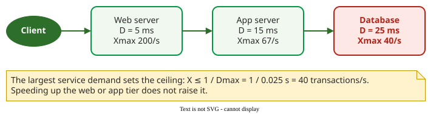

# Operational Laws

The **operational laws** are relationships between quantities measured on a running system during one observation window, such as throughput, utilization and response time. They hold for every window by definition, so they need no assumption about how arrival or service times are distributed .

## 1. A window, four counters, six derived metrics

Over a window of length *T*, record four counters: the arrivals *A*, the completions *C*, the busy time *B* of the resource, and *W*, the total time all requests spent in the system during the window (a window total, not a per-request time) (the shaded area below). Everything else is derived :

| Derived metric | Formula |
|---|---|
| Arrival rate λ | *A* / *T* |
| Throughput *X* | *C* / *T* |
| Utilization *U* | *B* / *T* |
| Mean service time *S* | *B* / *C* |
| Mean number in system *N* | *W* / *T* |
| Mean response time *R* | *W* / *C* |

```vega-lite
{
  "$schema": "https://vega.github.io/schema/vega-lite/v5.json",
  "width": 420, "height": 220,
  "layer": [
    {"data": {"values": [
        {"t":0,"a":1,"d":0},{"t":3,"a":2,"d":0},{"t":5,"a":3,"d":0},{"t":8,"a":3,"d":1},{"t":11,"a":3,"d":2},{"t":12,"a":3,"d":3},
        {"t":18,"a":4,"d":3},{"t":19,"a":5,"d":3},{"t":23,"a":5,"d":4},{"t":26,"a":5,"d":5},{"t":27,"a":6,"d":5},{"t":30,"a":7,"d":6},
        {"t":33,"a":8,"d":6},{"t":35,"a":9,"d":6},{"t":36,"a":9,"d":7},{"t":38,"a":9,"d":8},{"t":40,"a":10,"d":8},{"t":41,"a":10,"d":9},
        {"t":45,"a":10,"d":10},{"t":50,"a":10,"d":10}]},
     "mark": {"type": "area", "interpolate": "step-after", "opacity": 0.3, "color": "#019546"},
     "encoding": {"x": {"field": "t", "type": "quantitative", "title": "time (s)", "scale": {"domain": [0, 50]}},
                  "y": {"field": "a", "type": "quantitative", "title": "cumulative count", "scale": {"domain": [0, 11]}},
                  "y2": {"field": "d"}}},
    {"data": {"values": [{"t":0,"v":1},{"t":3,"v":2},{"t":5,"v":3},{"t":18,"v":4},{"t":19,"v":5},{"t":27,"v":6},{"t":30,"v":7},{"t":33,"v":8},{"t":35,"v":9},{"t":40,"v":10},{"t":50,"v":10}]},
     "mark": {"type": "line", "interpolate": "step-after", "strokeWidth": 2.5, "color": "#2D6E2A"},
     "encoding": {"x": {"field": "t", "type": "quantitative"}, "y": {"field": "v", "type": "quantitative"}}},
    {"data": {"values": [{"t":0,"v":0},{"t":8,"v":1},{"t":11,"v":2},{"t":12,"v":3},{"t":23,"v":4},{"t":26,"v":5},{"t":30,"v":6},{"t":36,"v":7},{"t":38,"v":8},{"t":41,"v":9},{"t":45,"v":10},{"t":50,"v":10}]},
     "mark": {"type": "line", "interpolate": "step-after", "strokeWidth": 2.5, "color": "#b42318"},
     "encoding": {"x": {"field": "t", "type": "quantitative"}, "y": {"field": "v", "type": "quantitative"}}}
  ],
  "config": {"font": "Tahoma, sans-serif", "view": {"stroke": null}}
}
```

_Cumulative arrivals (green line) and completions (red line) of one server over T = 50 s. Requests arrive at 0, 3, 5, 18, 19, 27, 30, 33, 35 and 40 s and complete, in the same order, at 8, 11, 12, 23, 26, 30, 36, 38, 41 and 45 s. The shaded area between them is W = 60 request-seconds; the server is busy whenever the lines differ, from 0 to 12, 18 to 26 and 27 to 45 s, so B = 12 + 8 + 18 = 38 s. After Denning and Buzen._ 

For example, for this window: *X* = 10/50 = 0.2 req/s, *U* = 38/50 = 76%, *S* = 38/10 = 3.8 s, *N* = 60/50 = 1.2 and *R* = 60/10 = 6 s.

**Where the counters come from.** On a running service they already exist. *A* and *C* are request counts from the access log or a metrics counter such as Prometheus's `http_requests_total`. *B* for a CPU is the process's CPU time in the window, from `ps -o time`, `/proc/<pid>/stat` or `psutil`; for a Linux disk, `iostat -x` reports %util = *B*/*T*. *W* is the sum of the logged response times. Take all four over one window and one system boundary.

## 2. The laws

Each law combines derived metrics. The examples use a submission service whose database is queried four times per request, each query taking 8 ms of database time.

| Law | Formula | Example |
|---|---|---|
| Little's law | *N* = *X* · *R* | window above: 0.2 req/s × 6 s = 1.2 requests in the system, as measured |
| Service demand | *D*<sub>k</sub> = *V*<sub>k</sub> · *S*<sub>k</sub> | submission service: 4 visits × 8 ms = 32 ms of database work per request (with one visit, *D* = *S*) |
| Forced flow | *X*<sub>k</sub> = *V*<sub>k</sub> · *X* | submission service at *X* = 10 req/s: the database answers 4 × 10 = 40 queries/s |
| Utilization | *U*<sub>k</sub> = *X* · *D*<sub>k</sub> | submission service: 10 req/s × 0.032 s = 32% busy |
| Interactive response time | *R* = *M* / *X* − *Z* | a separate service measured with 50 users, think time 30 s and 1.6 req/s: 50/1.6 − 30 = 1.25 s |

*V*<sub>k</sub> is the number of visits a request makes to resource *k*, *M* the number of users, and *Z* the think time between a user's requests . With *c* identical servers sharing the work, each does 1/*c* of it, so utilization per server is *X* · *D* / *c*.

## 3. The largest service demand is the bottleneck

Since *U*<sub>k</sub> = *X* · *D*<sub>k</sub> cannot exceed 1, throughput can never exceed 1 / *D*<sub>max</sub>, where *D*<sub>max</sub> is the largest service demand of any resource .



_A three-tier application. Only reducing the database demand, by fewer visits or faster queries, raises the 40 req/s ceiling._

## When to use it — and when not

- Use the laws on any measured window: to find the bottleneck, to check a load test's numbers, and as the input to [queuing models](models.md).
- Do not use them to predict percentiles: they speak only of averages.

## Limitations

The laws assume **flow balance** (arrivals equal completions in the window) and a workload whose rates do not change within it. A window cut through a crash, or one that includes start-up, breaks both; observe for many times the typical busy period. If measured values violate Little's law, for example *X* = 200 req/s and *R* = 25 ms but *N* = 10 instead of 5, the measurements are at fault, often because they were taken at different system boundaries .

## How solid is this?

- **Where it comes from.** Denning and Buzen derived the laws from measured quantities ; Hillston and Wilson give teaching versions .
- **What is exact.** Little's law and the utilization law are identities of the measured window, not approximations.

---

### References



---

{: .highlight }
**Disclaimer:** AI is used for text summarization, polishing and explaining. Authors have verified all facts and claims. In case of an error, feel free to file an issue.
