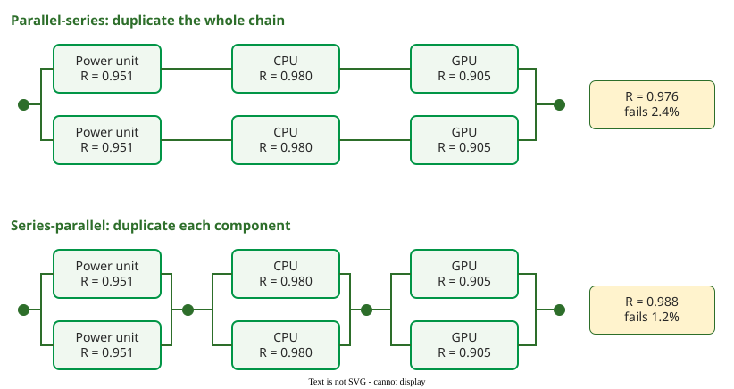

# Reliability Block Diagrams

A **reliability block diagram** (RBD) draws a system as blocks connected in series and in parallel, so that the system works if some path of working blocks connects input to output; the system's reliability is then computed from the blocks' reliabilities .

## 1. Series: every block must work

In a series system any block's failure fails the system. If blocks fail independently and every $$R_k$$ is given for the same interval :

$$R = \prod_k R_k, \qquad \lambda = \sum_k \lambda_k \ \text{(constant failure intensities)}$$

A series system is never more reliable than its weakest block.

**Example.** A rendering node needs a power unit, a CPU and a GPU, with failure intensities of 50, 20 and 100 per million hours. Over 1,000 hours, R = e−λt gives 0.951, 0.980 and 0.905. The node: λ = 170 per million hours, R = e−0.17 = 0.844, a mean time to failure (MTTF) of 1/λ ≈ 5,900 hours. (Constructed example.)

## 2. Parallel: one block is enough

In active redundancy all copies run and the system fails only when every copy has failed:

$$R = 1 - \prod_k (1 - R_k)$$

Two nodes of 0.844 in parallel give 1 − 0.1562 = 0.976. A parallel system no longer has a constant failure intensity, so do not add or invert λ values; for two identical active copies, each with constant λ and no repair, the MTTF is 1.5/λ .

## 3. Parallel-series or series-parallel?

The same six parts can be wired two ways.

_Duplicating the whole chain (top) against duplicating each component (bottom), with the component reliabilities of the example._ 

- **Parallel-series** duplicates the whole chain: R = 1 − (1 − 0.844)2 = 0.976, failing 2.4% of the time.
- **Series-parallel** duplicates each component: R = (1 − 0.0492)(1 − 0.0202)(1 − 0.0952) = 0.988, failing 1.2%.

The second halves the failure probability with the same parts: a failed GPU no longer takes a working power unit and CPU down with it. The price is the cross-connection: if both GPUs hang off one shared bus with R = 0.990, the system drops to 0.988 × 0.990 = 0.978, and the bus causes almost half of the failures. (Constructed example.)

## 4. Single points of failure

That bus is a **single point of failure** (SPF): a block in series with everything else, whose failure alone stops the system. Reading an RBD for blocks with no parallel path finds them. Five remedies are usual: redundancy with dissimilar parts, since identical copies share common causes ([Design Diversity and Voting](design-diversity.md)); a design change that removes the block; a much more robust component; preventive maintenance or replacement before wear-out; and less load or environmental stress.

## 5. From the RBD to the developed software's FIO

Software blocks sit in series with hardware ones. Because series intensities add, the RBD tells you how much of the system's failure intensity objective (FIO) is left for the code you write ([Severity Classes and the FIO](fio.md)) .

**Example: a drone ground station.** System FIO 0.01 failures per hour. Acquired blocks: workstation 0.0005, operating system 0.00082 and vehicle interface 0.002 per hour; the data link chain fails 0.0005 per megabyte and carries 4 MB per hour, so 0.002 per hour once in the common unit. The acquired blocks use 0.00532, leaving the mission-planning application an FIO of 0.01 − 0.00532 = 0.00468 per hour. (Constructed example; structure adapted from a UAV ground-station teaching case.)

**Where the inputs come from.** Hardware intensities come from vendor data sheets; acquired software from supplier incident history or your operation logs; data volume from traffic measurements. The diagram comes from the deployment architecture.

## When to use it — and when not

Use an RBD to decide where redundancy pays, find single points of failure, and split a system FIO among components. Do not use it for failures that depend on order or timing, such as failover that itself can fail; fault trees and Markov models handle those.

## Limitations

The formulas assume independent failures and repairs. Two copies of the same software, or two servers on one power feed, fail together, and the parallel formula then overstates reliability, sometimes by orders of magnitude.

## How solid is this?

- **Where it comes from.** Series and parallel formulas and RBDs follow Dubrova ; combining component intensities for the FIO follows Musa .
- **What is contested.** Not the arithmetic but independence, which fails for software versions ([Design Diversity and Voting](design-diversity.md)).
- **What we do not hold.** The SPF remedies are a practitioner checklist from reliability engineering courses, not a reviewed source.

---

### References



---

{: .highlight }
**Disclaimer:** AI is used for text summarization, polishing and explaining. Authors have verified all facts and claims. In case of an error, feel free to file an issue.
