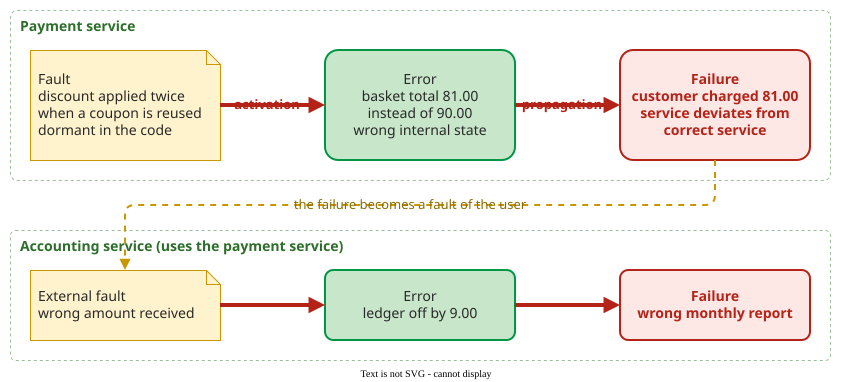

# Dependability and the Fault Chain

A **failure** is an event in which the service a system delivers deviates from correct service; it is the last link of a chain that starts with a **fault** in the system and passes through an **error** in its state .

## 1. Fault, error, failure

Avizienis and colleagues define the three threats to dependability as a causal chain :

- A **fault** is the adjudged or hypothesized cause of an error, for example a wrong condition in the code. It is **dormant** until an input, the *activation pattern*, makes it produce an error; then it is **active**.
- An **error** is the part of the system state that may lead to a failure, for example a wrong value in a variable.
- A **failure** happens when an error reaches the service interface and the delivered service deviates from correct service.

Only the failure is visible: testing observes failures and works back to the fault, and a fault never activated causes no failure.

_The chain in a payment service, and its cascade: the failure of one component is an external fault for the component that uses it._ 

In the figure, a 10% coupon applied twice turns a 100.00 basket into 81.00 instead of 90.00. The wrong total is an error; charging 81.00 is a failure. The accounting service then receives a wrong amount (an external fault) and its ledger is off by 9.00.

## 2. Worked example: Ariane 5

On its first flight in 1996, Ariane 5 broke up about 40 seconds into flight . Traced through the chain:

1. **Fault.** Code reused from Ariane 4 converted a 64-bit floating-point horizontal velocity value into a 16-bit integer without protection against overflow. On Ariane 4 the value never grew large enough to overflow.
2. **Activation.** Ariane 5 flies a different trajectory with a much higher horizontal velocity, so the conversion overflowed.
3. **Error.** The overflow raised an exception that shut down the inertial reference computer; the backup computer ran the same code and had already shut down for the same reason.
4. **Failure.** The flight computer read the shut-down unit's diagnostic output as flight data, steered the nozzles to full deflection, and the vehicle was destroyed.

The boundary decides the names: seen from the inertial reference computer, the overflow is an error and the shutdown its failure; seen from the rocket, that shutdown is a fault and the loss of the vehicle the failure. The fault was a design fault in reused code: the conversion was left unprotected because Ariane 4 never needed it, and nobody rechecked that for Ariane 5. The identical backup shows a second lesson, taken up in [Design Diversity and Voting](design-diversity.md): a copy of the same software contains the same fault.

## 3. Two vocabularies

| Term | Avizienis et al. (dependability) | Musa (software reliability engineering) |
|---|---|---|
| Error | a wrong part of the **system state** | an incorrect or missing **human action** |
| Fault | the cause of an error, e.g. a defect in code | the defect in the code |
| Failure | service deviates from correct service | system behaviour departs from what users need |

Both agree on fault and failure; they disagree on "error" . These pages use the Avizienis meaning and call the programmer's slip a **mistake**. Check which meaning a source uses before you trace a case.

## 4. Why software is not hardware

Software faults are design faults: they are present in every copy from the start, and they do not wear out . The comparison below explains why hardware methods transfer poorly.

| Aspect | Hardware | Software |
|---|---|---|
| Fault origin | physical wear and design | design only |
| Failure rate over time | bathtub: early failures, a flat useful life, then wear-out | changes only when the code or the usage changes |
| Identical spare | masks a random physical fault | fails on the same input in the same way |

The last row matters most, as the Ariane 5 backup showed.

## When to use it — and when not

Use the chain to analyse any incident: name the fault, the activation, the error and the failure, and ask where a check could have stopped the error. It does not tell you how likely a failure is; for that, see [Reliability Measurement](measurement.md).

## Limitations

The boundary between fault and error depends on where you draw the system: the same wrong value is an error inside a component and an external fault for its user. A "root cause" is therefore a judgement about where to stop tracing, not a fact in the code.

## How solid is this?

- **Where it comes from.** The taxonomy is the consensus reference of the dependability community ; the Ariane 5 account follows the inquiry board report .
- **What is contested.** Only the terms (section 3); the chain itself is not disputed.

---

### References



---

{: .highlight }
**Disclaimer:** AI is used for text summarization, polishing and explaining. Authors have verified all facts and claims. In case of an error, feel free to file an issue.
