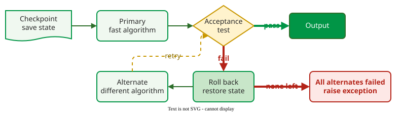
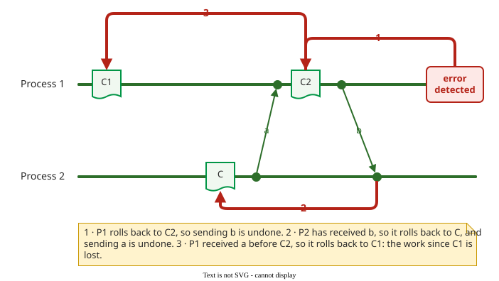
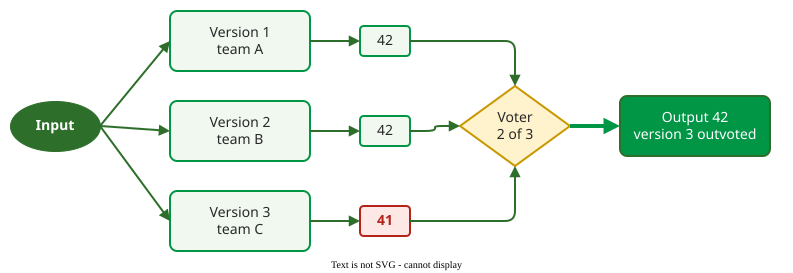

# Fault Tolerance

**Fault tolerance** is delivering correct service in the presence of faults: a fault in the code is activated, but an error check and a recovery action stop the error from becoming a failure .

## 1. Four means, and where tolerance fits

Avizienis and colleagues name four means of attaining dependability . **Fault prevention** keeps faults out (reviews, standards, typed languages). **Fault removal** finds and fixes them (testing, inspection, static analysis). **Fault forecasting** estimates how many remain and how often they will cause failures ([Reliability Growth Models](growth-models.md)). **Fault tolerance** accepts that some faults survive and designs the system to work despite them. It is designed in during specification and design, and acts during operation.

## 2. Backward and forward recovery

Tolerating a fault takes two steps: detect the error, then recover. There are two ways to recover :

- **Backward recovery** rolls the system back to a saved state, a *checkpoint*, and tries again, usually another way. It is general, because it needs no knowledge of what went wrong, but rollbacks make timing unpredictable.
- **Forward recovery** moves on to a correct state using redundancy, for example by taking a second sensor's reading when the first is out of range. It is fast and suits real-time systems, but only works for errors that were anticipated.

## 3. Recovery blocks

Randell's **recovery block** is the classic backward-recovery structure :

```text
ensure  acceptance_test
by      primary
else by alternate_1
else    fail
```



_A recovery block: if the primary's result fails the acceptance test, the state is restored and an alternate runs._ 

The **acceptance test** is a program-specific check that returns true or false. Typical checks: a checksum on received data; for a square-root routine that returns y for input x, abs(y · y − x) < ε; an exception on division by zero or integer overflow; a timer that interrupts a loop that runs too long.

**Example.** A route planner uses a fast heuristic as primary and a slower exact algorithm as alternate. The acceptance test checks that the route starts and ends at the requested points and uses only roads that are open. When the heuristic returns a route through a closed road, the planner restores its state and runs the exact algorithm.

The acceptance test is also the weak spot. Checking a result completely can be as hard as computing it: a sort can be checked for order in one pass, but checking that the output holds exactly the input elements takes almost as much work as sorting. Real acceptance tests check critical properties only, so some wrong results pass.

## 4. The domino effect

Backward recovery gets hard when processes communicate . If a process rolls back past a message it sent, the receiver holds a message that, in the restored history, was never sent, so the receiver must roll back too, and that can undo messages it sent in turn.



_The domino effect: each rollback undoes a message, forcing the other process further back._ 

Coordinated checkpoints, operations that are safe to repeat, and compensating actions limit the cascade in modern systems.

## 5. N-version programming

**N-version programming** runs N independently developed versions on the same input at the same time; a **voter** compares the results and the majority wins . It is forward recovery: a wrong version is outvoted, with no rollback.



_N-version programming with three versions and a majority voter._

| Aspect | Recovery blocks | N-version programming |
|---|---|---|
| Recovery | backward (rollback) | forward (masking) |
| Execution | alternates run only on demand | all versions always run |
| Error check | acceptance test (absolute: one result against a fixed criterion) | voter (relative: versions against each other) |
| Run-time overhead without faults | low | high |
| Weak point | writing a good acceptance test | versions failing together |

## When to use it — and when not

Use fault tolerance when failures are costly and fault removal cannot reach the FIO alone, as in flight control, rail signalling or medical devices. Do not count on it for ordinary business software: the cost of extra versions and acceptance tests is better spent on removal, and simpler resilience patterns, such as timeouts, retries and circuit breakers, cover most outages ([From FIO to SLO](slo-bridge.md)). To find where tolerance is needed, look for single points of failure in a [reliability block diagram](block-diagrams.md).

## Limitations

Software redundancy only helps if the copies differ: identical copies share the same faults, and even independently written versions fail together more often than chance predicts ([Design Diversity and Voting](design-diversity.md)). Every acceptance test and voter is itself code that can be wrong.

## How solid is this?

- **Where it comes from.** The four means from the dependability taxonomy , recovery blocks and the domino effect from Randell , and the techniques from Pullum's book .
- **What is contested.** How much redundancy buys; see the next page.

---

### References



---

{: .highlight }
**Disclaimer:** AI is used for text summarization, polishing and explaining. Authors have verified all facts and claims. In case of an error, feel free to file an issue.
