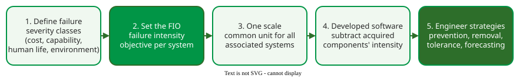

# Severity Classes and the FIO

A **failure intensity objective** (FIO) is the failure intensity a system must reach before release, set per **failure severity class**, so that reliability is "just right": high enough for users, and no higher than the cost and schedule justify .

_Defining the necessary reliability, after Musa._ 

## 1. Failure severity classes

A **failure severity class** is a set of failures with the same per-failure impact on users . Pick one column of the table below for your product; four classes are usually enough:

| Class | Cost per failure | System capability | Human life | Environment |
|---|---|---|---|---|
| 1 | ≥ USD 100,000 | basic service interrupted | possible loss of life | severe, unrecoverable damage |
| 2 | ≥ USD 10,000 and < 100,000 | basic service degraded | severe harm to health | severe, partly recoverable damage |
| 3 | ≥ USD 1,000 and < 10,000 | inconvenience; fix cannot wait | minor harm to health | minor damage |
| 4 | < USD 1,000 | minor effects; fix can wait | minor, recoverable deficiencies | minor, recoverable deficiencies |

Cost covers repair, lost business and disruption; its classes differ by a factor of 10. Severity is not complexity, and it changes with timing: the same checkout timeout costs more at peak than at night.

**Example, an online shop, by cost (constructed estimates).** Count one failure as one occurrence of the failure type, however many customers it hits, and estimate its cost:

| Failure type | Estimated cost of one failure | Class |
|---|---|---|
| Payment taken but no order created, for all checkouts until fixed (about 2 hours) | refunds, support and lost sales: about USD 150,000 | 1 |
| Checkout times out under peak load for an hour | lost sales: about USD 30,000 | 2 |
| A campaign's promotion code is rejected for a day | discounts honoured by support: about USD 5,000 | 3 |
| Currency symbol misplaced on one page | support tickets: about USD 200 | 4 |

The same kind of failure can land in another class if it hits one customer once: a single lost order costs perhaps USD 100, class 4.

## 2. Three ways to set the FIO

The cost route gives one FIO per severity class; the reliability and availability routes give one FIO for the whole system. Class FIOs add up to a system FIO.

**From cost.** Let C be the estimated cost of a typical failure of the class, in USD: an estimate, not the class bound. If a class holds several failure types, take the cost of the most frequent one. The rule of thumb sets the class FIO to one failure per C hours:

FIO = 1 / C failures per hour, so that FIO × C = USD 1 per hour.

That is why dollars become hours: the rule keeps the expected failure cost at about one dollar per hour of operation in every class, a convention rather than a law. Only for a worst class without an estimate, fall back on the project's total cost: a USD 1,000,000 project gives 1 failure per 106 hours, about 114 years. The scale is coarse:

| Cost of one failure, C | FIO = 1/C | Mean time to failure |
|---|---|---|
| USD 1,000,000 | 1 per 106 hours | about 114 years |
| USD 1,000 | 1 per 1,000 hours | about 6 weeks |
| USD 100 | 1 per 100 hours | about 4 days |

**Example, the shop.** Class 1 (C = 150,000): 1 per 150,000 hours. Class 2 (30,000): 1 per 30,000 hours, an MTTF of about 3.4 years. Class 3 (5,000): 0.0002 per hour. Class 4 (200): 0.005 per hour. Summed, the system FIO is about 0.0052 failures per hour, one every 190 hours, dominated by the cheap class 4, and the expected cost is USD 4 per hour, one dollar per class.

**From a reliability requirement.** With R(t) = e−λt, λ = −ln R / t. R = 0.992 for an 8-hour shift gives λ = −ln 0.992 / 8 ≈ 0.001 failures per hour.

**From an availability requirement.** Each failure causes a mean downtime tm (= MTTR). Substituting MTTF = 1/λ into A = MTTF / (MTTF + tm) gives A = 1 / (1 + λtm), so λ = (1 − A) / (A × tm).

**Worked example** . A human-machine team must be available 99% of the time. After each failure the machine is down 1 minute and the operator needs 14 more to recover; the service is down until both have, so tm = 0.25 hours. λ = 0.01 / (0.99 × 0.25) ≈ 0.040 failures per hour, about 4 per 100 hours. The approximation (1 − A) / tm also gives 0.04 when A is near 1, but show the exact formula.

## 3. From the system's FIO to the developed software's

Steps 3 and 4 of the figure turn a system target into one for the team's own code . Express every component's failure intensity in one common unit; in a system where every component must work (a serial system), intensities add, so:

FIO of developed software = system FIO − expected failure intensities of the acquired components

**Example.** System FIO 0.01 per hour; hardware 0.002 per hour; acquired operating system and database 0.002 per hour together. The developed software's FIO is 0.01 − 0.002 − 0.002 = 0.006 failures per hour.

## When to use it — and when not

Set severity classes and a FIO before system testing, so that testing knows when to stop and what failures matter most. A FIO is a release criterion for software that is stable during testing; for a service that changes daily, the same idea becomes a service level objective ([From FIO to SLO](slo-bridge.md)).

## Limitations

The cost rule is a starting point, not a calculation: the one-dollar-per-hour level is a convention, and the project-cost fallback is rarely checked. Severity is partly subjective, especially for reputation, and a class definition that the team does not agree on produces arguments, not priorities. A FIO of zero is not an option: no finite test proves it, and chasing it costs more than users gain.

## How solid is this?

- **Where it comes from.** Severity classes, the FIO and the availability formula are Musa's ; the cost classes and the cost table follow the course material derived from Musa.
- **What is contested.** How to set the FIO: Musa also lists profit analysis, experience with similar products and competitors' reliability as routes; none is precise.
- **What we do not hold.** No study validates the cost rule of thumb.

---

### References



---

{: .highlight }
**Disclaimer:** AI is used for text summarization, polishing and explaining. Authors have verified all facts and claims. In case of an error, feel free to file an issue.
