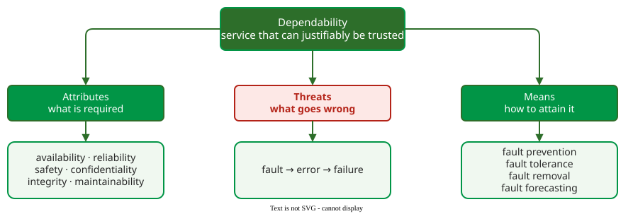

# Reliability

**Software reliability** is the probability that a program operates without failure for a specified time in a specified environment . It is one attribute of **dependability**, the ability to deliver service that can justifiably be trusted .

_The dependability tree: reliability is one of six attributes; faults, errors and failures are the threats; four means attain it._ 

## The pages at a glance

Each page answers one question that a reliability engineer meets, in the order a project meets them.

| Question | Main idea | Page |
|---|---|---|
| What exactly goes wrong? | A fault is activated, produces an error, and the error reaches the user as a failure | [Dependability and the Fault Chain](dependability.md) |
| How do we measure it? | Failure intensity λ, reliability R(t) = e−λt, mean time to failure and to repair (MTTF, MTTR), availability | [Reliability Measurement](measurement.md) |
| How do components combine? | Series blocks multiply reliabilities, parallel blocks multiply unreliabilities; single points of failure | [Reliability Block Diagrams](block-diagrams.md) |
| How reliable must it be? | Severity classes, then a failure intensity objective (FIO) from cost, reliability or availability | [Severity Classes and the FIO](fio.md) |
| When can we stop testing? | Reliability growth models predict when λ falls to the FIO | [Reliability Growth Models](growth-models.md) |
| How do we survive faults that remain? | Recovery blocks, N-version programming, backward and forward recovery | [Fault Tolerance](fault-tolerance.md) |
| Does redundant software fail independently? | Voting reliability, and the experiment that showed versions fail together | [Design Diversity and Voting](design-diversity.md) |
| Can we stop testing this module? | A trend test, two fitted models and the FIO, on real failure data | [Worked Case: When to Stop Testing a Module](worked-case.md) |
| What does this look like today? | The FIO became the service level objective (SLO); error budgets and chaos engineering | [From FIO to SLO](slo-bridge.md) |

## Reading order

Read the pages top to bottom: the chain gives the vocabulary, measurement gives the numbers, and the FIO turns them into a target. Growth models and fault tolerance are the two ways to meet the target, by removing faults or by surviving them. The last page connects the classical theory to how cloud services set and defend reliability targets today. How the operational profile drives reliability testing is covered in [Operational Profile](../../verif/operational-profile/index.md).

## How solid is this?

- **Where it comes from.** Musa's software reliability engineering , the dependability taxonomy of Avizienis, Laprie, Randell and Landwehr , and Google's SRE practice .
- **What is contested.** The words: "error" means a human mistake for Musa and a wrong system state for Avizienis (see the next page).

---

### References



### Acknowledgments

The lectures behind this area took early inspiration from the software reliability engineering lectures of Behrouz Homayoun Far (University of Calgary). The pages here are original, written from the literature review; any errors are ours.

---

{: .highlight }
**Disclaimer:** AI is used for text summarization, polishing and explaining. Authors have verified all facts and claims. In case of an error, feel free to file an issue.
