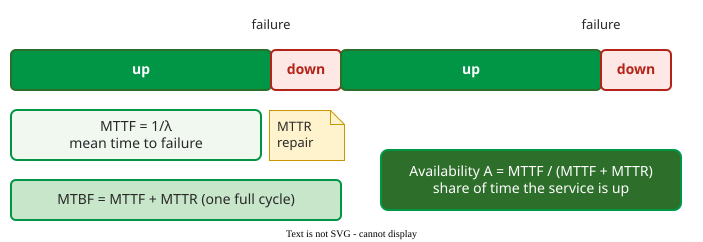

# Reliability Measurement

**Failure intensity** λ is the number of failures per unit of time, or per *natural unit* such as transactions or print jobs; it is the basic measure of software reliability, from which reliability, mean time to failure and availability follow .

## 1. Failure intensity and failure density

Two measures look alike but serve different readers :

- **Failure intensity** counts failures per hour or per natural unit, for example 5 failures per 1,000 transactions. It describes what users experience.
- **Failure density** counts faults or failures per thousand lines of code (KLOC) or per function point. It describes the code, for developers.

They can rank modules differently, as this constructed example shows:

| Module | Size | Faults found | Faults per KLOC | Hours of use in a year | Failures in use per year | Failures per 1,000 hours of use |
|---|---|---|---|---|---|---|
| Checkout | 20 KLOC | 2 | 0.1 | 5,000 (runs on every order) | 50 | 50 / 5 = 10 |
| Year-end report | 5 KLOC | 5 | 1.0 | 20 (runs once a year) | 0 | 0 |

By density the report is ten times worse; by intensity the checkout is, because its two faults sit on the path every customer takes and fail again and again, while the report's faults are rarely activated. Density corrects for size, intensity for use, and the user feels only intensity.

## 2. Reliability and mean time to failure

This page assumes faults are not being removed; [growth models](growth-models.md) drop that assumption. When usage also does not change, λ is constant and reliability follows the exponential model :

R(t) = e−λt and MTTF = 1 / λ

R(t) is the probability of no failure during a mission of length t, given the system works at the start; MTTF is the mean time to failure.

**Example: a system in the field** . It records 7 failures in 10,000 hours of operation:

1. λ = 7 / 10,000 = 0.0007 failures per hour.
2. MTTF = 1 / 0.0007 ≈ 1,429 hours.
3. For a 10-hour mission, R(10) = e−0.0007 × 10 = e−0.007 ≈ 0.993: a 99.3% chance of no failure.

For a system built from components that must all work (a *serial* system) with constant intensities, the system's failure intensity is the sum of the components' intensities.

## 3. Repair time and availability

A service that fails is repaired and comes back. The **mean time to repair** (MTTR) is the average outage per failure; one up-and-down cycle is the **mean time between failures**, MTBF = MTTF + MTTR.

_One cycle of operation and repair, and the availability that results._

**Availability** is the share of time the service is up:

A = MTTF / (MTTF + MTTR)

With MTTF = 1,000 hours and MTTR = 1 hour, A = 1,000 / 1,001 ≈ 0.999, "three nines". The formula shows two routes to high availability: fail less often (raise MTTF) or recover faster (cut MTTR). Cloud operators often find the second route cheaper .

## Where the numbers come from

In operation, failures come from the incident tracker; during testing, from the test log. Each entry needs the time the failure occurred (not when it was reported or fixed) and its severity class, with duplicate reports of one failure merged. The time base is the system's operating hours from monitoring, execution hours, or a natural unit the application already counts, such as transactions processed. MTTR comes from the incident timeline: from the start of the outage, or its detection if the start is unknown, to service restored.

## When to use it — and when not

Use λ, R(t) and MTTF to state and compare reliability once the software is stable: in acceptance testing, in operation, and when setting a target ([Severity Classes and the FIO](fio.md)). While testing is still removing faults, λ falls over time and a single constant misleads; use a [reliability growth model](growth-models.md) instead.

## Limitations

The numbers are only as good as the usage behind them. A failure intensity measured under one usage pattern does not hold under another, because different inputs activate different faults; that is why reliability testing draws its inputs from the [operational profile](../../verif/operational-profile/index.md). The exponential model also assumes failures arrive at random with a constant rate, which a bursty incident, such as a bad deployment, violates.

## How solid is this?

- **Where it comes from.** The measures and the worked example follow Musa's software reliability engineering as summarised by Vouk .
- **What is contested.** Whether time should be calendar time, execution time or natural units; Musa prefers execution time or natural units, because they track how hard the software is exercised.

---

### References



---

{: .highlight }
**Disclaimer:** AI is used for text summarization, polishing and explaining. Authors have verified all facts and claims. In case of an error, feel free to file an issue.
