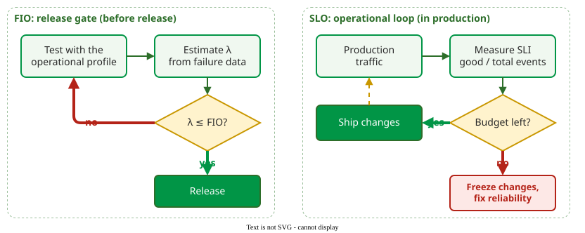
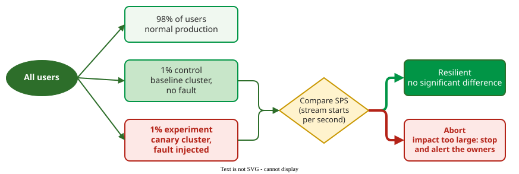

# From FIO to SLO

A **service level objective** (SLO) is a target for a measured service level, such as "99.9% of requests succeed over 30 days"; it plays the role of Musa's failure intensity objective for a service that changes every day, and its complement, 1 − SLO, is the **error budget** .

## 1. The same idea in a new phase

Musa's FIO and Google's SLO share one principle: 100% reliability is the wrong target, because users cannot tell the difference beyond some level and every extra nine costs features . The concepts map one to one:

| Classical (Musa) | Modern SRE (Google) | Shared idea |
|---|---|---|
| Failure intensity objective | Service level objective | the reliability target |
| Failure intensity λ | Service level indicator (SLI): good events / all events | what is measured |
| "Just right" reliability | Error budget = 1 − SLO | tolerated unreliability |
| Severity classes | Service tiers | not all failures are equal |
| Demonstration chart | Burn-rate alerts | the decision rule |

One direction is reversed: λ counts failures, so lower is better, while an SLI counts the share of good events, so higher is better; the error rate 1 − SLI corresponds to λ. The difference is the phase. The FIO is a **release gate**: test until the failure intensity is low enough, then ship. The SLO is an **operational loop**: keep shipping while budget remains, and stop when it runs out.



_The FIO gates one release; the SLO governs a continuous stream of releases._

## 2. Worked example: an error budget

A checkout service has an SLO of 99.9% successful requests over 30 days and serves 3,000,000 requests in that window.

1. Error budget: 1 − 0.999 = 0.1% of requests, that is 3,000,000 × 0.001 = **3,000 failed requests**. In time, 30 days × 0.001 = 0.03 days = **43.2 minutes** of full outage.
2. A bad deployment fails 500 requests per hour for 2 hours: **1,000 failed requests**, a third of the budget.
3. The SRE Workbook's example policy requires a postmortem when one incident uses more than 20% of the error budget; the Workbook states it for a four-week window, and this page applies it to the 30-day window . This incident used 33%, so it needs a postmortem. With 2,000 failures left, releases continue.

When an incident report mixes downtime and failed requests, convert to one unit before adding: at 3,000,000 requests per 43,200 minutes, a 10-minute outage loses about 694 requests.

## 3. Burn rate

The **burn rate** is how fast the budget is being spent, relative to the rate that would use it up exactly at the end of the window :

burn rate = observed error rate over the alert window (for example, one hour) / (1 − SLO)

A burn rate of 1 uses the whole budget in 30 days; 10 uses it in 3 days. Take the bad deployment from section 2. Traffic is 3,000,000 requests / 720 hours ≈ 4,167 requests per hour, so 500 failures per hour is an error rate of 500 / 4,167 ≈ 0.12, and the burn rate is 0.12 / 0.001 = 120. Measured per request, a natural unit, this error rate is Musa's failure intensity: 0.12 failures per request. A full outage fails every request: error rate 1, burn rate 1 / 0.001 = 1,000, so the 10-minute outage spends budget a thousand times faster than the sustainable rate. The Workbook's suggested fast-burn page fires at a burn rate of 14.4 over one hour, which spends 2% of a 30-day budget in that hour (14.4 × 1 / 720 = 0.02) .

```vega-lite
{
  "$schema": "https://vega.github.io/schema/vega-lite/v5.json",
  "width": 440, "height": 220,
  "data": {"values": [
    {"d":0,"b":100,"s":"burn rate 0.5"},{"d":30,"b":50,"s":"burn rate 0.5"},
    {"d":0,"b":100,"s":"burn rate 1"},{"d":30,"b":0,"s":"burn rate 1"},
    {"d":0,"b":100,"s":"burn rate 10"},{"d":3,"b":0,"s":"burn rate 10"}]},
  "mark": {"type": "line", "strokeWidth": 3},
  "encoding": {
    "x": {"field": "d", "type": "quantitative", "title": "Day of the 30-day window", "scale": {"domain": [0, 30]}},
    "y": {"field": "b", "type": "quantitative", "title": "Error budget left (%)", "scale": {"domain": [0, 100]}},
    "color": {"field": "s", "type": "nominal", "title": null, "scale": {"domain": ["burn rate 0.5", "burn rate 1", "burn rate 10"], "range": ["#019546", "#c99700", "#b42318"]}, "legend": {"symbolStrokeWidth": 3}},
    "strokeDash": {"field": "s", "type": "nominal", "title": null, "scale": {"domain": ["burn rate 0.5", "burn rate 1", "burn rate 10"], "range": [[1, 0], [8, 4], [2, 3]]}}
  },
  "config": {"font": "Tahoma, sans-serif", "axis": {"labelFontSize": 12, "titleFontSize": 13}, "legend": {"labelFontSize": 12}, "view": {"stroke": null}}
}
```

_Constant burn rates: 0.5 leaves half the budget, 1 spends it exactly, 10 spends it in three days._

## 4. Chaos engineering: testing the tolerance itself

Classical fault tolerance argued at design time that redundancy would work. Netflix instead injects faults into production to check that timeouts, retries and fallbacks really work, under four principles: define the steady state by a business metric, vary real-world events, run in production, and automate the experiments . The steady-state metric is SPS, stream starts per second, a system-level indicator of whether users can watch.



_Netflix's ChAP: 1% of users go to a baseline cluster and 1% to a canary cluster with the fault injected; the experiment stops automatically if the canary's SPS deviates too much._ 

Comparing two equal small groups, rather than the canary against all traffic, separates the effect of the fault from normal fluctuation and limits harm to a small share of users.

## When to use it — and when not

Use SLOs and error budgets for services that change continuously and have enough traffic to measure an SLI. A product shipped once into a device or a vehicle still needs a FIO at release, because no budget can be refilled after shipping. Chaos experiments presuppose monitoring good enough to see the steady state; without it they only cause outages.

## Limitations

An SLO is only as good as its SLI: measuring success at the server misses failures that happen in the client or the network. The budget arithmetic treats all failed requests as equal, which hides severity; a failed payment and a slow thumbnail count the same unless the service is split into tiers.

## How solid is this?

- **Where it comes from.** SLIs, SLOs and error budgets from Google's SRE book , burn-rate alerting and the example policy from the SRE Workbook , chaos engineering from Netflix's papers .
- **What is contested.** The mapping in section 1 is this handbook's synthesis, built on Musa's and Google's texts; neither source states it.

---

### References



---

{: .highlight }
**Disclaimer:** AI is used for text summarization, polishing and explaining. Authors have verified all facts and claims. In case of an error, feel free to file an issue.
