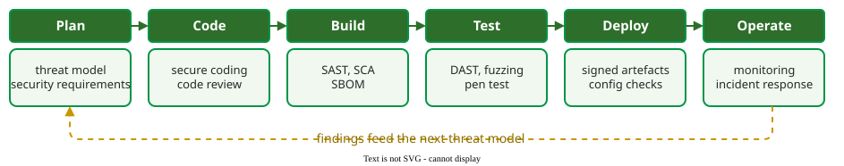
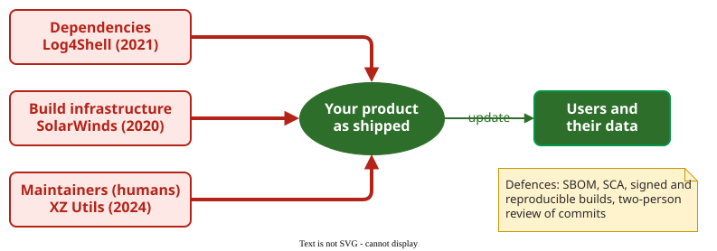

# DevSecOps and Supply Chain Security

**DevSecOps** builds security activities into every stage of a continuous delivery pipeline, so that each change is checked automatically before it ships; **supply chain security** extends the same care to the code, tools and people you depend on but do not control  .

## 1. An activity for every stage

Each stage of delivery has security work that fits its speed. (An **SBOM**, software bill of materials, listed at Build below, is an inventory of every component in a release; §3 explains its use.) Planning holds threat modeling and security requirements; coding holds secure coding and review; the build runs static analysis and dependency checks; testing runs dynamic scans; deployment checks configuration and signatures; operation monitors and responds to incidents. Findings from operation feed the next round of threat modeling.



_Security activities per delivery stage; the loop is what makes it continuous._ 

## 2. Speed against thoroughness

The central tension is time. Practitioners in Rajapakse et al.'s study of DevOps webinars report that static scans built for older release cycles can run for hours while teams deploy several times a day, and that floods of low-value findings cause alert fatigue . Their recommendations: scan at every commit with fast, incremental tools; run long dynamic scans in parallel rather than blocking the pipeline; move analysis into the IDE; and triage findings so only exploitable ones reach developers. Rangnau et al. showed that dynamic tests can run on every commit, at about 14 minutes per job in their prototype ; whether that is fast enough depends on how often the team deploys.

**Example.** A small Python project adds one workflow that runs on every push. The application code, including `shop.py`, lives in the `app/` folder. The build fails if Bandit finds a medium-severity or worse issue, or if a dependency has a known vulnerability:

```yaml
name: security
on: [push]
jobs:
  scan:
    runs-on: ubuntu-latest
    steps:
      - uses: actions/checkout@v4
      - uses: actions/setup-python@v5
        with:
          python-version: "3.12"
      - run: pip install bandit pip-audit
      - run: bandit -r app -ll
      - run: pip-audit -r requirements.txt
```

Each `-l` raises the minimum severity reported: `-l` reports low and above, `-ll` medium and above, `-lll` only high. `-ll` filters by severity only, a deliberate choice to keep the gate trusted; confidence is not filtered, so the SQL finding fails the gate even though Bandit rates its confidence Low. The filter has a price: on the vulnerable shop module from [Static Security Analysis](static-analysis.md), the gate fails on MD5, SQL and `eval`, but the low-severity hard-coded secret passes silently, so a separate secrets scanner is still needed. Exploit tests run in the normal test job, and a nightly job runs the full ZAP scan against staging.

## 3. The supply chain

Williams et al. describe three entry routes into the supply chain, each with a landmark incident :

- **Dependencies.** A vulnerable or malicious component enters through a library. Log4Shell (2021) was an accidental vulnerability in the ubiquitous Log4j logging library.
- **Build infrastructure.** Attackers compromise the pipeline itself. In SolarWinds (2020), malicious code was inserted during the build of the Orion product, then signed and shipped to customers as a normal update.
- **Humans.** An attacker gains a maintainer's trust. In XZ Utils (2024), a maintainer of a widely used compression library inserted a backdoor into two releases .

A **software bill of materials (SBOM)** is an inventory of every component in a release, with versions; the figure lists it among the defences.



_Three supply chain entry routes and the incidents that made them famous._ 

The main defences follow the routes. An SBOM lets a team answer "are we affected?" within hours of the next Log4Shell; US Executive Order 14028 made SBOMs mandatory for critical software sold to the US government in 2021 . **Software composition analysis** checks that inventory against vulnerability databases. **Reproducible and signed builds** let anyone verify that a binary matches its source. Review rules for maintainers address the human route.

## When to use it — and when not

Use DevSecOps practices in any team that already has continuous integration: the marginal cost of a scan step is small. A pipeline gate only enforces what tools can check, though; it does not replace threat modeling or penetration tests, which belong on the plan and release cadence rather than every commit.

## Limitation

Every gate added to the pipeline slows delivery, and gates that block on noisy findings get disabled. Supply chain defences mostly detect known problems: an SBOM shows that you ship XZ Utils, not that its latest release contains a backdoor.

## How solid is this?

- **Where it comes from.** The pipeline evidence is from one prototype  and one qualitative study of 31 practitioner webinars ; the supply chain vectors from a survey combining practitioner summits and research .
- **What is contested.** Recommendations such as "scan at every commit" come from practitioners' experience, not from measured outcomes.
- **What we do not hold.** Data on how many supply chain attacks SBOMs have actually shortened or prevented.

---

### References



---

{: .highlight }
**Disclaimer:** AI is used for text summarization, polishing and explaining. Authors have verified all facts and claims. In case of an error, feel free to file an issue.
