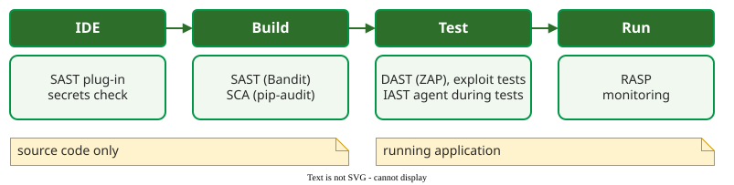

# Dynamic Security Testing

**Dynamic application security testing (DAST)** attacks a running system through its external interfaces, usually HTTP, and watches how it responds; it needs no source code and finds only what the attacked paths reveal .

## 1. Passive, then active

The OWASP Web Security Testing Guide splits black-box testing into two modes . In **passive** testing the tester uses the application as a normal user, often through an *intercepting proxy* (a tool between browser and server that records and edits requests), and maps its pages, parameters and access points. In **active** testing the tester sends attack inputs in twelve categories, from configuration to business logic. Scanners such as OWASP ZAP automate both: a *spider* (a crawler that follows every link) maps the site, then an active scan replays each parameter with injection, cross-site scripting (*XSS*: input that the page later sends to other users' browsers as script) and other payloads.

## 2. Example: a white-box exploit test

DAST sends attack payloads over HTTP to a deployed system. A **white-box exploit test** complements DAST and is not part of it: a unit test sends the same payload straight to the function behind the endpoint. It needs no deployment and runs every build, but skips the HTTP layer. For the shop's login ([Vulnerabilities, Bugs and Flaws](vulnerabilities.md)), the tests below, in `test_login_injection.py`, expect that a quote-and-comment payload does not bypass the password:

```python
def test_correct_password_logs_in(db):
    assert shop.find_user(db, "alice", "s3cret") == (1,)


def test_injection_does_not_bypass_password(db):
    assert shop.find_user(db, "alice' --", "wrong") is None
```

Against the vulnerable module, pytest fails the second test, because the payload logs in:

```text
E       assert (1,) is None
FAILED test_login_injection.py::test_injection_does_not_bypass_password
1 failed, 1 passed
```

Against the fixed module (its `find_user` is shown on [Secure Design Principles](secure-design.md)), with a parameterised query and salted hashes, both tests pass (`2 passed`). Each module needs its own fixture. For the vulnerable module, with one-argument `hash_password` and no salt:

```python
@pytest.fixture
def db():
    db = sqlite3.connect(":memory:")
    db.execute("CREATE TABLE users (id INTEGER, name TEXT, pw TEXT)")
    db.execute("INSERT INTO users VALUES (1, 'alice', ?)",
               (shop.hash_password("s3cret"),))
    return db
```

For the fixed module, with a salt column and `hash_password(password, salt)`:

```python
@pytest.fixture
def db():
    db = sqlite3.connect(":memory:")
    salt = b"0123456789abcdef"
    db.execute("CREATE TABLE users (id INTEGER, name TEXT, salt BLOB, pw TEXT)")
    db.execute("INSERT INTO users VALUES (1, 'alice', ?, ?)",
               (salt, shop.hash_password("s3cret", salt)))
    return db
```

The two tests stay the same. They now guard the fix: if someone reintroduces string-built SQL, the build fails. Unlike the static warning on the same line, the test proves the vulnerability is real and exploitable.

## 3. Fuzzing

**Fuzzing** sends large numbers of malformed or random inputs and watches for crashes, hangs and memory errors . Takanen et al. classify fuzzers on two axes: **generation-based** fuzzers build inputs from a specification of the protocol or file format, while **mutation-based** fuzzers modify valid sample inputs; **dumb** fuzzers ignore the input structure, **smart** ones respect it enough to get past the first parser check. Coverage-guided fuzzers, their evidence and their limits are covered on [Fuzz Testing](../../verif/random/fuzzing.md).

## 4. Inside the running application: IAST, RASP and SCA

Three related tool families sit next to DAST :

- **IAST** (interactive application security testing) places an agent inside the application while functional or DAST tests run, so each finding comes with the code line that handled the attack.
- **RASP** (runtime application self-protection) uses a similar agent in production to block attacks as they happen; it protects rather than tests.
- **SCA** (software composition analysis) compares the project's dependencies with databases of known vulnerabilities, for example by running `pip-audit` on a Python project.



_Where each tool family runs; a secrets check scans code for committed keys and passwords. Left of the middle, tools see source only; right of it, the running application._ 

## When to use it — and when not

Use DAST on a deployed test environment, for web applications and APIs and for problems only visible at run time: configuration, authentication, session handling; use white-box exploit tests on every build. Do not rely on DAST for completeness. A scanner tests only the pages it finds and the payloads it knows, and it reports a symptom (a URL and a response), not the faulty line.

## Limitation

Dynamic testing is slow compared with delivery. Rangnau et al. showed it *can* run on every commit: their pipeline ran three dynamic tests per commit in one job of 14 minutes 6 seconds, of which building the ZAP container alone took 6 minutes 52 seconds . Teams that deploy many times a day keep fast exploit tests in every build and run full scans in parallel with the main pipeline, or nightly.

## How solid is this?

- **Where it comes from.** The passive and active modes are from the OWASP guide ; the fuzzing axes from Takanen et al. ; the pipeline timing from Rangnau et al.'s prototype . The test output was produced by running the tests shown.
- **What is contested.** The tool families' relative strengths come from practitioners' webinars, not from controlled comparisons .
- **What we do not hold.** Independent benchmarks of DAST scanner recall on modern single-page applications.

---

### References



---

{: .highlight }
**Disclaimer:** AI is used for text summarization, polishing and explaining. Authors have verified all facts and claims. In case of an error, feel free to file an issue.
