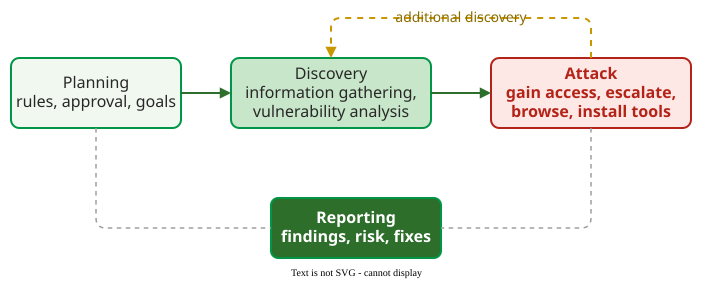

# Penetration Testing and Security Code Review

**Penetration testing** is an authorized attack on a system by testers who mimic real attackers, using tools and judgement to verify which weaknesses can actually be exploited . **Security code review** is its human counterpart on the source side: reviewers read changes looking for security defects .

## 1. Four phases of a penetration test

NIST SP 800-115 divides a penetration test into four phases . **Planning** sets the rules of engagement, the scope and the goals, and gets management approval in writing; no testing happens yet. **Discovery** gathers information (hosts, services, versions, staff names) and then compares it with vulnerability databases. **Attack** tries to exploit each candidate: gain access, escalate privileges (move from an ordinary account to an administrator's), browse the system and install further tools. A successful attack verifies the vulnerability; what it uncovers often sends the testers back to discovery. **Reporting** runs alongside the other phases and ends with findings, their risk and recommended fixes.



_The four-stage penetration testing method; the loop is "additional discovery"._ 

Weidman splits the same work into seven phases: pre-engagement, information gathering, threat modelling, vulnerability analysis, exploitation, **post-exploitation** (what an attacker could reach and do once inside, which decides business impact) and reporting .

**Example.** A shop hires testers for one week, against its staging system only, excluding denial of service. In discovery they find an outdated admin panel on port 8080. In the attack phase its default password works; from the panel they read the orders table and could delete products and orders or close the shop, which shows the impact. The report scores it 9.8, in the CVSS band Critical (see [CVSS Scoring](risk-rating.md)). A published default password needs no account, and the availability impact counts although denial of service was outside the test: the test boundaries limit what testers try, not the impact they score. The report recommends removing the panel from the internet and rotating all credentials.

## 2. What security code review finds

Yu et al. studied 432,585 review comments in four OpenStack and Qt projects . Fewer than 1% of comments were about security, yet reviewers raised 539 security defects there. Race conditions, crashes and resource leaks dominated; classic web defects were rare in this C++ and Python infrastructure code, with no SQL injection at all.

```vega-lite
{
  "$schema": "https://vega.github.io/schema/vega-lite/v5.json",
  "width": 420, "height": 260,
  "config": {"axis": {"labelFontSize": 13, "titleFontSize": 13}},
  "data": {"values": [
    {"t": "Race condition", "p": 39.0}, {"t": "Crash", "p": 22.8}, {"t": "Resource leak", "p": 10.9},
    {"t": "Integer overflow", "p": 7.6}, {"t": "Improper access", "p": 5.8}, {"t": "Buffer overflow", "p": 4.5},
    {"t": "Denial of service", "p": 2.2}, {"t": "Deadlock", "p": 2.0}, {"t": "Other (6 types)", "p": 5.2}
  ]},
  "encoding": {
    "y": {"field": "t", "type": "nominal", "sort": null, "title": null},
    "x": {"field": "p", "type": "quantitative", "title": "% of 539 security defects found by reviewers", "scale": {"domain": [0, 45]}}
  },
  "layer": [
    {"mark": {"type": "bar", "color": "#019546"}},
    {"mark": {"type": "text", "align": "left", "dx": 3, "fontSize": 13, "color": "#282828"}, "encoding": {"text": {"field": "p", "type": "quantitative", "format": ".1f"}}}
  ]
}
```

_Security defect types raised in code review; "other" is encryption, cross-site scripting, use after free, command injection, request forgery and format string together. SQL injection is not in the chart: 0 instances._ 

How a reviewer phrases a finding matters. Developers fixed 65.9% of the security defects reviewers raised, and 81.3% (204 of 251) when the reviewer proposed a specific fix .

## When to use it — and when not

Use penetration testing before a major release, after a large architectural change, or when a regulator or customer requires independent evidence; it finds chains of weaknesses and business-logic abuse that tools miss. Use security-focused code review on every change touching authentication, input handling, cryptography or concurrency. Do not use either as the only defence: a one-week test samples the system once, and reviewers rarely look for security unless asked to.

## Limitation

Both depend on the people. A penetration test is bounded by its scope, its time box and the testers' skill; a clean report means the testers found nothing in that week, not that nothing exists.

## How solid is this?

- **Where it comes from.** The four phases are NIST's, which presents them as one acceptable grouping among several . The review figures are from one study of four open-source projects .
- **What is contested.** The defect mix in Yu et al. reflects systems code; web applications would show more injection and access-control defects.
- **What we do not hold.** Security exercises often name a red team (attackers), a blue team (defenders) and a white team (referees). These roles are often attributed to NIST SP 800-115, but the publication does not define them, and we hold no source that does.

---

### References



---

{: .highlight }
**Disclaimer:** AI is used for text summarization, polishing and explaining. Authors have verified all facts and claims. In case of an error, feel free to file an issue.
