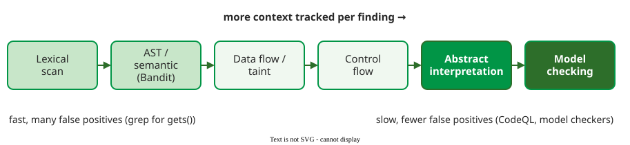

# Static Security Analysis

**Static application security testing (SAST)** analyses source code without running it and reports patterns that commonly lead to vulnerabilities; Chess and West compare such tools to a spell checker for well-understood mistakes .

## 1. A spectrum of techniques

Static analysers differ in how much of the program they model. A lexical scan looks for dangerous names such as `gets()`; an AST (abstract syntax tree) scan understands the language's syntax; data-flow or **taint** analysis follows untrusted input from where it enters (a *source*, such as a request parameter) to where it does damage (a *sink*, such as a database call) and checks whether anything cleans it on the way . Control-flow analysis, abstract interpretation and model checking go further, at growing cost.



_The more context a technique tracks per finding, the fewer false alarms it raises and the slower it runs._ 

## 2. Example: Bandit on a shop module

Bandit, a Python static analyser, matches plugins (one check per test id, e.g. B608) against the syntax tree; each finding has a test id, a severity, a confidence and a CWE number . A deliberately vulnerable shop module:

```python
import hashlib
import sqlite3

SECRET_KEY = "shop-admin-2024"


def hash_password(password):
    return hashlib.md5(password.encode()).hexdigest()


def find_user(db, name, password):
    query = f"SELECT id FROM users WHERE name = '{name}' AND pw = '{hash_password(password)}'"
    return db.execute(query).fetchone()


def apply_discount(price, rule):
    return eval(rule, {"price": price})
```

Running `bandit shop.py` (Bandit 1.9.4) reports four issues; the output below keeps the message, ratings, CWE and line of each and drops the source excerpt:

```text
>> Issue: [B105:hardcoded_password_string]
   Possible hardcoded password: 'shop-admin-2024'
   Severity: Low   Confidence: Medium   CWE-259   shop.py:4
>> Issue: [B324:hashlib]
   Use of weak MD5 hash for security.
   Severity: High   Confidence: High   CWE-327   shop.py:8
>> Issue: [B608:hardcoded_sql_expressions]
   Possible SQL injection vector through string-based query construction.
   Severity: Medium   Confidence: Low   CWE-89   shop.py:12
>> Issue: [B307:blacklist]
   Use of possibly insecure function - consider using safer ast.literal_eval.
   Severity: Medium   Confidence: High   CWE-78   shop.py:17
```

**Severity** estimates the harm if the finding is real; **confidence** estimates how likely it is to be real. Bandit's severity is its own three-level rating and is unrelated to the CVSS scores on [CVSS Scoring](risk-rating.md). The SQL finding is the most dangerous one here, yet Bandit is least sure of it, because it only sees a string being formatted, not where `name` comes from. A taint analyser would follow `name` from its source, the login request, to its sink, `db.execute`, and report the finding with high confidence because nothing cleans it on the way. Bandit files `eval` under CWE-78, OS command injection; CWE-95, eval injection, fits better. The fixes are a secret read from the environment, a salted slow hash, a parameterised query and an allowlist of discount rules instead of `eval`; the fixed module is shown on [Secure Design Principles](secure-design.md). On the fixed module Bandit reports "No issues identified." Reach differs: request input reaches the query and `eval`; the key and hashes need another leak first. [From Severity to Fix Order](cvss-context.md) scores two of the four.

**Where the inputs come from on a real system.** Run it on the package as it ships (`bandit -r app`), with settings committed in `pyproject.toml` so every run has the same scope. Triage at scale is in [Worked Case: Threat Model and SAST Triage for a Web Shop](worked-case.md).

## 3. Why false positives are unavoidable

A **false positive** is a warning about code that is not vulnerable; a **false negative** is a vulnerability the tool stays silent about. Rice's theorem says that no program can decide any non-trivial property of all programs, so no analyser can avoid both: each one approximates and must choose which way to err . Security tools prefer false positives: a missed injection costs more.

**Example of a false positive.** Bandit flags this line with the same B608 warning, although the table name is a constant and no user input reaches the query:

```python
ORDERS_TABLE = "orders"
db.execute(f"SELECT COUNT(*) FROM {ORDERS_TABLE}")
```

After checking, a developer may suppress it with a `# nosec B608` comment that states why, so the decision is visible in review .

## When to use it — and when not

Use SAST on every commit: it is fast, needs no running system, and points at the exact line. Run in the IDE and at build, it reports a bug minutes after it is written; moving checks this early is called *shifting left*. Do not use it as evidence that a design is secure: it cannot see a missing authorization check that the design forgot, or a flaw in how components trust each other . Those need [Threat Modeling](threat-modeling.md) and review.

## Limitation

Too many unhelpful warnings teach teams to ignore all of them. Practitioners in the webinars studied by Rajapakse et al. report that only about 30% of scan results are effective, and name this "alert fatigue" a main obstacle .

## How solid is this?

- **Where it comes from.** The technique spectrum and the Rice's theorem argument are from Chess and West . The Bandit output was produced by running Bandit 1.9.4 on the module shown.
- **What is contested.** The 30% figure is a practitioner report quoted in a study of webinars, not a measurement; "not effective" also includes real issues that are not worth fixing, so it is not a false-positive rate .
- **What we do not hold.** Benchmark results comparing the recall of specific SAST tools.

---

### References



---

{: .highlight }
**Disclaimer:** AI is used for text summarization, polishing and explaining. Authors have verified all facts and claims. In case of an error, feel free to file an issue.
