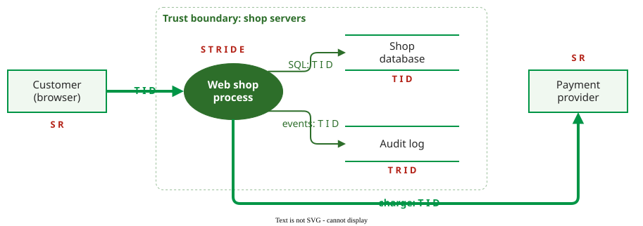

# Threat Modeling

**Threat modeling** is the structured analysis of a system's design to find what an attacker could do to it, before the system is built or changed; it is the main technique for finding design flaws rather than coding bugs .

## 1. Four questions

Shostack reduces threat modeling to four questions :

1. **What are we building?** Draw a data flow diagram (DFD) of the system.
2. **What can go wrong?** Walk the diagram with a prompt such as STRIDE.
3. **What are we going to do about it?** For each threat: mitigate, eliminate, transfer or accept it.
4. **Did we do a good job?** Check that every element was covered and every threat has a decision.

A **DFD** uses four element types: **external entities** (people or systems outside your control, drawn as rectangles), **processes** (code you run, circles), **data stores** (databases, files, logs; parallel lines) and **data flows** (arrows). A **trust boundary** (dashed line) separates parts with different privileges; most threats sit where flows cross it.

**Where the inputs come from on a real system.** Draw the DFD from artefacts, not memory: the list of routes or API endpoints (Flask's `flask routes`, an OpenAPI file), the deployment configuration (what runs where, which ports are open), and every place the code opens a connection, a file or an outgoing request. [Worked Case: Threat Model and SAST Triage for a Web Shop](worked-case.md) follows one app from code to a release decision.

## 2. STRIDE

Besides confidentiality, integrity and availability, three more properties are added in practice: **authentication** (a principal, the identity that acts, a user or a service, is who it claims to be), **authorization** (a principal may do only what it is allowed to) and **non-repudiation** (a principal cannot later deny an action it took). STRIDE names six threat categories, each the opposite of one of these six properties :

| Threat | Violates | Example in a shop |
|---|---|---|
| **S**poofing | Authentication | Logging in as Alice with her leaked password |
| **T**ampering | Integrity | Changing the price field in an order request |
| **R**epudiation | Non-repudiation | A customer denies placing an order and no log proves it |
| **I**nformation disclosure | Confidentiality | An error page showing the SQL query and table names |
| **D**enial of service | Availability | Thousands of fake orders filling the database |
| **E**levation of privilege | Authorization | A customer reaching the admin page by guessing its URL |

In **STRIDE-per-element**, external entities can be spoofed and can repudiate (S, R); processes are open to all six; data flows to T, I and D; data stores to T, I and D, plus R when the store is a log that must prove who did what .

_A shop's DFD with the STRIDE letters that apply to each element._ 

**Example.** Walking the shop diagram element by element gives, among others: the customer can be **spoofed** (fix: multi-factor login for accounts with saved cards); the login flow crossing the boundary can be **tampered** with (fix: TLS, Transport Layer Security, on every connection); the shop database can **disclose** data through SQL injection (fix: parameterised queries); the audit log data store can be **tampered** with by an admin who wants to hide a refund, which in turn enables **repudiation**, since the log can no longer prove who did what (fix: append-only log shipped off the server).

One attack can produce entries on several elements, and each element gets its own letter. **S goes on the element whose identity is faked**, because the mitigation (stronger authentication of that identity, such as multi-factor login) belongs to it. For the login SQL injection ([Vulnerabilities, Bugs and Flaws](vulnerabilities.md)), this gives **S** (spoofing) on the external entity Customer, whose identity (Alice's) is faked, and **I** (information disclosure) and **T** (tampering) on the shop database; the weakness that allows it is fixed in the web-shop process. This handbook uses that convention; some teams record such an attack on the process instead.

**Rate and rank before deciding.** Question 3 needs a ranked list. Score each threat as the vulnerability it would become: a [CVSS](risk-rating.md) base score, adjusted for exposure and data ([From Severity to Fix Order](cvss-context.md)). The shop (constructed vectors, CVSS 3.1, all S:U):

| Rank | Threat | AV/AC/PR/UI/C/I/A | Base |
|---|---|---|---|
| 1 | SQL injection in login exposes every account | N/L/N/N/H/H/N | 9.1 |
| 2 | Login sniffed or altered on Wi-Fi without TLS | A/H/N/N/H/H/N | 6.8 |
| 3 | Customer floods the database with fake orders | N/L/L/N/N/N/H | 6.5 |
| 4 | Admin edits the audit log to hide a refund | N/L/H/N/N/H/N | 4.9 |

All four threaten the same server and data; with equal confidentiality, integrity and availability requirements the environmental adjustment changes no position: here the rank is the base-score order.

## 3. How well it works

Scandariato et al. measured STRIDE with 57 master's students, in teams of three to five, analysing the same digital publishing system over three years . **Precision**, the share of reported threats that are real, was good: 81%. **Recall**, the share of real threats that were reported, was low: on average teams found 36% of the threats in the study's reference set, against the 80% the authors had expected.

Practice is immature. Yskout et al. analysed 20 threat modeling projects done by one consultancy and placed the discipline at **level 1, ad hoc**, of a five-level maturity model; a project took about 69 hours, and finding threats was only a third of that effort .

## 4. Other methods

Shevchenko et al. compare twelve threat modeling methods and conclude that none is best; the choice depends on the system and the goal . Four common alternatives to STRIDE: **PASTA**, a seven-stage, risk-centred process from business objectives to simulated attacks; **LINDDUN**, the same DFD walk for privacy threats, which STRIDE omits; **attack trees**, which decompose the attacker's goal into ways to reach it; and **Trike**, which rates the risk of each create, read, update and delete action on each asset.

## When to use it — and when not

Use threat modeling when a new system or feature changes trust boundaries: new interfaces, data stores or third parties. It is cheapest before code exists, and a poor fit for coding bugs in finished code; that is what [Static Security Analysis](static-analysis.md) and review are for.

## Limitation

STRIDE is a mnemonic, not a taxonomy: Shostack himself calls it a "lousy taxonomy", because one attack often fits several letters . With 36% recall, a STRIDE session should be one input among several, not a completeness check.

## How solid is this?

- **Where it comes from.** The four questions and STRIDE-per-element are from Shostack ; the effectiveness data from one controlled study ; the maturity assessment from one consultancy's projects .
- **What is contested.** Scandariato's subjects were students, so professionals may reach higher recall; recall also depends on the reference set of threats being complete.
- **What we do not hold.** Comparative studies of PASTA, LINDDUN or attack trees with the same rigour as the STRIDE study.

---

### References



---

{: .highlight }
**Disclaimer:** AI is used for text summarization, polishing and explaining. Authors have verified all facts and claims. In case of an error, feel free to file an issue.
