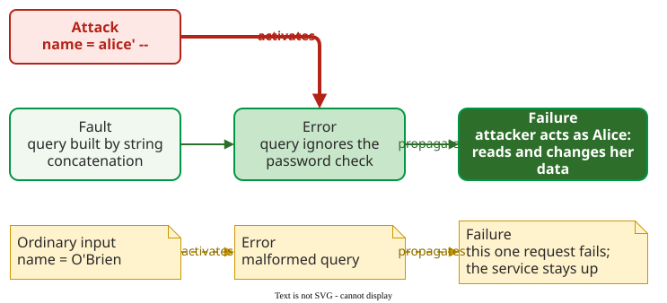

# Vulnerabilities, Bugs and Flaws

A **vulnerability** is a fault in the system that an attacker can reach and exploit on purpose: outside input can activate it and harm the system . When that input is deliberately malicious, it is an **attack**. Security reuses the dependability chain of fault, error and failure, with the attacker supplying the activating input. Here a **bug** means, narrowly, a fault in a few lines of implementation code (§2).

## 1. The chain with an attacker in it

Avizienis and colleagues define security as a composite of three attributes: **confidentiality** (no unauthorized disclosure), **integrity** (no improper alteration) and **availability** (the service is ready for authorized users) . A security failure is a failure that breaks one of the three, judged for the service as a whole and by what an attacker can do on purpose: a crash that fails one request while the service stays up for everyone else is not a loss of availability. Further properties such as authentication follow from these three; [Threat Modeling](threat-modeling.md) lists them. The causal chain is the one used for reliability: a **fault** in the code is activated, produces an **error** (a wrong internal state), and the error propagates to a **failure** the user can see. The difference is who activates the fault: in reliability, ordinary use; in security, someone searching for the most damaging input.



_The same fault, two activations. An attack turns it into a breach; ordinary input fails one request._ 

**Example.** A shop's login builds its query by pasting the user's name into SQL text:

```python
query = f"SELECT id FROM users WHERE name = '{name}' AND pw = '{hash_password(password)}'"
```

- **Fault:** the query is built by string concatenation, so input can change its structure.
- **Attack:** the name `alice' --` (a quote, a space and two hyphens) closes the quote and turns the rest of the line, including the password condition, into a comment.
- **Error:** the database runs a query with no password check.
- **Failure:** the attacker is logged in as Alice. They can read her orders and address (confidentiality lost) and act as her (integrity lost). [Threat Modeling](threat-modeling.md) shows where this attack lands in a STRIDE walk, a checklist of six threat types applied to each element of a design.

Customer O'Brien activates the same fault by accident: the stray quote makes the SQL malformed and that one login request fails. That failure is a reliability problem, not a breach: nobody gains access and the service keeps working for everyone else. What makes the fault a **vulnerability** is that an attacker can activate it deliberately and gain something.

## 2. Bugs and flaws

McGraw separates two kinds of defect :

- A **bug** is an implementation-level fault in a few lines of code, such as the query above, a missing bounds check or a hard-coded password. Tools that read code can find many of them.
- A **flaw** is a design mistake, such as an admin interface reachable from the internet, or a session token that never expires. Each line can be correct and the system still insecure.

He estimates that each kind causes about half of all security problems, which is why code scanning alone cannot make a system secure .

## 3. Naming vulnerabilities

Two public catalogues name vulnerabilities. A **CWE** (Common Weakness Enumeration) number names a *kind* of weakness: CWE-89 is SQL injection, CWE-259 a hard-coded password. A **CVE** (Common Vulnerabilities and Exposures) number names one *specific* vulnerability in one product, such as CVE-2014-0160 for Heartbleed in OpenSSL . Scanners report CWEs; advisories cite CVEs.

## When to use it — and when not

Use the chain to analyse a finding: name the fault, the activating input, the error and which CIA property fails. It shows whether an attacker could trigger the failure on purpose, and which fix breaks the chain earliest. It is less useful for flaws, where there is often no single faulty line to point to; there, [Threat Modeling](threat-modeling.md) works better.

## Limitation

Whether a fault is a vulnerability depends on reachability and impact, and both need judgement. A crash in an admin-only tool that no outsider can reach becomes a vulnerability once the tool faces the internet.

## How solid is this?

- **Where it comes from.** The definitions of vulnerability, attack and security are taken from Avizienis et al. .
- **What is contested.** McGraw's half-and-half split between bugs and flaws is an expert estimate, not a measured ratio . Felderer et al. state only that "a high proportion" of incidents exploit known vulnerabilities; the "90%" often quoted with their name does not appear in the paper .
- **What we do not hold.** Breach costs such as IBM's 2024 average of USD 4.88 million come from an industry survey, not peer-reviewed research .

---

### References



---

{: .highlight }
**Disclaimer:** AI is used for text summarization, polishing and explaining. Authors have verified all facts and claims. In case of an error, feel free to file an issue.
