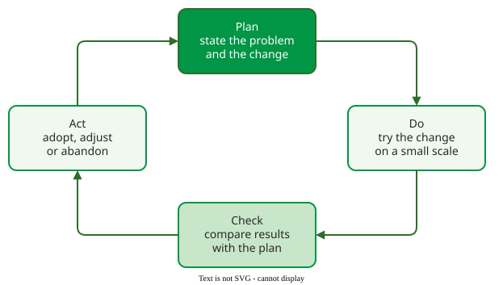
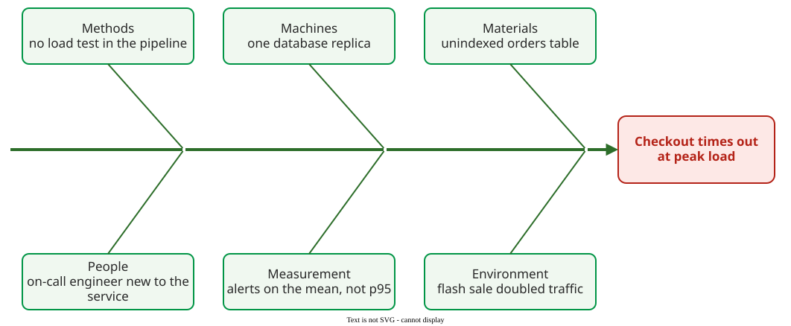

# Quality Pioneers

The **quality pioneers** are the engineers and managers who, mostly in manufacturing between the 1920s and the 1980s, turned quality from inspection at the end of the line into something planned, measured and improved; software quality borrowed their ideas almost unchanged. This page gives each one's lasting idea and where it shows up in software.

## 1. Seven people, seven ideas

| Pioneer | Lived | Lasting idea | In software today |
|---|---|---|---|
| Walter Shewhart | 1891–1967 | control charts: separate common-cause from special-cause variation | flaky-test and build-time dashboards |
| W. Edwards Deming | 1900–1993 | 14 points for management; the Plan–Do–Check–Act cycle | retrospectives, "build quality in" |
| Joseph Juran | 1904–2008 | quality as fitness for use; the quality trilogy; the vital few | defect Pareto charts |
| Kaoru Ishikawa | 1915–1989 | cause-and-effect (fishbone) diagram; seven basic tools; quality circles | post-incident reviews |
| Philip Crosby | 1926–2001 | quality as conformance to requirements; zero defects; cost of nonconformance | cost of quality |
| Watts Humphrey | 1927–2010 | process maturity for software: the Capability Maturity Model (CMM); the Personal and Team Software Processes (PSP, TSP) | CMMI, the CMM's successor, used to assess software processes |
| Noriaki Kano | born 1940 | must-be and attractive quality | feature prioritisation ([Kano Model](kano.md)) |

## 2. The improvement cycle

**Shewhart** showed in the 1920s that a process varies for two kinds of reasons: common causes built into the process, and special causes that can be traced and removed. Reacting to every fluctuation as if it were special makes a process worse. **Deming** carried Shewhart's improvement cycle to Japan and made it famous as Plan–Do–Check–Act .

_The Plan–Do–Check–Act cycle; Deming later preferred Study to Check._ 

Deming's **14 points** include "cease dependence on inspection to achieve quality" and "drive out fear" . In software terms, testing at the end cannot put quality into a product, and a team afraid to report defects will hide them.

## 3. Defining and managing quality

**Juran** defined quality as fitness for use and split quality management into a **trilogy**: quality planning, quality control and quality improvement . He also popularised the Pareto principle for defects: a vital few causes account for most of them. **Crosby** defined quality as conformance to requirements, argued that doing it right the first time costs less than fixing it, and measured the price of nonconformance ; his book's title, *Quality Is Free*, is the claim.

**Ishikawa** gave front-line teams seven simple tools, among them the Pareto chart, the check sheet, the control chart and the **cause-and-effect diagram** .

_A cause-and-effect diagram for a software incident. Each bone is a category of cause; the team fills the bones before deciding which cause to fix._

For example, a shop's checkout times out during a flash sale. The on-call team's first guess is "the database is slow". Filling the fishbone shows six candidate causes, from an unindexed table to alerts that watch mean latency, not p95. The team fixes the index first, because it is cheap, and adds a load test so that the next special cause is caught before release.

## 4. Into software

**Humphrey** carried these ideas into software. *Managing the Software Process* argued that software organisations could be assessed and improved like manufacturing processes, and became the basis of the Capability Maturity Model ; he later scaled the same discipline down to individuals with the Personal Software Process .

## When to use it — and when not

- **Use** these ideas when a quality problem recurs: PDCA to run the improvement, a fishbone to find causes, a Pareto chart to choose which to fix.
- **Do not** transfer manufacturing statistics blindly: software is built once and copied, so variation between copies is not the problem it is on a production line.

## How solid is this?

- **Where it comes from.** The pioneers' own books and articles cited above.
- **What is contested.** Many popular attributions are loose: the cycle is Shewhart's, Deming named it Plan–Do–Study–Act, and "fitness for purpose" is a later paraphrase of Juran's "fitness for use".

---

### References



---

{: .highlight }
**Disclaimer:** AI is used for text summarization, polishing and explaining. Authors have verified all facts and claims. In case of an error, feel free to file an issue.
