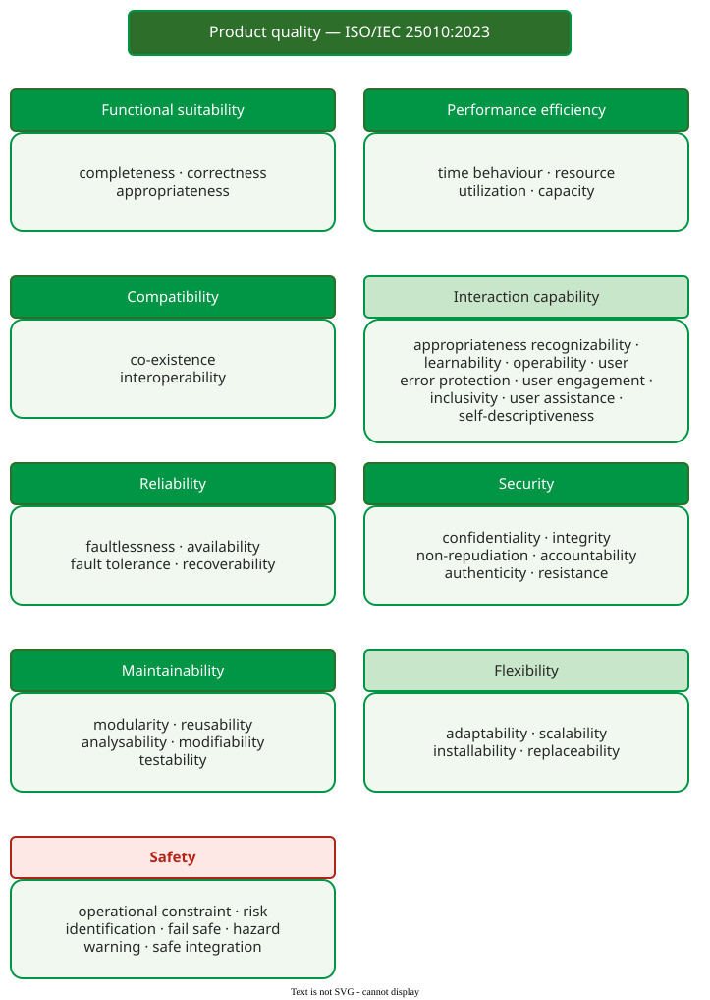

# ISO/IEC 25010 Product Quality

**ISO/IEC 25010** is the international standard that defines the product quality model: nine characteristics of a software or ICT product, each split into subcharacteristics, used to specify, measure and evaluate product quality . It is the shared vocabulary most quality requirements are written in today.

## 1. From McCall to the 2023 model

The table shows how the top level changed since McCall.

| Model | Year | Top-level characteristics |
|---|---|---|
| McCall | 1977 | 11 factors  |
| ISO/IEC 9126-1 | 2001 | 6: functionality, reliability, usability, efficiency, maintainability, portability; security sits under functionality  |
| ISO/IEC 25010 | 2011 | 8 product characteristics, with security and compatibility at the top level, plus a quality-in-use model  |
| ISO/IEC 25010 | 2023 | 9 product characteristics; quality in use moved to ISO/IEC 25019  |

The 2023 edition changed more than numbering . It added **safety** as a characteristic. It renamed usability to **interaction capability** and portability to **flexibility**. It added scalability under flexibility and resistance under security, and replaced maturity with **faultlessness**. Many textbooks still show the 2011 model.

The next table maps McCall's factors. McCall had no factor *named* security or compatibility, but their content was there, under integrity and interoperability; only safety has no counterpart at all. The same word can also mean different things in the two models.

| McCall factor (1977) | Its home in ISO/IEC 25010:2023 | Same word, different meaning? |
|---|---|---|
| Correctness | functional suitability (functional correctness) | |
| Reliability | reliability | |
| Efficiency | performance efficiency | ISO's quality-in-use *efficiency* is the user's effort, not resources |
| Integrity | security | McCall: controlled access; ISO: *integrity* is a security subcharacteristic, protection from unauthorised change |
| Usability | interaction capability | ISO keeps *usability* for [quality in use](quality-in-use.md), now ISO/IEC 25019 |
| Maintainability, testability, reusability | maintainability (analysability, modifiability, testability, reusability) | |
| Flexibility | maintainability (modifiability) | not ISO's *flexibility* |
| Portability | flexibility (adaptability, installability) | ISO's *flexibility* is McCall's portability plus scalability |
| Interoperability | compatibility (interoperability) | |
| no counterpart | safety | |

Two more false friends: *suitability* means functions in functional suitability, the fit of a process to the work in process quality, and a part of beneficialness in ISO/IEC 25019; *self-descriptiveness* is a code criterion in McCall but a property of the user interface (interaction capability) in ISO.

## 2. The nine characteristics

Each characteristic is a *capability of a product*; functional suitability, for example, is the "capability of a product to provide functions that meet stated and implied needs of intended users when it is used under specified conditions" .

_The product quality model of ISO/IEC 25010:2023. Light green: renamed in 2023; red: new in 2023._ 

## 3. Use it as a checklist

The standard's main use is to make sure no characteristic is forgotten when requirements are written. For example, a team specifying a food-delivery app walks the nine characteristics in an hour. Functional suitability, performance efficiency, interaction capability, reliability and security all yield requirements: orders must reach the restaurant, the menu must load in 2 s on 4G, a repeat order must take at most five taps, the service must be available at lunchtime, and card data must be protected. Compatibility yields one, the payment provider's API. Maintainability yields a target: a fix for a critical defect reaches users within 24 hours. Flexibility yields one: the app runs on the current and previous major versions of iOS and Android. Safety is dropped, and the team writes down why: the app controls nothing that can harm a person. Eight characteristics yield requirements and one is dropped, and the dropped one is as useful as the eight: a reviewer can challenge the reason. [A Project Quality Model](project-model.md) shows the resulting table.

## When to use it — and when not

- **Use** ISO/IEC 25010 to structure non-functional requirements, test plans and evaluation reports, so that everyone uses the same word for the same property.
- **Do not** treat it as a specification to satisfy in full: most products need only some characteristics, and the standard itself sets no thresholds.

## Limitations

The model names properties; it does not say how much of each is enough, how to measure them (that is ISO/IEC 25020 to 25029), or how they trade off. Its categories are a convention: availability sits under reliability, though many teams treat it as its own concern, and some properties, such as energy use, fit only awkwardly.

## How solid is this?

- **Where it comes from.** The text of ISO/IEC 25010:2023, its foreword listing the changes from 2011, and the 2001 and 2011 editions .
- **What is contested.** Whether the decomposition is complete or orthogonal; it is agreed by committee, not derived from data.
- **What we do not hold.** The full 2023 text beyond the definitions of the first characteristics; the subcharacteristic names in the figure come from the published structure of the standard.

---

### References



---

{: .highlight }
**Disclaimer:** AI is used for text summarization, polishing and explaining. Authors have verified all facts and claims. In case of an error, feel free to file an issue.
