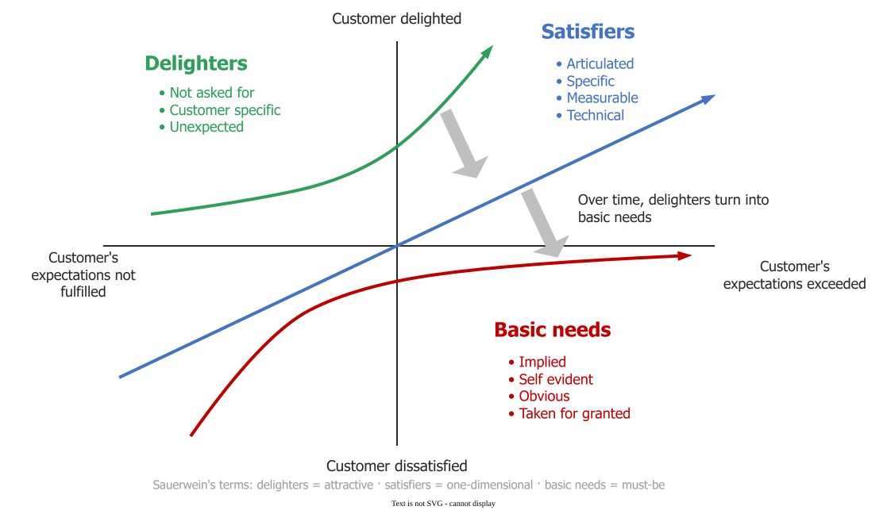

# Kano Model

The **Kano model** classifies product attributes by how customer satisfaction responds when the attribute is present or absent: a missing **must-be** attribute causes dissatisfaction, a **one-dimensional** attribute raises satisfaction in proportion, and an **attractive** attribute delights when present but is not missed when absent . Noriaki Kano and colleagues published it in 1984. It answers a question that "satisfaction is performance against expectation" leaves open: why can delivering everything customers asked for still disappoint them?

## 1. Five categories

Kano and colleagues named three main categories and two minor ones :

- A **must-be** attribute is taken for granted: its absence makes customers dissatisfied, and its presence adds nothing.
- A **one-dimensional** attribute works like a slider: more of it means more satisfaction.
- An **attractive** attribute delights when present and is not missed when absent.
- An **indifferent** attribute changes nothing either way.
- A **reverse** attribute makes some customers less satisfied when present.

_Practitioner names on the figure: delighters = attractive, satisfiers = one-dimensional, basic needs = must-be. The curves show shape only, and the migration arrows are not in Kano's or Sauerwein's papers._ 

## 2. Classifying an attribute with two questions

Kano classified attributes from a pair of questions per attribute: a **functional** question ("how do you feel if the product has it?") and a **dysfunctional** one ("how do you feel if it does not?"), each answered on the same five-point scale: I like it, I expect it, I am neutral, I can live with it, I dislike it . The pair of answers gives the category through the **evaluation table**: find the row for the answer about presence and the column for the answer about absence .

| Present ↓ / Absent → | Like | Expect | Neutral | Live with | Dislike |
|---|---|---|---|---|---|
| **Like** | Q | A | A | A | O |
| **Expect** | R | I | I | I | M |
| **Neutral** | R | I | I | I | M |
| **Live with** | R | I | I | I | M |
| **Dislike** | R | R | R | R | Q |

_A attractive, O one-dimensional, M must-be, I indifferent, R reverse, Q questionable: the two answers contradict each other, so the response is discarded._

For example, a team asks 50 users of a video-streaming app about "skip the intro". Their answer pairs (present, absent) are: like and neutral, 18; like and live with, 7; like and dislike, 9; neutral and neutral, 11; expect and dislike, 3; like and like, 2. The table turns them into A = 18 + 7 = 25, O = 9, I = 11, M = 3 and Q = 2. The two questionable answers are dropped, and the feature takes its most frequent category: **attractive**, with 25 of 48 valid answers. The same survey gives "resume where I stopped" M = 38, O = 6, I = 4, A = 2, so must-be, and "4K picture" O = 31, A = 9, I = 6, M = 4, so one-dimensional. When two categories are close, Sauerwein and colleagues break the tie in the order must-be, one-dimensional, attractive, indifferent, because a failed must-be cannot be compensated . Chapman and Callegaro report that category assignment may be unreliable with samples under 200 , so treat a 50-person survey as a first signal. Two **satisfaction coefficients** per feature read the counts as an investment case: *better* = (A + O) / (A + O + M + I), how much having it raises satisfaction, and *worse* = −(O + M) / (A + O + M + I), how much lacking it lowers satisfaction :

| Feature | Better | Worse | Reading |
|---|---:|---:|---|
| Resume where I stopped | 8/50 = 0.16 | −44/50 = −0.88 | insurance: getting it right buys little, getting it wrong is punished hard |
| 4K picture | 40/50 = 0.80 | −35/50 = −0.70 | both directions matter |
| Skip the intro | 34/48 = 0.71 | −12/48 = −0.25 | upside with little downside |

The team concludes that resume must work before anything else, 4K is worth steady investment, and skip-intro is a cheap way to stand out.

## When to use it — and when not

- **Use** Kano to prioritise features and to set quality targets: must-be attributes need a reliability threshold, such as "resume works in at least 99.9% of sessions", and one-dimensional ones a target on a performance scale.
- **Do not** use one survey forever: categories drift, and yesterday's attractive feature becomes tomorrow's must-be, as phone cameras, free HTTPS and dark mode did (our examples).

## Limitations

Categories hold for a group of customers at a time, not for everyone: a feature can be must-be for professionals and indifferent for casual users, so the most frequent answer can hide two segments. The model says which way satisfaction moves, not by how much.

## How solid is this?

- **Where it comes from.** Kano and colleagues' 1984 paper, in Japanese, introduced the categories and the question pair ; Sauerwein and colleagues' 1996 ski study (over 1,500 customers) gives the coefficients and the tie-break rule, and reports, after Griffin and Hauser, that 20 to 30 interviews per homogeneous segment surface 90 to 95% of the requirements . That figure is about finding requirements, not about classifying them reliably.
- **What is contested.** Scoring rules beyond "most frequent category" differ between authors, and Chapman and Callegaro question whether a method built for durable consumer goods fits technology products ; the drift from attractive to must-be is widely observed but rarely measured.
- **What we do not hold.** The original paper's text. The evaluation table is the form popularised by Berger and colleagues , checked against several published reproductions; the streaming survey is constructed.

---

### References



---

{: .highlight }
**Disclaimer:** AI is used for text summarization, polishing and explaining. Authors have verified all facts and claims. In case of an error, feel free to file an issue.
