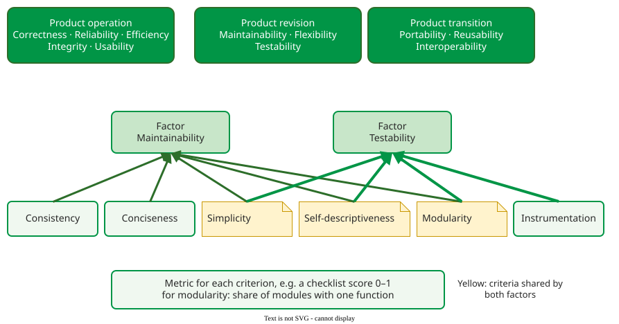

# McCall's Quality Model

**McCall's quality model** describes software quality as 11 **factors** that users and buyers care about, each supported by **criteria** that developers can build in and **metrics** that measure those criteria . McCall, Richards and Walters wrote it at General Electric in 1977 for the US Air Force; it was the first model to connect what a buyer asks for with properties of the code.

## 1. Eleven factors in three groups

McCall grouped the factors by the stage of the product's life they concern, and defined most of them as an **effort** or an **extent** :

| Group | Factor | McCall's definition |
|---|---|---|
| **Product operation**: how well does it run? | Correctness | extent to which a program satisfies its specification and fulfils the user's objectives |
| | Reliability | extent to which a program can be expected to perform its intended function with required precision |
| | Efficiency | amount of computing resources and code required to perform a function |
| | Integrity | extent to which access to software or data by unauthorized persons can be controlled |
| | Usability | effort required to learn, operate, prepare input and interpret output |
| **Product revision**: can we change it? | Maintainability | effort required to locate and fix a defect in an operational program |
| | Flexibility | effort required to modify an operational program |
| | Testability | effort required to test a program to ensure it performs its intended functions |
| **Product transition**: can we move it? | Portability | effort required to transfer a program to another hardware or software environment |
| | Reusability | extent to which parts of a program can be reused in other applications |
| | Interoperability | effort required to couple one system with another |

McCall has no factor named security: it lives inside integrity. The factors are **external** in McCall's sense: they describe what users and buyers experience and cannot be measured directly, unlike the internal criteria below.

## 2. Factors, criteria and metrics

A factor cannot be measured directly, so McCall linked each one to criteria: 23 properties of the software or its development, such as modularity, simplicity and traceability . Each criterion is then scored by metrics, often checklist questions answered yes or no and turned into a score between 0 and 1.

_Two factors and their criteria. The highlighted criteria support both factors._ 

The same links as a table:

| Criterion | Maintainability | Testability |
|---|---|---|
| Consistency | ✓ | |
| Conciseness | ✓ | |
| Simplicity | ✓ | ✓ |
| Self-descriptiveness | ✓ | ✓ |
| Modularity | ✓ | ✓ |
| Instrumentation | | ✓ |

For example, a team must judge the **maintainability** of a 40-module billing system. McCall's criteria for maintainability are consistency, simplicity, conciseness, self-descriptiveness and modularity. The team scores modularity by asking of each module "does it implement one function?": 30 modules out of 40 do, a score of 0.75. Each criterion is scored the same way, as the share of "yes" answers to its checklist questions. With equal weights, scores of 0.75 for modularity, 0.8 for consistency, 0.6 for simplicity, 0.7 for conciseness and 0.9 for self-descriptiveness average to (0.75 + 0.8 + 0.6 + 0.7 + 0.9) / 5 = 0.75: a maintainability figure the team can track from release to release. Three of the five criteria also support **testability**, so work on modularity raises both factors at once.

## When to use it — and when not

- **Use** McCall's model to see why an internal property matters: the criteria name the code properties behind each user-visible factor, which modern standards hide.
- **Do not** use it as the checklist for a new product: it has no separate security or compatibility characteristic, and none for safety. Use [ISO/IEC 25010](iso25010.md) instead.

## Limitations

The model is not orthogonal: one criterion feeds several factors, and improving one factor can degrade another (see [Quality Trade-offs](tradeoffs.md)). Its metrics were checklist scores from the 1970s; the weights that combine them into a factor score were never validated across organisations. And its factors reflect one buyer, the US Air Force, whose concerns were mission software that ran, could be fixed and could move to new hardware.

## How solid is this?

- **Where it comes from.** The original report ; the factor definitions and the criteria list are quoted from Naik and Tripathy's summary of it .
- **What is contested.** The factor-to-criterion links are expert judgement, not measured relationships.
- **What we do not hold.** The report's metric worksheets; the modularity score above is a constructed example.

---

### References



---

{: .highlight }
**Disclaimer:** AI is used for text summarization, polishing and explaining. Authors have verified all facts and claims. In case of an error, feel free to file an issue.
