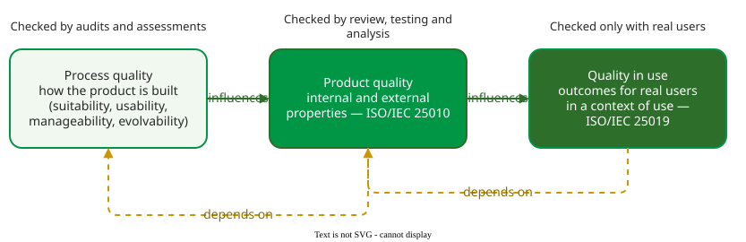

# Quality in Use and Process Quality

**Quality in use** is the degree to which a product lets specific users achieve specific goals in a specific context of use; it is judged by what happens to the users, not by properties of the code . **Process quality** is the quality of the way the product is built. Together with [product quality](iso25010.md) they give three places to look for quality.

## 1. Three views, one chain

ISO/IEC 25010 drew the three as a chain: the process influences the product's properties, and the product's properties influence quality in use. Each also depends on the one before it .

_Quality in the life cycle, after ISO/IEC 25010:2011; the four process qualities are Kroeger and Davidson's._ 

The chain explains a common surprise. For example, a company builds an expense-claim app with clean code, no open defects and a 300 ms response time: good product quality. Three months later, half the claims still arrive by e-mail. Interviews show why: the app asks for a cost-centre code that most employees do not know. Product quality was high and quality in use was low, and no code review or performance test could have shown it; only watching real users could.

The boundary between the two is a judgement, and ISO draws it by context. The same measure, such as the share of first-time users who complete an order without help, is product quality (learnability, under interaction capability) when it is taken in a controlled test with representative users, and quality in use (effectiveness) when it is taken from real users in their own context of use. ISO/IEC 25010 calls interaction capability a prerequisite for usability, which it leaves to the quality-in-use model .

## 2. What quality in use measures

The 2011 standard listed five quality-in-use characteristics . The table pairs each with a requirement for a ticket-booking site.

| Characteristic | Asks | Example requirement |
|---|---|---|
| Effectiveness | do users reach their goal? | in live use, 90% of first-time users complete a booking without help |
| Efficiency (not performance efficiency) | at what cost in the user's time and effort? | a returning user books in under 2 minutes |
| Satisfaction | do users like it? | mean score of at least 4 of 5 in the post-booking survey |
| Freedom from risk | does use cause economic, health or environmental harm? | no booking is charged twice |
| Context coverage | does it work in every intended context? | the targets above also hold on a phone over 3G |

The 2023 revision moved quality in use into its own standard, ISO/IEC 25019, which regroups it into three characteristics: **beneficialness** (covering usability, accessibility and suitability), **freedom from risk** and **acceptability** . The idea is unchanged: outcomes for users, measured with users.

## 3. Process quality

Kroeger and Davidson grouped the qualities of a good software process, drawn from practitioner interviews and improvement case studies, into four . The names reuse product terms with a process meaning: **suitability** (does the process fit the work?), **usability** (can people follow it?), **manageability** (can it be planned, monitored and controlled?) and **evolvability** (can it be improved?). Process standards such as CMMI (Capability Maturity Model Integration, which rates an organisation's processes on maturity levels) and ISO 9001 (requirements for a quality management system) assess process quality on the bet that a good process tends to produce good products. It is a tendency, not a guarantee: a team can follow a sound process and still build the wrong thing.

## When to use it — and when not

- **Use** quality-in-use requirements when user outcomes decide success, and plan user tests or field measurements to check them.
- **Do not** expect to verify them before release with technical tests alone; and do not judge a product by its process audit.

## Limitations

Quality in use depends on the context, so a result from one user group does not transfer to another. Its measures need real users, which makes them slow and costly to collect, and the thresholds in the table are judgements for one product.

## How solid is this?

- **Where it comes from.** ISO/IEC 25010:2011 for the life-cycle chain and the five characteristics; ISO/IEC 25019:2023 for the current structure; Kroeger and Davidson for process quality .
- **What we do not hold.** The full text of ISO/IEC 25019 and of Kroeger and Davidson's paper; their structure is taken from published summaries. The expense-app case is constructed.

---

### References



---

{: .highlight }
**Disclaimer:** AI is used for text summarization, polishing and explaining. Authors have verified all facts and claims. In case of an error, feel free to file an issue.
