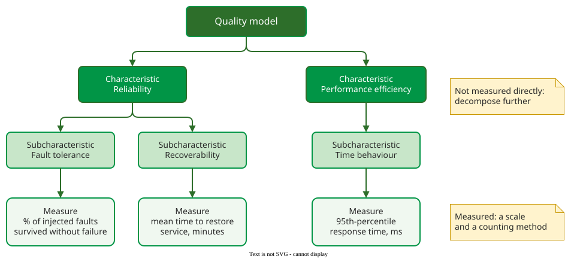

# What Is a Quality Model?

A **quality model** is a defined set of quality characteristics, and of the relationships between them, that a team uses to specify quality requirements and to evaluate whether a product meets them . It replaces "I know it when I see it" with a vocabulary that two people can agree on and a test can check.

## 1. Characteristics break down until they can be measured

Every model from McCall's to ISO/IEC 25010 has the same shape: a few broad **characteristics**, each split into **subcharacteristics**, each of which is finally tied to a **measure** with a scale and a counting method . A characteristic such as reliability is too broad to measure directly; "mean time to restore service, in minutes" is not.

_The generic hierarchy, with examples from ISO/IEC 25010._ 

For example, a product owner writes "the payment service must be reliable". Walking down the hierarchy turns that into something testable. The characteristic is **reliability**. The subcharacteristic that matters for payments is **recoverability**, because a failed payment must not stay failed. The measure is **mean time to restore service after a crash, in minutes**. The requirement adds a threshold: at most 5 minutes, measured over a quarter; [Writing Quality Requirements](requirements.md) puts it into a template. Each step discards meanings the owner did not intend, such as "never shows a wrong colour".

## 2. Internal and external quality

Measures come in two kinds. **Internal** measures are taken on the code or the design without running it: cyclomatic complexity, coupling, comment density. **External** measures are taken on the running system: response time, failure rate, task completion time. Users only experience external quality; developers can only change internal properties. Quality models encode the bet that the second drives the first, which [Measurement](../measurement/) shows is weaker than it sounds.

## 3. Words for quality work

A quality model says *what* quality is; quality management says *who does what about it*. ISO 9000 defines the main activities as parts of quality management :

| Term | Focused on |
|---|---|
| **Quality planning** | setting quality objectives and the processes and resources to meet them |
| **Quality assurance (QA)** | providing confidence that quality requirements will be fulfilled |
| **Quality control (QC)** | fulfilling quality requirements, by checking work products and correcting them |
| **Quality improvement** | increasing the ability to fulfil quality requirements |

The common confusion is QA against QC. A code review of one pull request is QC: it checks a work product. An audit showing that every pull request is reviewed before merge is QA: it gives confidence that the process will catch problems in pull requests nobody has seen yet.

## When to use it — and when not

- **Use** a quality model when stakeholders must agree on what "good enough" means, when writing [quality requirements](requirements.md), and when planning what to test.
- **Do not** expect a model to tell you which characteristics matter: that depends on the product, and choosing is the first step of using one.

## Limitations

No model is complete: each reflects the concerns of its authors, and characteristics overlap, so the same property can sit in two places. A measure stands for a subcharacteristic only by agreement; a team that optimises the measure can lose the quality it was meant to show.

## How solid is this?

- **Where it comes from.** The hierarchy is common to McCall's model and the ISO/IEC 25000 family . The opening definition paraphrases the SQuaRE vocabulary (ISO/IEC 25000), which we do not hold in full; the activity definitions paraphrase ISO 9000.
- **What is contested.** Standards and textbooks name the levels differently: factor, criterion and metric in McCall; characteristic, subcharacteristic and measure in ISO. The structure is the same.

---

### References



---

{: .highlight }
**Disclaimer:** AI is used for text summarization, polishing and explaining. Authors have verified all facts and claims. In case of an error, feel free to file an issue.
