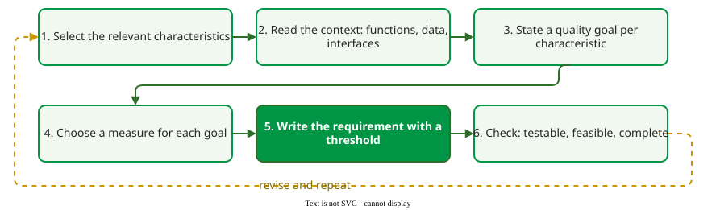

# Writing Quality Requirements

A **quality requirement** states how well a system must do something, under a stated condition, with a threshold that a test can check: "while up to 1,000 concurrent users are active, the search API shall respond within 200 ms for at least 95% of requests". It is how a [quality model](quality-models.md) reaches a project.

## 1. A template

Every testable quality requirement has four parts: a **condition**, a **component**, a **measure** tied to a quality characteristic, and a **threshold**.

```text
While [condition, with any measurement window], the [component] shall [measure] [threshold].
```

The bracketed parts vary; "While" may read "During" or "When". A measurement window, such as "measured per month", is part of the condition.

"The system shall be fast and reliable" has none of the four parts, so no test can fail it. Split it and fill the template:

- **Performance efficiency:** While up to 1,000 concurrent users are active, the search API shall respond within 200 ms for at least 95% of requests.
- **Reliability (availability):** During business hours, the order service shall be available at least 99.9% of the time, measured per calendar month.

In the first, the condition is up to 1,000 concurrent users, the component the search API, the measure the 95th-percentile response time, and the threshold 200 ms.

The percentile matters. The **95th percentile** (**p95**) of response time is the value that 95% of requests stay under. Suppose 98% of requests take 70 ms and 2% take 5 s. The mean is 0.98 × 70 + 0.02 × 5,000 ≈ 169 ms, a time no real request takes. The p95 is 70 ms, which tells most users what they wait, but it does not show the slow 2% either; only the 99th percentile (p99 = 5 s) does. So a requirement names the percentile that matters, and adds a second one when the tail matters: "…within 200 ms for 95% of requests and within 1 s for 99%".

## 2. Six steps from model to requirement

Quality requirements are best derived from the quality model rather than written from memory. The steps below follow the quality-model-driven approach of Firesmith and colleagues .



_From quality model to requirement; the last step loops back when a check fails._

Step 2 collects the facts the threshold depends on: the operation affected, its data volume, peak users and external calls. Step 3's goal is a plain statement such as "search is fast", not one of McCall's criteria.

For example, for a product-search feature:

| Step | Decision |
|---|---|
| 1. Relevance | Performance efficiency matters: users leave slow searches |
| 2. Context | Search is called on every page; peak is about 1,000 concurrent users; another requirement logs every query for search analytics |
| 3. Quality goal | Search is fast |
| 4. Measure | 95th-percentile latency in ms, from the load-test tool |
| 5. Requirement | While up to 1,000 concurrent users are active, the search API shall respond within 200 ms for at least 95% of requests |
| 6. Check | Testable with a load test; feasible on current hardware; conflicts with the requirement to log every query for search analytics, resolved by logging asynchronously |

Step 6 is where [trade-offs](tradeoffs.md) surface: two requirements that each pass on their own may not pass together.

The next page, [A Project Quality Model](project-model.md), collects such requirements into one table for a whole product.

## When to use it — and when not

- **Use** the template for every non-functional requirement, and the six steps when a project starts or a new characteristic becomes important.
- **Do not** invent thresholds to fill the template: a number nobody can justify is worse than a stated assumption to be checked. Base it on user research, a competitor or current performance.

## Limitations

Some qualities, such as maintainability, need several weak measures rather than one threshold, and some quality-in-use goals can only be checked after release. The template sets no priority between conflicting requirements.

## How solid is this?

- **Where it comes from.** The template and the six steps are a teaching form of quality-model-driven requirements engineering .
- **What we do not hold.** The book's own step list; the six steps here are a simplified adaptation, and the search example is constructed.

---

### References



---

{: .highlight }
**Disclaimer:** AI is used for text summarization, polishing and explaining. Authors have verified all facts and claims. In case of an error, feel free to file an issue.
