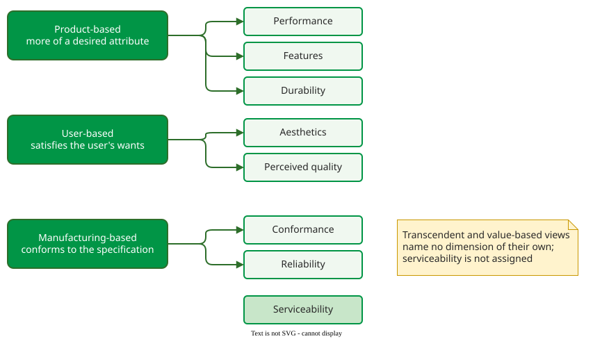

# Views of Quality

Garvin's **five views of quality** are five different answers to "what is quality?": excellence you recognise, more of a desirable attribute, satisfying the user, conforming to the specification, and performance at an acceptable price . People who argue about quality usually hold different views without saying so.

## 1. Five views

Garvin collected definitions from philosophy, economics, marketing and operations management and grouped them into five approaches . The table quotes a definition he lists for each.

| View | Quality is… | Garvin quotes | Measurable? |
|---|---|---|---|
| **Transcendent** | innate excellence: you know it when you see it | Pirsig: "even though Quality cannot be defined, you know what it is" | no |
| **Product-based** | the amount of a desired attribute | Abbott: "differences in the quantity of some desired ingredient or attribute" | yes, attribute by attribute |
| **User-based** | the capacity to satisfy the user's wants | Juran: "fitness for use" | only through users |
| **Manufacturing-based** | conformance to the specification | Crosby: "conformance to requirements" | yes, as defects against a specification |
| **Value-based** | excellence at an acceptable price | Broh: "the degree of excellence at an acceptable price" | yes, if cost and benefit are |

For example, a team ships release 4.2 of a mobile banking app. The test lead reports zero open defects against the specification: high quality in the **manufacturing** view. App-store reviews complain that transfers take six taps: low quality in the **user** view. Marketing points to a faster login than any competitor: high quality in the **product** view. All three are right, which is why the release meeting stalls until someone names the view the decision will use.

## 2. Eight dimensions

Garvin then split product quality into eight dimensions: **performance, features, reliability, conformance, durability, serviceability, aesthetics and perceived quality** . Serviceability, the speed, courtesy and competence of repair, is the nearest to software maintainability, though Garvin meant the repair service rather than the product's structure. Each view looks mainly at some of the dimensions.

_Which dimensions each approach focuses on, as Garvin pairs them._ 

A firm need not compete on all eight. Garvin's example is pianos: Steinway sells on tone and craftsmanship, Yamaha on reliability and conformance, so that its pianos sound consistently alike; both were profitable. In software, one text editor competes on features, another on starting in 50 ms.

## When to use it — and when not

- **Use** the views at the start of a project to make each stakeholder's notion of quality explicit, and the dimensions to choose which ones the product will compete on.
- **Do not** use them as a requirements checklist: they describe physical products and say nothing about security, maintainability or compatibility. Use [ISO/IEC 25010](iso25010.md) for that.

## Limitations

The transcendent view cannot be specified or tested, so it gives an engineer nothing to work with; it is a reminder that some judgements stay subjective. The manufacturing view has a known blind spot: conforming to a process can produce a bad product consistently . The views also overlap: Juran's "fitness for use" is listed as user-based, yet a specification is meant to capture exactly that fitness. Which view dominates is a judgement about a project, not a property of a method: an agile team that accepts work by customer demo leans on the user view, a team audited against a process standard leans on the manufacturing view.

## How solid is this?

- **Where it comes from.** Garvin's 1984 article; the five views and eight dimensions are his own synthesis of the literature, not an empirical result .
- **What is contested.** Software texts keep the five views but reinterpret them; Naik and Tripathy read the product view as "good internal properties give good external qualities", a hypothesis about code rather than Garvin's amount of a desired attribute . Many slides also quote the user view as "fitness for purpose"; Garvin's word is "fitness for use", quoting Juran.

---

### References



---

{: .highlight }
**Disclaimer:** AI is used for text summarization, polishing and explaining. Authors have verified all facts and claims. In case of an error, feel free to file an issue.
