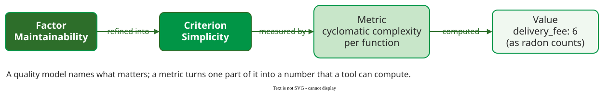
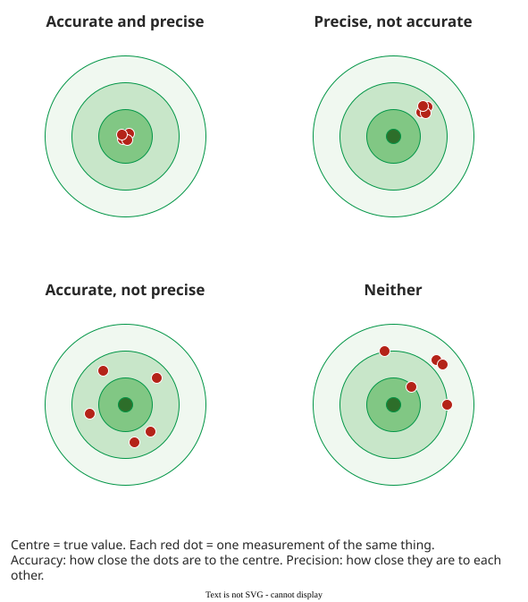

# Measurement Definitions

A **measurement** assigns numbers or symbols to an attribute of an entity by a stated rule, so that relations between the numbers reflect relations between the things measured . A **software quality metric** is such a rule applied to software data: a function whose output is a single value read as the degree to which the software has a quality attribute .

## 1. Entity, attribute, rule

Every measurement names three things . The **entity** is the object: a module, a release, a code review. The **attribute** is the property of it we care about: size, complexity, effort, number of defects. The **rule** says how a value is assigned: "count non-blank, non-comment lines". Change the rule and you have a different measure, even if the name stays the same.

Hubbard adds the purpose: a measurement is *"a quantitatively expressed reduction of uncertainty based on one or more observations"* . It does not need to be exact to be useful. Knowing that a review takes one to three hours, not "no idea", already changes a plan. Hubbard's argument that *everything is measurable* runs: if we care about something, it must show up somehow; if it shows up, we can observe more or less of it; and what we can observe in amounts, we can measure. "Maintainability" or "user trust" are not unmeasurable, only not yet defined.

## 2. From a quality model to a number

A quality model names what matters; a metric turns one part of it into a number. McCall's model refines each quality **factor** into **criteria**, and each criterion into **metrics** that can be computed .

_From factor to value, after McCall's factor–criteria–metric structure. The value 6 is radon's count for `delivery_fee`, the example on [Size and Complexity Metrics](examples.md); McCabe's graph gives 5._ 

## 3. The representation condition

A measure is valid for an attribute only if the numbers behave like the attribute: if module A is larger than B, its number must be larger too. Lines of code satisfy this for *physical size*: a 2,000-line file is larger than a 500-line file. They do not satisfy it for *functionality*: the same feature can take 50 lines in one style and 500 in another, so more lines does not mean more function. The same number can be a valid measure of one attribute and an invalid measure of another.

## 4. Accuracy, precision, resolution

Three properties describe how good a single measurement is:

- **Accuracy** is how close the measured value is to the true value.
- **Precision** is how close repeated measurements of the same thing are to each other.
- **Resolution** is the smallest difference the instrument can show.

_Accuracy is closeness to the centre; precision is closeness of the shots to one another._

**Example.** A load-testing script times each request but adds 50 ms of its own start-up to every reading: a request that really takes 200 ms is reported as 250 ms, run after run. The script is **precise** (the same answer every time) but **not accurate** (always 50 ms too high). A response-time log that truncates every reading to whole seconds has a **resolution** of one second: a request that took 200 ms and one that took 800 ms both show as 0, so a 4× slowdown is invisible.

Not every disagreement is an accuracy problem. If a complexity tool reports 10 for a function and a hand count gives 12, first check whether both use the same counting rule: [Size and Complexity Metrics](examples.md) shows two correct rules giving 5 and 6 for the same code. That is a difference of definition, settled by an [operational definition](development.md) (a statement of exactly how the value is obtained), not by a better instrument.

## When to use it — and when not

- **Use** the entity–attribute–rule triple whenever a metric is proposed: if one of the three cannot be stated, the metric is not ready.
- **Use** the representation condition to check that a number means what its name says.
- **Do not** trust a precise tool to be accurate. Check it once against a known value, using the same counting rule.
- **Do not** read a difference smaller than the resolution: 0 ms vs 0 ms says nothing.

## How solid is this?

- **Where it comes from.** The definitions are standard: Sarle's from measurement theory, Hubbard's from decision analysis, and the metric definition from IEEE Std 1061-1998. McCall's criteria and metrics were designed for 1970s projects; the chain structure, not the particular list, is what survives in today's models.
- **What is contested.** Whether every attribute *should* be measured is a separate question from whether it can be. [Measurement Pitfalls](pitfalls.md) shows what happens when only the measurable parts are managed.

---

### References



---

{: .highlight }
**Disclaimer:** AI is used for text summarization, polishing and explaining. Authors have verified all facts and claims. In case of an error, feel free to file an issue.
