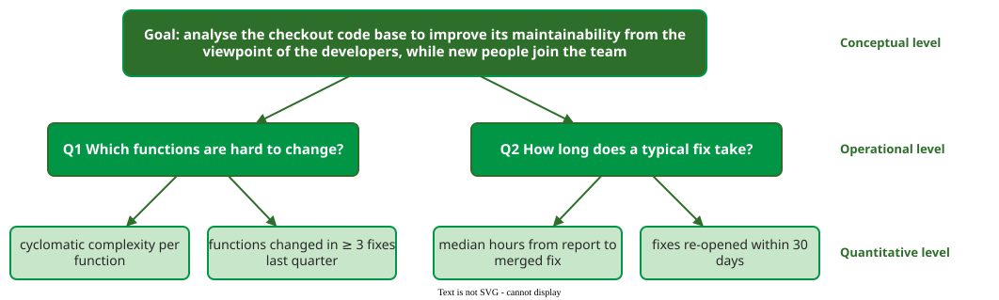

# Developing Metrics with GQM

**Goal–Question–Metric (GQM)** derives metrics from the top down: state a measurement goal, ask the questions that would show whether the goal is being met, and only then choose the metrics that answer each question . Every metric collected must answer a question, and every question must serve a goal.

## 1. Write the goal in five parts

A GQM goal has a fixed shape  : *analyse* an **object** *for the purpose of* a **purpose** *with respect to* a **quality focus** *from the viewpoint of* a **stakeholder** *in the context of* an **environment**. The template forces decisions a vague goal hides: whose problem is this, and what would count as better?

## 2. Example: a maintainability goal

A team is about to add three new developers to a checkout service and worries that changes take too long.

_One goal, two questions, four metrics. Each metric answers exactly one question here; in larger trees a metric can serve several._

- **Goal.** Analyse the checkout code base *to improve* its maintainability *from the viewpoint of* the developers, *in the context of* new people joining the team. The five parts: object = the checkout code base; purpose = improve; quality focus = maintainability; stakeholder = the developers; environment = new people joining.
- **Q1: Which functions are hard to change?** Answered by [cyclomatic complexity](examples.md) per function (its number of decisions plus one), a property of the code, and by the number of functions changed in three or more fixes last quarter, a property of its history.
- **Q2: How long does a typical fix take?** Answered by the median hours from bug report to merged fix, and by the share of fixes re-opened within 30 days, which guards against fixes that are fast but wrong.

Notice what the tree leaves out: lines of code per developer, commit counts, coverage. They are easy to collect, but they answer neither question.

## 3. Make each metric operational

A metric name is not yet a measurement. An **operational definition** states exactly how the value is obtained, so that it passes two tests :

- **Communication**: would someone else know precisely what was measured, and what was included and excluded?
- **Repeatability**: would someone else following the definition get the same value?

**Example.** Team A reports a **defect density** of 15 defects per thousand lines of code (KLOC); Team B reports 8. Before concluding that B writes better code, ask:

- What counts as a defect: every report, or only confirmed ones, and are duplicates removed?
- When is a defect counted: from unit testing on, or only after release?
- What counts as a line: physical lines or statements, with or without comments, blank lines and generated code?

If Team A counts every report from unit testing on and Team B counts confirmed field defects only, the two numbers measure different things.

## 4. Check validity and reliability

A metric is **valid** when it measures the attribute it claims to (*construct validity*, which is the [representation condition](definitions.md) checked against data), when it predicts the outcome it is used for (*predictive validity*), and when results carry over to other projects (*external validity*). It is **reliable** when repeated measurement gives the same value: reliability is the precision of the measurement process, and Park's repeatability criterion asks for it in the definition. This is the reliability of a measurement, not the software quality attribute [Reliability](../../attributes/reliability/index.md). Develop metrics in stages, from the goal to a conceptual definition, then an operational definition, then the tool that collects the data, and go back a stage whenever a later one shows a gap.

## When to use it — and when not

- **Use** GQM when introducing any new metric or dashboard, and when an existing dashboard has metrics nobody acts on.
- **Use** operational definitions whenever numbers from two teams, tools or periods are compared.
- **Do not** start from the list of metrics a tool offers; that is the [streetlight effect](pitfalls.md).
- **Do not** expect GQM to tell you whether a metric is valid. It ensures the metric is relevant; validity still has to be checked against data.

## How solid is this?

- **Where it comes from.** GQM was developed by Basili and colleagues at the University of Maryland and NASA's Software Engineering Laboratory; the SEI guidebook turns it into a step-by-step process . The two criteria for operational definitions are Park's .
- **What is contested.** GQM trees grow quickly, and the method gives no rule for when to stop adding questions. In practice teams cap a goal at a handful of metrics.

---

### References



---

{: .highlight }
**Disclaimer:** AI is used for text summarization, polishing and explaining. Authors have verified all facts and claims. In case of an error, feel free to file an issue.
