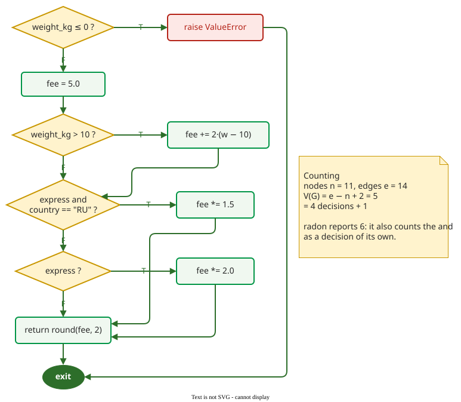

# Size and Complexity Metrics

**Size and complexity metrics** are computed from source code alone: **lines of code** count its length, **cyclomatic complexity** counts its decisions, and **Halstead's metrics** count its operators and operands. The [Maintainability Index](maintainability-index.md) combines all three into one score.

**Example.** The page computes each one on the same Python function, with the output of the `radon` tool .

```python
def delivery_fee(weight_kg, express, country):
    if weight_kg <= 0:
        raise ValueError(
            "weight must be positive")

    fee = 5.0
    if weight_kg > 10:
        fee += 2.0 * (weight_kg - 10)
    if express and country == "RU":
        fee *= 1.5
    elif express:
        fee *= 2.0
    return round(fee, 2)
```

## 1. Lines of code

`radon raw` gives three counts for the same function:

```text
    LOC: 13
    LLOC: 11
    SLOC: 12
    Comments: 0
    Multi: 0
    Blank: 1
```

**LOC** counts every physical line: 13. **SLOC** (source lines) leaves out blank and comment lines: 12, without the blank line. **LLOC** (logical lines) counts statements, so the `raise` spread over two lines counts once: 11, namely the `def` line, three `if` lines, the `elif`, `raise`, `fee = 5.0`, the three updates of `fee` and `return`. Sizes of whole systems are usually quoted in **KLOC**, thousands of lines. Which count a figure uses must be stated; otherwise "500 lines" means nothing. All three measure physical size well and functionality poorly: see the [representation condition](definitions.md).

## 2. Cyclomatic complexity

McCabe's **cyclomatic complexity** is the number of linearly independent paths through a function's control-flow graph: *V(G) = e − n + 2*, where *e* is the number of **edges** (transfers of control) and *n* the number of **nodes** (statements or blocks) . When every decision has two outcomes, this equals the number of decisions plus one.



_The graph has 11 nodes and 14 edges: V(G) = 14 − 11 + 2 = 5, that is four decisions plus one. Conventions: one exit node is added, the `raise` gets an edge to it, and `express and country == "RU"` is drawn as a single decision; drawing the `and` as two decision nodes would give 6._

Tools count decisions from the code instead of drawing the graph. `radon cc` starts at 1 and adds 1 for each `if`, `elif`, `for`, `while`, `except`, `with`, `assert` and comprehension or generator expression, and 1 for each Boolean operator (`and`, `or`); `else` and `finally` add nothing . For `delivery_fee` it reports **6**, not 5, because `express and country == "RU"` hides a second decision inside the first. Neither number is wrong; they follow different counting rules, so compare complexity only between values from the same tool.

The number has two uses. It is the size of a basis set: the smallest set of paths from which every path can be built, which [basis path coverage](../../verif/coverage/basis.md) asks the tests to run. [Branch coverage](../../verif/coverage/code.md), which asks only that every decision outcome be taken once, may need fewer tests. And it is a risk flag. McCabe suggested 10 as an upper limit per module ; the SEI bands are 1–10 low risk, 11–20 moderate, 21–50 high and above 50 untestable . `radon cc` scores every function, method and class separately (a class with *m* methods scoring *c₁ … cₘ* gets ⌊(1 + c₁ + … + cₘ) / m⌋ + 1; for the `Cart` class of [Object-Oriented Metrics](oo-metrics.md), with methods scoring 1, 1, 2 and 1, that is ⌊6 / 4⌋ + 1 = 2, as radon prints) and prints a letter: A for 1–5, B for 6–10, C for 11–20, D for 21–30, E for 31–40 and F for 41 and above . At 6, `delivery_fee` is a B: low risk.

## 3. Halstead's metrics

Halstead counts distinct operators *n₁*, distinct operands *n₂*, and their total occurrences *N₁* and *N₂*; the **vocabulary** is *n = n₁ + n₂* and the **length** *N = N₁ + N₂* . What counts as an operator is the tool's choice. Radon counts only arithmetic, augmented-assignment (every augmented assignment counts as its operator: `+=` as `+`, `*=` as `*`), comparison and Boolean operators; each operator's operands are what it acts on, and a sub-expression such as `(weight_kg - 10)` counts as one operand of the operator above it. Calls (`round`), assignments with `=`, `raise` and `return` are not counted . Unary operators such as `-x` and `not x` count with one operand; `in`, `not in`, `is` and `is not` count as comparisons; attribute access (`order.total`), subscripts (`items[0]`) and call arguments are not operators, and appear only as operands when they stand on one side of an operator.

| Operator | Occurrences | Operands (each pair is one occurrence) |
|---|---|---|
| `<=` | 1 | `weight_kg`, `0` |
| `>` | 1 | `weight_kg`, `10` |
| `-` | 1 | `weight_kg`, `10` |
| `+` (from `+=`) | 1 | `fee`, `2.0 * (…)` |
| `*` (1 plain, 2 from `*=`) | 3 | `2.0`, `(weight_kg - 10)`; `fee`, `1.5`; `fee`, `2.0` |
| `and` | 1 | `express`, `country == "RU"` |
| `==` | 1 | `country`, `"RU"` |
| **7 distinct** | ***N₁* = 9** | ***N₂* = 18** occurrences, **12 distinct** |

For a file containing only `delivery_fee`, `radon hal` prints the four counts under its own names, followed by the derived values; for reading a report, *h1*, *h2*, *N1*, *N2* and *volume* are the ones to check:

```text
    h1: 7          # distinct operators, n₁
    h2: 12         # distinct operands, n₂
    N1: 9          # operator occurrences, N₁
    N2: 18         # operand occurrences, N₂
    vocabulary: 19
    length: 27
    volume: 114.6940428629768
    difficulty: 5.25
    effort: 602.1437250306282
    time: 33.45242916836823
```

The 12 distinct operands are `weight_kg`, `0`, `10`, `fee`, `2.0`, `1.5`, `express`, `country`, `"RU"` and the three sub-expressions `(weight_kg - 10)`, `2.0 * (weight_kg - 10)` and `country == "RU"`. From these, **volume** *V = N · log₂ n*, **difficulty** *D = (n₁ / 2) · (N₂ / n₂)* and **effort** *E = D · V*:

- *V* = 27 · log₂ 19 = 27 · 4.25 ≈ **114.7**, the bits needed to write the function down in this vocabulary;
- *D* = 3.5 · 1.5 = **5.25**, which grows when the same operands are used again and again;
- *E* = 5.25 · 114.7 ≈ **602**. Halstead read *E / 18* as seconds of writing time: radon prints 33 s, a sign of a small function.

Halstead gave no thresholds. Use the values to compare functions within one code base, measured by one tool.

## When to use them — and when not

- **Use** cyclomatic complexity to find the functions that need the most tests and the closest review.
- **Use** the same tool, with the same settings, for every value you compare.
- **Do not** compare LOC across languages or styles, or use it to judge productivity.

## How solid is this?

- **Where it comes from.** McCabe 1976 and Halstead 1977. Every figure on this page was produced by radon 6.0.1 and recomputed by hand; the counting rules were read from radon's source.
- **What is contested.** All three metrics grow with size, so much of what they "predict" is size; see [Reading Metric Data](statistics.md). Halstead's time and effort interpretations have little empirical support.

---

### References



---

{: .highlight }
**Disclaimer:** AI is used for text summarization, polishing and explaining. Authors have verified all facts and claims. In case of an error, feel free to file an issue.
