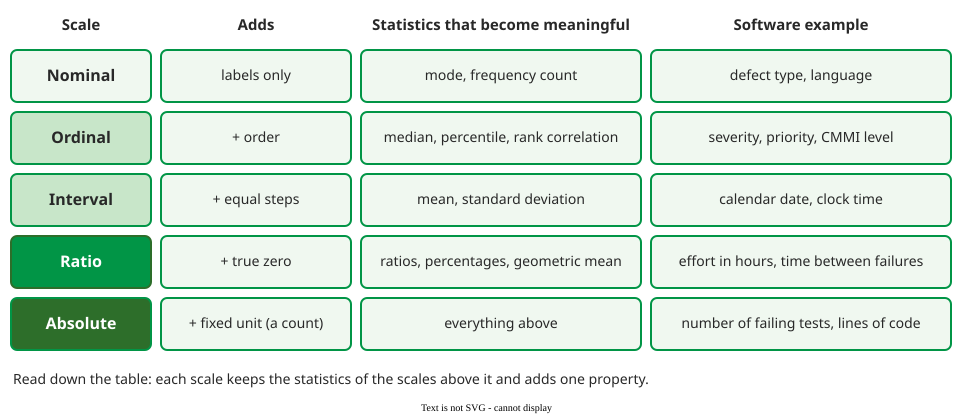

# Measurement Scales

A **measurement scale** fixes which comparisons and which arithmetic on a measure's values mean something. Stevens named four scales, **nominal, ordinal, interval and ratio** ; software measurement adds a fifth, **absolute**, for counts . Averaging defect severities is arithmetic their scale does not support.



_Each scale keeps the statistics of those above and adds one property; stronger scales allow fewer unit changes. Statistics after the SEI guidebook._ 

## 1. The test: does the statement survive a change of unit?

A statement about measured values is **meaningful** if it stays true under every change of unit the scale allows . Temperature in °C is an interval scale: any shift and stretch, such as converting to °F, is allowed. "Today, at 20 °C, is twice as warm as yesterday at 10 °C" fails the test, because in °F the same days are 68 and 50, not double. "Today is 10 degrees warmer" survives, as a difference of 18 °F. Effort in hours is a ratio scale: converting to minutes multiplies both values by 60, so "task A took twice as long as task B" stays true.

## 2. Example: one bug tracker, five scales

A single defect record holds all five scales. Process ratings work the same way: a CMMI maturity level, the 1–5 rating of an organisation's process capability, is ordinal, so level 4 is not "twice" level 2.

The defect record:

| Field | Scale | Meaningful | Not meaningful |
|---|---|---|---|
| Component (UI, API, DB) | nominal | most frequent component (mode) | "average component" |
| Severity 1–4 (cosmetic … critical) | ordinal | median severity; "more severe than" | mean severity 2.7; "critical is twice minor" |
| Date reported | interval | days between two reports | "reported twice as late" |
| Hours to fix | ratio | mean, ratios: "took three times longer" (meaningful; for skewed times the median summarises better) | — |
| Number of open defects | absolute | everything; the unit is the thing counted, so no conversion applies | — |

A count is on an absolute scale only once its counting rule is fixed: once the rule is set there is exactly one way to count . "13 physical lines" and "11 logical lines" of the same function are two different measures, each absolute, which is why a line count must name its rule.

For severities 1, 1, 2, 4 and 4, the mean is 2.4, which assumes that the step from 2 to 4 is twice the step from 1 to 2. Nothing in the definition of "severity" says so. Any relabelling that keeps the order is equally valid for an ordinal scale: code the levels 1, 2, 3, 10 instead of 1, 2, 3, 4, and the same defects have mean (1 + 1 + 2 + 10 + 10) / 5 = 4.8, while the median is still level 2. The mean changed with an arbitrary choice; the median did not, so the median is the honest summary .

## 3. Story points: the scale is a judgement

Scale type is not printed on a measure; it depends on how the values were produced and what we conclude from them . Story points show why. Teams add them up into velocity, which treats them as ratio data: a 2-point story should take twice as long as a 1-point story. Mike Cohn published the hours actually spent on stories at one company :

```vega-lite
{
  "$schema": "https://vega.github.io/schema/vega-lite/v5.json",
  "width": "container", "height": 240,
  "data": {"values": [
    {"pts": 1, "lo": 6, "hi": 36, "median": 21, "ratio": 21},
    {"pts": 2, "lo": 31, "hi": 73, "median": 52, "ratio": 42},
    {"pts": 3, "lo": 11, "hi": 117, "median": 64, "ratio": 63},
    {"pts": 5, "lo": 56, "hi": 144, "median": 100, "ratio": 105},
    {"pts": 8, "lo": 56, "hi": 166, "median": 111, "ratio": 168}
  ]},
  "encoding": {"x": {"field": "pts", "type": "quantitative", "title": "Story points", "scale": {"domain": [0, 9]}, "axis": {"values": [1, 2, 3, 5, 8]}}},
  "layer": [
    {"mark": {"type": "rule", "strokeWidth": 3, "color": "#c8e6c9"},
     "encoding": {"y": {"field": "lo", "type": "quantitative", "title": "Hours spent", "scale": {"domain": [0, 180]}}, "y2": {"field": "hi"}}},
    {"mark": {"type": "line", "strokeDash": [6, 4], "color": "#1f5fa8", "point": {"color": "#1f5fa8", "shape": "square", "size": 50}},
     "encoding": {"y": {"field": "ratio", "type": "quantitative"}}},
    {"mark": {"type": "point", "filled": true, "size": 90, "color": "#019546"},
     "encoding": {"y": {"field": "median", "type": "quantitative"}}}
  ],
  "config": {"font": "Tahoma", "axis": {"labelFontSize": 13, "titleFontSize": 13}}
}
```

_Green dots: median hours; bars: range from shortest to longest story; blue dashes: 21 hours × points, what a ratio scale predicts from the 1-point median. Data from one company._ 

At 3 and 5 points the medians sit on the line: 64 against 63, 100 against 105. At 2 points the median is 52 against 42, about 24% higher. At 8 points the median is 111 hours, not 168. And the ranges overlap so much that a 3-point story took anything from 11 to 117 hours. Two readings are defensible. Treat points as **ratio** and sum them, accepting a planning error that grows with story size; or treat them as **ordinal** and plan from counts of stories of each size. Decide which you assume, write it down, and check it against hours spent.

## When to use it — and when not

- **Use** the scale to choose the summary: mode for nominal, median for ordinal, mean only from interval upward.
- **Use** the meaningfulness test before any "twice as" or "average" claim.
- **Do not** let the scale table forbid analysis outright: start with the conservative type and promote it only when the data show that the steps really are equal .

## How solid is this?

- **Where it comes from.** Stevens's four scales ; the absolute scale and the table of permitted statistics from the SEI guidebook .
- **What is contested.** Statisticians such as Velleman argue that scale types should not dictate analysis; the guidebook recommends using them to test reasoning, not to restrict it . The story-point data come from one company.

---

### References



---

{: .highlight }
**Disclaimer:** AI is used for text summarization, polishing and explaining. Authors have verified all facts and claims. In case of an error, feel free to file an issue.
