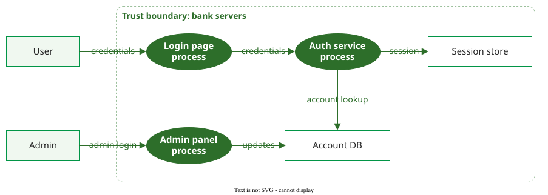

# RQ L10: Software Security

**Format:** Explain in your own words, give brief examples, and show every calculation step. These questions test the lecture summarised in [SN L10: Software Security](SN_L10_Security.md).

---

## Part 1: Security Fundamentals

### Q1: Fault, Error, Failure in Security

A junior developer writes a login query using string concatenation instead of a parameterised query. An attacker submits `alice' --` as the user name and any password.

1. Trace the **fault → error → failure** chain for this attack. Name each stage precisely and say which CIA properties fail, and why.
2. Trace the chain again for a customer named **O'Brien** who simply logs in. What is different about the activation, the error and the failure?
3. Both cases share one fault and one fix. Why does the fault count as a **vulnerability**, although O'Brien's failed login on its own is only an accidental reliability failure?

---

### Q2: Detecting vs Preventing — The CTO's Dilemma

A start-up CTO with a 20-person team and a small budget asks: "Should we invest in static analysis tools or in threat modeling first?" You know:

- McGraw's estimate: about half of security problems are implementation **bugs**, about half are design **flaws**.
- IBM's 2024 survey (figures given here, not in the study notes): an average breach costs **USD 4.88 million** and is found after **194 days**.
- Avizienis's **four means**: fault prevention, fault tolerance, fault removal, fault forecasting.

(a) Using McGraw's estimate, explain why investing in only one approach leaves roughly half of the problems unaddressed.

(b) If the team deploys daily and can pick only one to start with, which do you recommend? Justify.

(c) Map each of the four means to a concrete security practice. Under which means do static analysis and threat modeling fall?

---

## Part 2: Detecting Vulnerabilities

### Q3: Tool Selection Under Constraints

Your team deploys **5 times per day**. The budget allows **one** tool:

| Tool | Strength | Weakness |
|------|----------|----------|
| SAST | Finds bugs early, points to the line | False positives are unavoidable (Rice's theorem) |
| DAST | Tests the running application, proves exploitability | One job took about 14 minutes in Rangnau et al.'s pipeline; finds only what it reaches |
| SCA | Finds known vulnerabilities in dependencies | Cannot find bugs in your own code |

1. For each tool, describe its practical effect on a 5-per-day deployment cycle. Which causes the least friction?
2. Practitioners in Rajapakse et al.'s study report that only about **30% of scan results are effective vulnerabilities**. Why is this not the same as a 70% false-positive rate, and how does it change your cost-benefit analysis?
3. Make a recommendation. Under what circumstances would you change it?

---

### Q4: Code Review and Fuzzing — A Combined Strategy

You design the security testing strategy for a **banking application** that processes wire transfers. Yu et al. found that **fewer than 1%** of review comments concern security, but that developers fix **81.3%** of security defects when the reviewer proposes a specific fix.

(a) Which kinds of vulnerability does **code review** catch well, and which does it miss? (Think: logic and concurrency versus input-handling edge cases.)

(b) Which kinds does **fuzzing** catch well, and which does it miss? (Think: crashes and memory errors versus business-logic bypasses.)

(c) Given Yu et al.'s result, how should a reviewer phrase a security comment so that it gets fixed, and where would you aim the fuzzer?

(d) For this bank, which technique matters more against **fraud**, and which against **denial of service**?

---

### Q5: Penetration Testing

A shop hires an external team for a one-week penetration test of its staging system.

(a) Name the four NIST phases and say what happens in each. In which phase must written approval exist, and why?

(b) The testers log in to an admin panel with its default password. Which phase is this (planning, discovery, attack or reporting), and what does Weidman's **post-exploitation** add to the report?

(c) The final report lists no critical findings. What may the shop conclude, and what may it not? (Hint: what did one week of testing actually sample?)

---

## Part 3: Threat Modeling

### Q6: STRIDE Application

Consider this simplified data flow diagram of an online bank. Rectangles are external entities, ovals processes, the open boxes data stores, and labelled arrows data flows; everything inside the dashed box runs on the bank's servers, and its edge is the trust boundary.



1. Using **STRIDE-per-element**, identify **six threats**, one per STRIDE category. For each, state the threat, the DFD element it targets (external entity, process, data store or data flow) and one mitigation.
2. Check your list against the per-element rule: which letters can apply to the *User* external entity, and which to the *Account DB* data store?
3. Scandariato et al. measured a recall of **36%** for STRIDE. What kinds of threat might your six miss, and which complementary techniques would raise recall?

---

### Q7: Method Selection for a Healthcare Portal

A healthcare start-up builds a **patient portal** that must comply with data-protection law. It has three developers, no security team and six months to launch.

| Method | Focus | Effort |
|--------|-------|--------|
| STRIDE | Security threats per DFD element | Medium |
| PASTA | Risk-centred, seven stages, attack simulation | High |
| LINDDUN | Privacy threats such as linkability and identifiability | Medium |

(a) Why is STRIDE alone not enough here? Which threats does LINDDUN prompt for that STRIDE does not?

(b) Propose a pragmatic combination and justify it.

(c) Yskout et al. place threat modeling as a field at **level 1, ad hoc**, with about **69 hours** per project. What does this tell the start-up about the effort to plan and about what tools and guidance to expect?

---

## Part 4: Risk Rating and Secure Design

### Q8: CVSS Analysis — Prioritising Patches

A published CVE in the web framework you use has:

- **Base score 8.1 (High):** `AV:N/AC:H/PR:N/UI:N/S:U/C:H/I:H/A:H`
- **Temporal metrics:** proof-of-concept exploit code exists (E:P), a temporary fix is available (RL:T), the report is confirmed (RC:C)
- **Environmental metrics:** the component handles only public data and sits behind a rate-limiting proxy, so the organisation sets CR:L, IR:L and AR:L and leaves the base metrics unmodified

(a) Using the weights in the study notes, compute the temporal score. Show the rounding.

(b) Compute the environmental score: MISS, Modified Impact, the rounded sum with Exploitability (compute it yourself from the base vector), and the final rounding after applying the temporal weights.

(c) Explain what each metric group tells you and why the score falls from 8.1 through the temporal value to the environmental value.

(d) Patch immediately, or schedule for the next sprint? Justify.

(e) Log4Shell scored 10.0 with `AV:N/AC:L/PR:N/UI:N/S:C/C:H/I:H/A:H`. Identify the **two base metrics** that differ from the vector above and explain what each means. Then, starting from this S:C base score of 10.0, state Log4Shell's exploit code maturity (E), remediation level (RL) and report confidence (RC) at CVE publication, using the study notes, compute its temporal score, and explain how these changed the urgency.

---

### Q9: Principle Mapping — A Judgement

For each incident, name the one principle (where the study notes give two or more readings, as for Heartbleed, any of them is accepted with reasons) you think was most directly violated, using the eight Saltzer and Schroeder principles or, where none fits, an SD3 commitment (study notes §7). "Validate all input" is a practice, not one of the eight:

| Incident | Year | Your reading |
|----------|------|--------------|
| Heartbleed | 2014 | ? |
| Equifax | 2017 | ? |
| WannaCry | 2017 | ? |
| Log4Shell | 2021 | ? (hint: was the risky lookup feature on or off by default?) |
| SolarWinds | 2020 | ? (hint: who could change the build, and what checked them?) |
| Target | 2013 | ? (hint: what could a contractor's account reach?) |

Then, for **two** incidents of your choice:

(a) Describe the technical fault.

(b) State your principle, its definition, and why it fits.

(c) Give a second defensible reading and argue which one you prefer.

---

### Q10: Input Validation — "All Input Is Evil"

A REST endpoint accepts:

```json
{
  "user_name": "Alice",
  "email": "alice@example.com",
  "age": 25
}
```

1. Design an **allowlist** validation for each field: allowed characters, length limits, format and type checks.
2. A colleague proposes a **blocklist** of `<`, `>`, `'` and `"`. Give a concrete input that defeats it.
3. *Canonicalising* means decoding input into one standard form before checking it: a filter that blocks apostrophes passes the attack payload `%27 OR 1=1 --`, whose `%27` is decoded into `'` afterwards. Why must validation run after decoding, and give one more example of an encoding that could slip past?
4. What is an **input chokepoint**, and why does validating in one place reduce risk?

---

## Part 5: DevSecOps and Supply Chain

### Q11: Pipeline Design

You are the DevSecOps engineer for 12 microservices built with GitHub Actions and deployed to Kubernetes. Fill in which checks run at each stage and stay within the time budget:

| Stage | Checks | Time budget |
|-------|--------|-------------|
| IDE | ? | Instant |
| Pre-commit | ? | < 30 s |
| Build | ? | < 5 min |
| Test | ? | < 15 min |
| Deploy | ? | < 2 min |
| Operate | ? | Continuous |

(a) Where does DAST go, given that one job took 14 minutes 6 seconds in Rangnau et al.'s pipeline, and how do you keep it from blocking deployments?

(b) Your Bandit gate uses `-ll` (a Bandit severity threshold). Which findings does it let through, and what do you add to cover them?

(c) Why can't all security testing move left into the IDE?

---

### Q12: Supply Chain and Remediation Plan

You are the security architect of a fintech company that processes about USD 2 million a day. A penetration test reports:

1. **SQL injection** in the payment API, CVSS 9.8 (`AV:N/AC:L/PR:N/UI:N/S:U/C:H/I:H/A:H`): three endpoints build queries from strings, and the database accepts several statements per call, so an attacker can also delete tables. Compare this vector with the shop example, scored 9.1 in §6 of the study notes: why A:H here and A:N there?
2. A **Log4j 2.14.1** dependency in the logging service, with a public exploit for Log4Shell.
3. **No threat model** for authentication and authorization.

(a) **This week:** which finding do you fix first and why (CVSS, exploit availability, blast radius, how much of the system an exploit can reach)? Until the code fix ships, how would you reduce who can reach the vulnerable endpoint?

(b) **This quarter:** which pipeline checks would have caught findings 1 and 2 automatically? Which supply chain vector does finding 2 belong to, and how would an SBOM have helped?

(c) **This year:** choose a threat modeling method and say where in the delivery cycle it runs (study notes §5 and §8) and add one control for each of the other two supply chain vectors, using SolarWinds and XZ Utils as examples.

---

### Q13: Security Requirements

A university builds an online exam system. Students log in, see their exam during a fixed window, and submit answers; teachers grade.

SQUARE's nine steps are: (1) agree on definitions; (2) identify security goals; (3) develop artefacts such as architecture diagrams, use and misuse cases, and attack trees; (4) assess risks; (5) select an elicitation technique; (6) elicit the security requirements; (7) categorise them; (8) prioritise them; (9) inspect them. A **misuse case** describes, next to a normal use case, how an attacker would abuse the same function.

(a) Walk through steps 2 to 4 for the submission feature: name two assets and goals, write one misuse case, and state the risk you would rank highest.

(b) Turn that misuse case into one testable security requirement, and describe the automated test that would check it on every build.

(c) **RQCODE** expresses requirements as code with `check()` and `enforce()`. Which kinds of requirement does this suit well, and why would your requirement from (b) be harder to express that way?

---

## Topics Covered

| Topic | Questions |
|-------|-----------|
| CIA triad, fault–error–failure, vulnerability | Q1 |
| Detecting vs preventing, bugs vs flaws, four means | Q2 |
| SAST, DAST and SCA trade-offs | Q3, Q11 |
| Code review and fuzzing | Q4 |
| Penetration testing | Q5 |
| STRIDE and other threat modeling methods | Q6, Q7 |
| CVSS | Q8, Q12 |
| Secure design principles and breaches | Q9 |
| Input validation | Q10 |
| DevSecOps and supply chain | Q11, Q12 |
| Security requirements (SQUARE, RQCODE) | Q13 |

---

{: .highlight }
**Disclaimer:** AI is used for text summarization, polishing and explaining. Authors have verified all facts and claims. In case of an error, feel free to file an issue.
