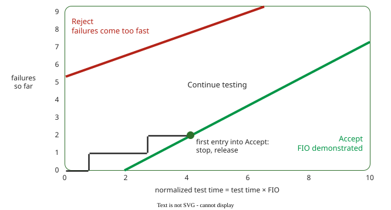

# SN L08: Software Reliability

The lecture runs: define failure, measure it, rank failures by severity, set a target (the FIO), reach it by removing faults (growth models) or tolerating them (recovery, voting), then keep it in operation (the SLO). The [revision questions](RQ_L08_Reliability.md) test this lecture.

## 1. A failure is the visible end of a fault–error–failure chain

**Software reliability** is the probability of failure-free operation for a specified time in a specified environment . Three terms form a chain :

- a **fault** is the cause of an error, such as a wrong condition in the code; it stays *dormant* until an input *activates* it;
- an **error** is a wrong part of the system state;
- a **failure** happens when the error reaches the user and the service deviates from correct service.

Only failures are visible. For example, a coupon is applied twice (fault), the total becomes 81.00 instead of 90.00 (error), and the customer is charged 81.00 (failure). A component's failure is its user's fault: errors cascade. Ariane 5 (1996), as two chains . Inside the inertial reference computer: unprotected 64-to-16-bit conversion in code reused from Ariane 4 (fault); Ariane 5's higher velocity (activation); overflow exception (error); the computer shuts down (failure). For the rocket, that shutdown is a fault; the flight computer reads diagnostic data as flight data (error); the rocket is destroyed (failure).

Musa's **error** is the programmer's *mistake*, Avizienis's the wrong *state*; these notes follow Avizienis .

Software faults are design faults, in every copy, and do not wear out. Hardware follows a bathtub curve (early failures, useful life, wear-out); software changes only with code or usage. So identical spare copies fail together: Ariane 5's backup computer ran the same code and shut down the same way.

→ [Dependability and the Fault Chain](../../attributes/reliability/dependability.md)

## 2. Failure intensity is the basic measure; reliability, MTTF and availability follow

**Failure intensity** λ counts failures per unit of time (any consistent unit) or *natural unit* (2 per 1,000 transactions): what users experience. **Failure density** counts failures per KLOC or function point: a property of the code. They can disagree. Constructed example:

| Module | Size | Faults | Faults per KLOC | Hours of use per year | Failures in use per year | Failures per 1,000 h of use |
|---|---|---|---|---|---|---|
| Checkout | 20 KLOC | 2 | 0.1 | 5,000 | 50 | 10 |
| Year-end report | 5 KLOC | 5 | 1.0 | 20 | 0 | 0 |

Density ranks the report worse; intensity, which users feel, ranks the checkout worse.

With no fault removal (growth models in §5 drop this) and stable usage, λ is constant and :

- **reliability** over time t: R(t) = e−λt;
- **mean time to failure**: MTTF = 1/λ;
- **mean time to repair** (MTTR): the mean downtime per failure, also written tm;
- **mean time between failures**: MTBF = MTTF + MTTR;
- **availability**, the share of uptime: A = MTTF / (MTTF + MTTR).

Example: 7 failures in 10,000 hours give λ = 0.0007 per hour, MTTF ≈ 1,429 hours, and R(10 h) = e−0.007 ≈ 0.993 . In a serial system (all components needed), intensities add.

→ [Reliability Measurement](../../attributes/reliability/measurement.md)

## 3. Severity classes decide which failures count

A **failure severity class** (FSC) is a set of failures with the same per-failure impact on users . Pick one criterion; four classes are usually enough:

- **cost** per failure, scaled by a factor of 10: class 1 over USD 100,000, class 2 USD 10,000–100,000, class 3 USD 1,000–10,000, class 4 under USD 1,000;
- **system capability**: 1 basic service interrupted, 2 basic service degraded, 3 inconvenience whose fix cannot wait, 4 minor effects whose fix can wait;
- **human life**: 1 possible loss of life, 2 severe harm to health, 3 minor harm, 4 minor recoverable deficiencies;
- **environment**: 1 severe unrecoverable damage, 2 severe but partly recoverable damage, 3 minor damage, 4 minor recoverable deficiencies.

Severity is not complexity, and it changes with timing: the same checkout timeout costs more at peak than at night. 

Example, a shop by cost per failure (one failure type, however many customers it hits; constructed estimates): payment taken but no order for all checkouts for 2 hours, about USD 150,000 (class 1); checkout times out for an hour at peak, about USD 30,000 (2); a campaign's promotion code rejected for a day, about USD 5,000 (3); a misplaced currency symbol, about USD 200 (4).

→ [Severity classes](../../attributes/reliability/fio.md)

## 4. The FIO turns a requirement into a failure intensity

The **failure intensity objective** (FIO) is the failure intensity to reach before release, "just right" reliability: 100% is the wrong target, since users cannot tell beyond some level and every extra nine costs features . Three routes:

- **From cost**, one FIO per class. C is the estimated cost of a typical failure of the class (of its most frequent type), not the class bound. Rule of thumb: FIO = 1/C per hour, which keeps the expected failure cost at about USD 1 per hour (a convention). The shop: 1/150,000 + 1/30,000 + 1/5,000 + 1/200 ≈ 0.0052 per hour as one system FIO, one failure every 190 hours. A worst class without an estimate falls back on the project cost: USD 1,000,000 gives 1 per 106 hours.
- **From reliability**, one system FIO. λ = −ln R / t. R = 0.992 over an 8-hour shift gives λ = −ln 0.992 / 8 = 0.001004 ≈ 0.001 per hour.
- **From availability**, one system FIO. Substituting MTTF = 1/λ into the availability formula gives A = 1/(1 + λtm), so λ = (1 − A) / (A × tm).

Then, in one common unit, subtract the acquired components (serial intensities add): developed software's FIO = system FIO − acquired components' intensities. Example: 0.01/h − hardware 0.002/h − operating system and database 0.002/h = 0.006/h.

Example (Musa's): 99% availability of a human-machine team; after each failure the machine is down for 1 minute and the operator needs 14 more minutes to recover; the service is down until both have recovered, so tm = 15 min = 0.25 h. λ = 0.01 / (0.99 × 0.25) ≈ 0.040 failures per hour, about 4 per 100 hours. The approximation (1 − A)/tm gives 0.04.

→ [Severity Classes and the FIO](../../attributes/reliability/fio.md)

## 5. Growth models tell you when to stop testing

A **reliability growth model** predicts from test failure data when λ reaches the FIO. Goel and Okumoto :

- expected failures by test time t: m(t) = a(1 − e−bt), where a is the expected total number of faults and b the detection rate per fault;
- failure intensity: λ(t) = ab·e−bt, falling over time;
- faults still to find: a·e−bt = λ(t)/b.

Each failure removes one fault. Solving FIO = λ(0)e−bt gives t = ln(λ(0)/FIO)/b. Example: a = 50, b = 0.05/week, FIO = 0.5/week: λ(0) = 2.5, t = ln 5 / 0.05 ≈ 32.2 weeks; by then m = 40 faults are found, 10 remain.

Recognise the model families by name : finite-failure (Goel–Okumoto, Musa's basic model), infinite-failure (Musa–Okumoto logarithmic Poisson) and S-shaped. All assume perfect fixes, tests that follow real usage and stable code; under continuous delivery, use an SLO and error budget (section 8).

For a frozen release, Musa's **demonstration chart** decides without a model : each failure steps the path up, failure-free testing moves it right along normalized time (test time × FIO); stop the first time it enters Accept (release) or Reject (rework). The exam gives the chart; you only read it.

_Illustrative boundaries._ Reading it: at normalized time 2.0 the path shows one failure, between the lines, so testing continues; at about 4.1, with two failures, it first touches Accept, and testing stops.

→ [Reliability Growth Models](../../attributes/reliability/growth-models.md)

## 6. Fault tolerance recovers by rolling back or by masking

Of the four means of dependability, **prevention** (keep faults out), **removal**, **forecasting** (estimate what remains) and **tolerance** , tolerance delivers correct service despite faults, using an error check and a recovery :

- **Backward recovery** restores a saved checkpoint and retries: general, but with unpredictable timing.
- **Forward recovery** continues using redundancy, e.g. a second sensor's reading: fast, but handles only anticipated errors.

Randell's **recovery block**, `ensure acceptance_test by primary else by alternate else fail`, checks the primary with an **acceptance test** and on failure rolls back and runs an alternate . Acceptance tests are cheap checks: a checksum; abs(y·y − x) < ε for a square root y of x; an overflow exception; a loop timer. A complete check can cost as much as the computation: a sort's output must be in order *and* a permutation of the input, and the second check costs almost as much as sorting.

Backward recovery suffers the **domino effect**: if P1 rolls back past a message it sent, the receiver P2 must roll back past its receipt, which can undo a message P2 sent to P1, forcing P1 further back .

**N-version programming** runs N independent versions in parallel; a **voter** picks the majority: forward recovery by masking.

→ [Fault Tolerance](../../attributes/reliability/fault-tolerance.md)

## 7. Redundant versions fail together more often than chance predicts

**Majority voting** needs m ≥ ⌈(N+1)/2⌉ agreeing versions (⌈x⌉ rounds up; this m is not the m(t) of §5); **2-of-N voting** accepts any two agreeing outputs (the same as majority for N = 3, not for N ≥ 4). If versions with reliability Rc fail **independently**, majority voting gives Rsys = Σi=m..N C(N,i) Rci(1 − Rc)N−i, where C(N,i) is the number of ways to choose which i of the N versions work. Examples: majority 2 of 3 with Rc = 0.95 gives 0.1354 + 0.8574 ≈ 0.993; 3 of 5 with Rc = 0.9 gives 0.073 + 0.328 + 0.590 = 0.991.

Independence rarely holds. Suppose in a 2-of-3 majority system an input makes all three versions fail together with probability 0.01, and on all other inputs each version fails on its own with probability 0.04 (so each still fails about 5% of the time: 0.01 + 0.99 × 0.04 ≈ 0.05). Then P(fail) = 0.01 + 0.99 × (3 × 0.04² × 0.96 + 0.04³) ≈ 0.0146, so R drops from 0.993 (independent case) to 0.985, and no voter can outvote the shared failures.

Knight and Leveson had students write 27 versions of one anti-missile program and ran one million random tests . Yet in 1,255 tests two or more versions failed on the same input, about ten times the 127 that independence predicts; independence was rejected at the 99% level. The causes were the same logical slips (forgetting that three collinear points can form an angle of 0), limited-precision arithmetic, and inputs hard for every algorithm . Diversity still helps, but less than the formula claims .

→ [Design Diversity and Voting](../../attributes/reliability/design-diversity.md)

## 8. The FIO lives on as the SLO

A service that changes daily cannot be certified once, so in Google's SRE practice the FIO became a **service level objective** (SLO) for a **service level indicator** (SLI), such as good requests / all requests . The **error budget** is 1 − SLO: ship while budget remains, freeze changes when it is gone.

Example: SLO 99.9% over 30 days, 3,000,000 requests. Budget: 3,000 failed requests, or 43.2 minutes of full outage. An incident failing 500 requests per hour for 2 hours uses 1,000, a third. The SRE Workbook's example policy: a postmortem for any incident using over 20% of the budget ; this one needs one. Assuming even traffic, a 10-minute outage loses 3,000,000 / 43,200 × 10 ≈ 694 requests. The **burn rate** = error rate over the alert window (say, one hour) / (1 − SLO): 1 spends the budget exactly in the window, 10 in a tenth of it. For the bad deployment, traffic is 3,000,000 / 720 h ≈ 4,167 requests per hour, so 500 failures per hour is an error rate of 500 / 4,167 ≈ 0.12 and a burn rate of 0.12 / 0.001 = 120. A full outage has error rate 1 and burn rate 1 / 0.001 = 1,000. An SLO of 100% leaves a zero budget: any failure freezes all changes.

**Chaos engineering** tests tolerance in production: Netflix sends 1% of users to a control cluster and 1% to a faulty one, compares stream starts per second (videos starting), and aborts if they differ too much .

→ [From FIO to SLO](../../attributes/reliability/slo-bridge.md)

## Where this goes next

Next lecture: performance, where SLOs again set the target.

---

### References



---

{: .highlight }
**Disclaimer:** AI is used for text summarization, polishing and explaining. Authors have verified all facts and claims. In case of an error, feel free to file an issue.
