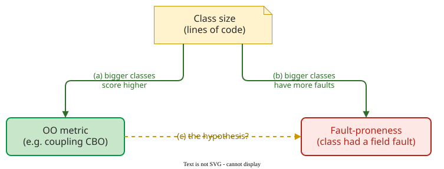

# Study Notes: Quality Measurement

The previous lecture described quality through models. This lecture asks how to put a number on quality, and when that number can be trusted. Roadmap: §1–2 what a measurement is; §3 how metrics mislead; §4–5 scales and reading data; §6 designing a metric; §7 code metrics on one function; §8 whether they predict faults. The [revision questions](RQ_L2_Metrics.md) test this lecture.

## 1. A metric is the bottom rung of a quality model

A metric turns one criterion of a quality model into a value a tool can compute. In McCall's model, the factor *maintainability* is refined into criteria such as *simplicity*, which a metric such as cyclomatic complexity per function measures . IEEE 1061 defines a quality metric as a function from software data to a single value read as the degree to which the software has a quality attribute .

→ [Measurement Definitions](../../define/measurement/definitions.md)

## 2. Measuring means reducing uncertainty, not being exact

Hubbard defines measurement as *"a quantitatively expressed reduction of uncertainty based on one or more observations"* . His argument that *everything is measurable* has three steps: if we care about something, it must be detectable; if it is detectable, we can observe more or less of it; and what we can observe in amounts, we can measure. Sarle defines measurement as assigning numbers to things so that relationships between the numbers reflect relationships in the attribute measured . That requirement is the **representation condition**: if module A is larger than B, its number must be larger too. Lines of code satisfy it for physical size, not for functionality, complexity or effort: one feature can take 50 lines or 500.

Every measurement names an **entity** (a module), an **attribute** (its size) and a **rule** (count non-blank lines) . Three properties describe a single measurement. **Accuracy** is closeness to the true value; **precision** is agreement between repeated measurements; **resolution** is the smallest difference the instrument shows: a log that truncates to whole seconds shows a 200 ms and an 800 ms request both as 0. For example, a timing script that adds 50 ms to every reading reports 250 ms for a 200 ms request, every run: precise, not accurate. A tool reporting complexity 10 where a hand count gives 12 may just use another counting rule: a difference of definition, not accuracy.

→ [Measurement Definitions](../../define/measurement/definitions.md)

## 3. Metrics mislead in three ways

**Bad statistics**: the number is misread. In 1995 British regulators warned that third-generation pills doubled the risk of thrombosis: about 1 in 7,000 women on the older pills against 2 in 7,000 on the newer ones, a relative increase of 100% but an absolute increase of 1 in 7,000 . Ask for the base. **Bad decisions**: the number answers a different question. The **McNamara fallacy** measures what is easy, ignores what is not, and assumes the unmeasured does not matter, which amounts to estimating its effect as zero . The **streetlight effect** picks metrics because a tool reports them, not because a question needs them. The fallacy concerns what you conclude; the streetlight effect, what you collect. **Bad incentives**: people move the number instead of the outcome. A mandated 80% coverage gate shows all three: a line-weighted 88% overall hides a payment module at 40% (bad statistics), coverage, which only records which lines ran, stands in for test quality (bad decision), and tests that run code without checking it are the cheapest way to raise it (bad incentive).

→ [Measurement Pitfalls](../../define/measurement/pitfalls.md)

## 4. The scale decides which arithmetic is allowed

Stevens defined four scales , and software measurement adds a fifth for counts :

| Scale | Adds | Meaningful summary | Software example |
|---|---|---|---|
| Nominal | labels | mode | defect type |
| Ordinal | order | median | severity 1–4 |
| Interval | equal steps | mean | date reported |
| Ratio | true zero | ratios, "twice as" | hours to fix |
| Absolute | counts of things; the unit cannot change | everything | number of open defects |

A statement is meaningful only if it survives every allowed change of unit: 20 °C is not "twice as warm" as 10 °C (68 and 50 °F). Dates are interval: the mean of 10 and 14 March is 12 March, but a defect reported on the 14th is not "twice as late". The mean of severities 1, 1, 2, 4, 4 is 2.4, which assumes equal steps between severities; the median, 2, does not.

Scale type is partly a judgement. Summing story points into velocity treats them as ratio data. In one company's data the median hours were 21, 52, 64, 100 and 111 for 1, 2, 3, 5 and 8 points . A ratio scale predicts 21 hours (the 1-point median) × points: 42, 63, 105 and 168. The data fit at 3 and 5 points, run 24% high at 2, and fall far short at 8: decide which scale you assume, and check it.

→ [Measurement Scales](../../define/measurement/types.md)

## 5. Software data are skewed and confounded by size

If nine bugs take 1 hour each and one takes 100 hours, the mean fix time is 10.9 hours and the median 1 hour: for skewed data, report the median and a high percentile. A **confounder** is a third variable that drives two others and makes them look related. In software it is usually size: large classes score high on most metrics and also have more faults.



**Controlling for size** means comparing classes of similar size, or testing whether size plus the metric predicts faults better than size alone. The **CK metrics** are six class-level metrics of Chidamber and Kemerer (§7), among them **CBO**, the number of other classes a class uses or is used by. In one C++ system no CK metric stayed associated with faults once size was controlled ; in another C++ system, 4 of 24 object-oriented metrics stayed associated with faults, and 2 of those, both coupling metrics, improved prediction .

→ [Reading Metric Data](../../define/measurement/statistics.md)

## 6. Start from the goal, then define the metric operationally

Basili's **Goal–Question–Metric** works top down: a goal (object, purpose, quality focus, viewpoint, context), questions that show whether it is met, and metrics answering each question . In the goal "analyse the checkout code (object) to improve (purpose) its maintainability (focus) from the developers' viewpoint, while new people join (context)", the question "which functions are hard to change?" is answered by complexity per function and by how often each needed fixing. An **operational definition** states exactly how each value is obtained, meeting Park's two criteria: **communication** (others know what was measured) and **repeatability** (others get the same value) . Before comparing 15 defects per thousand lines (KLOC) with 8, ask what counts as a defect, when, and what counts as a line.

→ [Developing Metrics with GQM](../../define/measurement/development.md)

## 7. Classic code metrics depend on their counting rules

One function serves as the running example; the `#` comments are annotations for these notes, not code that radon measures:

```python
def delivery_fee(weight_kg, express, country):   # LLOC 1
    if weight_kg <= 0:                           # decision 1;  LLOC 2
        raise ValueError(                        # LLOC 3 (two physical lines)
            "weight must be positive")

    fee = 5.0                                    # LLOC 4
    if weight_kg > 10:                           # decision 2;  LLOC 5
        fee += 2.0 * (weight_kg - 10)            # LLOC 6
    if express and country == "RU":              # decision 3, plus `and`;  LLOC 7
        fee *= 1.5                               # LLOC 8
    elif express:                                # decision 4;  LLOC 9
        fee *= 2.0                               # LLOC 10
    return round(fee, 2)                         # LLOC 11
```

**Lines of code** come in three counts: LOC (every physical line: 13), SLOC (without blank and comment lines: 12) and LLOC (one per statement: 11, as numbered).

**Cyclomatic complexity** is the number of linearly independent paths through a function's control-flow graph, with $$e$$ edges and $$n$$ nodes :

$$
V(G) = e - n + 2
$$

 Paths are **linearly independent** when each has an edge the others lack; a **basis set** of them builds every other path. Counted from the code, $$V(G)$$ is the number of decisions plus one.


The graph has four decisions, so $$V(G) = 14 - 11 + 2 = 5$$. Drawing `express and country == "RU"` as one node is a convention; radon counts the `and` too: it starts at 1 and adds 1 for each `if`, `elif`, `for`, `while`, `except`, `with`, `assert` and comprehension, and 1 for each Boolean operator (`and`, `or`); `else` adds nothing . So radon reports 6 for `delivery_fee`, letter B. The Software Engineering Institute (SEI) bands are 1–10 low risk, 11–20 moderate, 21–50 high, above 50 untestable ; `radon cc` uses other cut-offs: A (1–5), B (6–10), C (11–20), D (21–30), E (31–40), F (41+).

**Halstead's metrics** count distinct operators $$n_1$$ and operands $$n_2$$ and their occurrences $$N_1$$ and $$N_2$$ :

$$
n = n_1 + n_2, \qquad N = N_1 + N_2, \qquad V = N \log_2 n
$$

 Radon counts only arithmetic, augmented-assignment (`+=` as `+`, `*=` as `*`), comparison and Boolean operators; calls, `=`, `raise` and `return` are not counted. Each binary operator has two operands, its two sides, even when a side is itself an expression, and a unary one (`-x`, `not x`) has one; `in` and `is` count as comparisons, while attribute access, subscripts and call arguments are never operators: in `2.0 * (weight_kg - 10)` the operands of `*` are `2.0` and the whole `(weight_kg - 10)`. For `delivery_fee`:

| Operator | Uses | Its two operands, per use |
|---|---|---|
| `<=` | 1 | `weight_kg`, `0` |
| `>` | 1 | `weight_kg`, `10` |
| `-` | 1 | `weight_kg`, `10` |
| `+` (from `+=`) | 1 | `fee`, `2.0 * (weight_kg - 10)` |
| `*` (1 plain, 2 from `*=`) | 3 | `2.0`, `(weight_kg - 10)`; `fee`, `1.5`; `fee`, `2.0` |
| `and` | 1 | `express`, `country == "RU"` |
| `==` | 1 | `country`, `"RU"` |
| 7 distinct | *N₁* = 9 | *N₂* = 18 uses |

The 12 distinct operands are the nine names and literals in the table plus the three expressions `(weight_kg - 10)`, `2.0 * (weight_kg - 10)` and `country == "RU"`. So $$n = 19$$, $$N = 27$$ and $$V = 27 \log_2 19 \approx 114.7$$. In `radon hal` output, read *h1*, *h2*, *N1*, *N2* and *volume*. In `a + b + c`, `+` is used twice: on `a`, `b`, then on `(a + b)`, `c`.

The **Maintainability Index** combines the three , with Halstead volume $$V$$, cyclomatic complexity $$G$$, line count $$L$$ and the natural logarithm $$\ln$$:

$$
MI = \max\left(0,\ \left(171 - 5.2 \ln V - 0.23\,G - 16.2 \ln L\right) \cdot \frac{100}{171}\right)
$$

Radon uses its own $$G = 6$$ and the logical lines, $$L = 11$$:

$$
171 - 24.66 - 1.38 - 38.85 = 106.11, \qquad 106.11 \cdot \frac{100}{171} = 62.055
$$

which `radon mi -s` prints as 62.06. Radon scores MI **per file**, not per function: one Halstead volume over the whole file, $$G$$ = 1 + all decision points in the file, and the file's logical lines. A file with two functions of complexity 6 each therefore has $$G = 1 + 5 + 5 = 11$$, not 12. It also adds a comment term inside the bracket,

$$
+\,50 \sin\sqrt{2.46\, C_{\text{rad}}}, \qquad C = \frac{\text{comments} + \text{docstring lines}}{\text{SLOC}} \cdot 100, \qquad C_{\text{rad}} = C \cdot \frac{\pi}{180},
$$

treating the percentage as degrees. $$C$$ can exceed 100% when a file has more comment lines than code lines. This file has no comments, so the term is 0. Radon's MI ranks are A (20–100), B (10–19) and C (0–9), as Visual Studio's green, yellow and red , and separate from the complexity letters.

For classes, the **CK suite** has six metrics :

- **WMC**, weighted methods per class: the sum of the methods' complexities, or the number of methods when each counts 1.
- **DIT**, depth of inheritance tree: steps from the class up to the root. The handbook counts Python's `object` as the root at depth 0, so a class inheriting only from `object` has DIT 1.
- **NOC**, number of children: immediate subclasses.
- **CBO**, coupling between objects: other classes it uses or is used by.
- **RFC**, response for a class: its own methods plus the methods they call directly.
- **LCOM**, lack of cohesion: pairs of methods that use no attribute in common, minus pairs that share at least one, floored at 0.

Fixed thresholds for them usually come from value distributions in other systems and are rarely checked against faults .

→ [Size and Complexity Metrics](../../define/measurement/examples.md) · [Maintainability Index](../../define/measurement/maintainability-index.md) · [Object-Oriented Metrics](../../define/measurement/oo-metrics.md)

## 8. A high score is not a verdict

Before trusting a radon grade on your own code, ask whether such scores predict faults. A fault predictor flags classes. Count true positives (TP: flagged and faulty), false positives (FP: flagged but fine), false negatives (FN: faulty but not flagged) and true negatives (TN). Then **accuracy** = (TP + TN) / all; **precision** = TP / (TP + FP), undefined (0/0) when nothing is flagged; **recall** = TP / (TP + FN); and **F1** = 2 · precision · recall / (precision + recall). These are a classifier's accuracy and precision, not those of a single measurement in §2.

When faults are rare, accuracy flatters: flagging nothing is 99% accurate when 1% of classes are faulty, with recall 0. One study raised the accuracy of a CK-based fault predictor from 69.3% to 91.3% by adding inheritance metrics, while its F1 fell from 69.5% to 63.9% . The same metrics apply to code written by language models: GPT-4's solutions to 72 tasks passed more tests than human ones but had 61% higher average cyclomatic complexity .

→ [Do Code Metrics Predict Quality?](../../define/measurement/evidence.md)

## Where this goes next

Next: [Verification and Validation](SN_L03_Verification.md), then [Adequacy Criteria](SN_L04_Coverage.md), which measures tests with coverage. The linting lab runs `radon cc -s`, `radon hal` and `radon mi -s` on your own code; read the output with [Size and Complexity Metrics](../../define/measurement/examples.md) at hand.

---

### References



---

{: .highlight }
**Disclaimer:** AI is used for text summarization, polishing and explaining. Authors have verified all facts and claims. In case of an error, feel free to file an issue.
