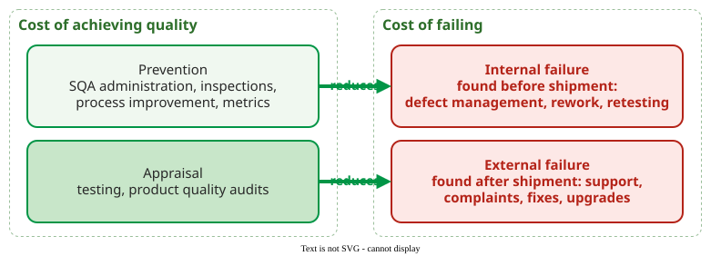

# Cost of Software Quality

The **cost of software quality (CoSQ)** is all the effort a project spends on achieving quality plus all it loses through poor quality, sorted into four categories so that managers can see where the money goes and decide where to invest .

## 1. Four categories

The model comes from manufacturing and was adapted to software by Knox and by Houston and Keats . Two categories are the **cost of achieving quality**, two are the **cost of failing**:

| Category | Definition | Typical software costs |
|---|---|---|
| Prevention | efforts to ensure product quality | SQA administration, inspections, process studies and improvement, metrics collection |
| Appraisal | discovering the condition of the product | testing and related activities, product quality audits |
| Internal failure | quality failures detected before shipment | defect management, rework, retesting |
| External failure | quality failures detected after shipment | technical support, complaint investigation, fixes and upgrades |

_The four CoSQ categories and their typical costs, after Houston and Keats' Table 1._ 

The categories separate activities that are easy to confuse. **Running a test** is appraisal: it discovers the condition of the product. **Debugging the failure** that the test exposes, fixing it and running the test again is internal failure: that effort is spent only because a defect exists. The same engineer may do both in one afternoon, but the second cost disappears if the defect is never made.

## 2. How large it is

In manufacturing, quality-related costs ran at 10 to 30 percent of sales, far more than accounting reports had shown . Houston and Keats report software CoSQ of 20 to 70 percent of development cost, roughly twice the manufacturing figure; organizations that had not yet started process improvement were at 60 percent and higher .

## 3. Maturity shifts the mix

Knox mapped the categories onto the five levels of the SEI Capability Maturity Model (CMM). His model predicts that total CoSQ falls by about two-thirds, from about 60 percent of development cost at Level 1 to about 20 percent at Level 5, as spending moves from failure to prevention . Houston and Keats compare the model with measured data: Raytheon's software organization cut its rework fourfold, from about half of development effort to under 10 percent, in a process improvement programme that began in 1988 .

## 4. Where is the optimum?

The **traditional** model assumes an optimum short of perfection: past some point, preventing and finding the last defects costs more than the failures they avoid. In manufacturing, that optimum lies at 95–100% conformance . Knox's **emerging** model argues that software has not reached it: investing in prevention shows no point of diminishing returns yet . Houston and Keats show how a better process **moves** the optimum. In a simulated 80,000-line project, adding inspections cut the lowest total CoSQ from 3,500 to 2,900 hours and moved it from 2.7 to 1.6 defects per thousand lines : the cheapest point now sat at a higher quality.

## Example: reading a CoSQ split

A team logs 1,000 hours in a release: 60 on code reviews and coding-standard training, 200 on writing and running tests, 150 on debugging and fixing test failures, and 90 on fixing defects that customers reported. Prevention is 60 hours, appraisal 200, internal failure 150 and external failure 90, so CoSQ is 500 hours, half of the release. Failure costs (240 hours) are four times prevention (60 hours): by Knox's reasoning, the next hour is best spent preventing the defects that tests and customers now find. _(Constructed example.)_

## When to use it, and when not

- **Use it** to make the case for prevention in management's terms, to compare releases, and to check whether a process change moved effort from failure to prevention.
- **Do not use it** as a precise accounting figure. Most teams do not record effort by category, so the first numbers are estimates; their value is the trend, not the decimal.

## Limitations

- **Category boundaries are judgements.** Houston and Keats list inspections under prevention, while many teams book reviews as appraisal. Pick one rule and keep it.
- **External failure is undercounted.** Lost customers and reputation rarely appear in any ledger.
- **The CMM figures are a model plus one company.** Knox's curve is theoretical, and Raytheon is a single, self-reported case.

## How solid is this?

- **Where it comes from.** The categories and the CMM model from Knox, the software ranges and the Raytheon data from Houston and Keats . At national scale, NIST estimated that an inadequate infrastructure for software testing cost the US economy USD 59.5 billion a year, about 0.6% of GDP; users bore about 60% of it through error avoidance and mitigation, and feasible improvements could save USD 22.2 billion . (The report's summary quotes the two figures as a range of USD 22.2 to 59.5 billion.)
- **What is contested.** The often-quoted "1:10:100" rule (a defect costs ten times more at each later phase) appears in none of the sources held for this page; treat it as a slogan. The effect of early removal is worked through on [Defect Injection and Removal](02-defect-injection-removal.md).
- **What we do not hold.** The manufacturing handbooks of Juran and Campanella are cited through Houston and Keats, not read directly.

Different stakeholders mean different things by "quality"; Garvin's five views are on [Views of Quality](../../define/foundations/views.md).

---

### References



---

{: .highlight }
**Disclaimer:** AI is used for text summarization, polishing and explaining. Authors have verified all facts and claims. In case of an error, feel free to file an issue.
