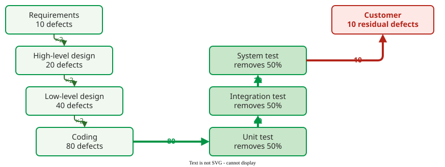

# Defect Injection and Removal

A **defect injection and removal model** follows defects through a project: each development phase adds defects, each verification activity removes a fraction of those present, and whatever is left reaches the customer . It lets a team compare improvement options on paper before paying for them.

## 1. Tank and pipes

Picture a tank. Pipes into it are the phases that create defects (requirements, design, coding); pipes out of it are the activities that remove them (reviews, inspections, tests); what stays in the tank at release are the **residual defects**, the source of external failure costs. Residual defects fall in only two ways: put less in (better methods, training) or take more out (reviews, inspections, tests). In CoSQ terms, putting less in is prevention; of the pipes out, tests are appraisal, while reviews and inspections are booked as prevention by this handbook's [booking convention](01-cosq-foundations.md#1-four-categories).



_The baseline flow of Miranda's example: 80 defects reach testing and 10 escape._ 

**How much goes in.** COQUALMO, the quality model of COCOMO II, uses nominal introduction rates of 10, 20 and 30 defects per thousand source lines for requirements, design and code, adjusted by quality drivers such as analyst capability and process maturity .

**How much comes out.** The fraction of present defects an activity removes is its **defect removal efficiency**. Knox collected typical values: formal inspections 65%, informal reviews 45%, unit testing 25–50%, system testing 25–50%, beta testing 25% .

## 2. The process signature

Plotting cumulative injected and removed defects by phase gives the project's **process signature**. In the baseline, nothing is removed until coding is finished, and each test removes half of what remains:

```vega-lite
{
  "$schema": "https://vega.github.io/schema/vega-lite/v5.json",
  "width": 440, "height": 200,
  "data": {"values": [
    {"p": "Req", "o": 1, "s": "Injected", "v": 10}, {"p": "HLD", "o": 2, "s": "Injected", "v": 20},
    {"p": "LLD", "o": 3, "s": "Injected", "v": 40}, {"p": "Code", "o": 4, "s": "Injected", "v": 80},
    {"p": "UT", "o": 5, "s": "Injected", "v": 80}, {"p": "IT", "o": 6, "s": "Injected", "v": 80},
    {"p": "ST", "o": 7, "s": "Injected", "v": 80},
    {"p": "Req", "o": 1, "s": "Removed", "v": 0}, {"p": "HLD", "o": 2, "s": "Removed", "v": 0},
    {"p": "LLD", "o": 3, "s": "Removed", "v": 0}, {"p": "Code", "o": 4, "s": "Removed", "v": 0},
    {"p": "UT", "o": 5, "s": "Removed", "v": 40}, {"p": "IT", "o": 6, "s": "Removed", "v": 60},
    {"p": "ST", "o": 7, "s": "Removed", "v": 70}]},
  "mark": {"type": "line", "point": {"filled": true, "size": 70}, "strokeWidth": 3},
  "encoding": {
    "x": {"field": "p", "type": "ordinal", "sort": {"field": "o"}, "title": "Phase", "axis": {"labelAngle": 0}},
    "y": {"field": "v", "type": "quantitative", "title": "Cumulative defects"},
    "color": {"field": "s", "type": "nominal", "scale": {"domain": ["Injected", "Removed"], "range": ["#b42318", "#019546"]}, "title": null},
    "shape": {"field": "s", "type": "nominal", "scale": {"domain": ["Injected", "Removed"], "range": ["triangle-up", "circle"]}, "title": null}},
  "config": {"font": "Tahoma, sans-serif", "axis": {"labelFontSize": 13, "titleFontSize": 13}, "legend": {"labelFontSize": 13}, "view": {"stroke": null}}
}
```

_Baseline process signature: the gap at the last phase, 10 defects, ships to the customer._ 

## 3. Worked example: two ways to ship fewer defects

Miranda's example assumes that every development phase **doubles** the defects it receives (10, 20, 40, 80): a requirements defect leads to wrong design, and wrong design to wrong code . Testing removes 50% at each of three levels, so 80 × 0.5³ = 10 defects ship. Two improvements are compared:

| Phase | Baseline | 1: unit testing 50% → 70% | 2: 20% inspections after requirements, high-level design and code |
|---|---:|---:|---:|
| after requirements | 10 | 10 | 10 × 0.8 = 8 |
| after high-level design | 20 | 20 | 16 × 0.8 = 12.8 |
| after low-level design | 40 | 40 | 25.6 |
| after code | 80 | 80 | 51.2 × 0.8 = 40.96 |
| after unit test | 40 | 24 | 20.48 |
| after integration test | 20 | 12 | 10.24 |
| shipped | **10** | **6** | **5.12** |

Both options cut the shipped defects roughly in half. They differ in **where** the work happens. Option 1 removes 74 defects, all in testing. Option 2's inspections remove 2 + 3.2 + 10.24 = 15.44 defects early, and because each removed defect no longer doubles, only 56.4 defects are ever created instead of 80; testing then has 35.84 to remove instead of 70. Which option is cheaper depends on what an inspection hour and a test-and-fix hour cost in your organization, and on how likely each improvement is to deliver its assumed efficiency .

## Where the inputs come from

Removal counts per activity come from the bug tracker's *where found* field; injection counts need an *origin* field on each defect (see [Defect Origin and Detection](03-defect-classification.md)) and a size measure, such as thousands of lines counted with `cloc`, to turn counts into rates. Until a team has a few releases of its own data, the published rates above are its only option, and they are rough.

## When to use it, and when not

- **Use it** to compare process changes, to set removal targets per activity, and to explain to managers why late testing alone cannot reach a low residual count.
- **Do not trust** its output as a forecast without your own injection and removal data; the result is only as good as the rates you feed in.

## Limitations

- **The rates are rough.** When COQUALMO was fitted to space flight software projects, the nominal rates looked high; the modelled curves needed 0.5 to 6.1 defects per thousand lines to match the data .
- **The doubling assumption drives the result.** Without it, early inspections help much less; check whether defects in your project really cascade.

## How solid is this?

- **Where it comes from.** The tank model, the example and its doubling assumption from Miranda's course notes; the rates from COQUALMO and Knox .
- **What is contested.** Removal efficiencies vary widely between studies and teams; Knox gives ranges, not constants.
- **What we do not hold.** Capers Jones' defect-potential tables are cited in the lecture but not held for this page.

---

### References



---

{: .highlight }
**Disclaimer:** AI is used for text summarization, polishing and explaining. Authors have verified all facts and claims. In case of an error, feel free to file an issue.
