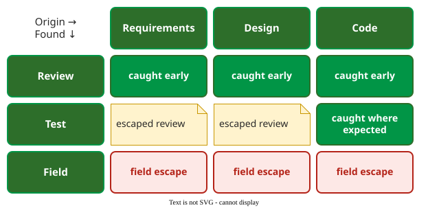

# Defect Origin and Detection

The **origin / where-found matrix** classifies every defect by two attributes, the phase that introduced it and the activity that found it, and from those counts computes how well each verification activity removes the defects present when it runs . It is the minimum classification that makes a cost-of-quality analysis actionable.

## 1. The two attributes

- **Origin**: where the defect was introduced (requirements, high-level design, low-level design, code, or a bad fix during testing).
- **Where found**: the activity that detected it (an inspection, a test level, or the field).

Cross-tabulating them shows **escapes**: a defect found far later than it was made passed through every activity in between, and each phase it slipped through raises the cost of its fix.

_Reading the matrix: review finds are cheap, earlier-phase defects found in test escaped a review, and field finds cost most._ 

## 2. Example: Kan's project data

Kan's example project recorded 3,465 defects. The counts below are the matrix's margins, as reproduced in Miranda's notes :

| Origin | Defects | | Where found | Defects |
|---|---:|---|---|---:|
| Requirements | 122 | | High-level design inspection | 730 |
| High-level design | 859 | | Low-level design inspection | 729 |
| Low-level design | 939 | | Code inspection | 1,095 |
| Code | 1,537 | | Unit test | 332 |
| Bad fixes during testing | 8 | | Integration test | 387 |
| | | | System test | 111 |
| | | | Field | 81 |
| **Total** | **3,465** | | **Total** | **3,465** |

The diagonal shows most defects caught where they were made: 681 of the 859 high-level design defects in the design inspection, 941 of the 1,537 code defects in the code inspection .

## 3. Defect removal efficiency per activity

The **defect removal efficiency (DRE)** of an activity is the share of the defects present when it runs that it finds. Defects present = defects introduced so far minus defects already found . For the low-level design inspection:

DRE = 729 / ((122 + 859 + 939) − 730) = 729 / 1,190 = 61.3%

For the tests, count the 8 bad fixes in when they were made. The margins above do not show this; the split comes from the bad-fix columns of Kan's full matrix (column totals): 2 made during unit test, 4 during integration test, 1 during system test, and 1 in a column the matrix labels "field", a fix made after system test that only the field could find. Unit test then sees 3,457 − 2,554 + 2 = 905, integration test 905 − 332 + 4 = 577 and system test 577 − 387 + 1 = 191. The same rule gives every activity:

| Activity | Present | Found | DRE |
|---|---:|---:|---:|
| High-level design inspection | 981 | 730 | 74.4% |
| Low-level design inspection | 1,190 | 729 | 61.3% |
| Code inspection | 1,998 | 1,095 | 54.8% |
| Unit test | 905 | 332 | 36.7% |
| Integration test | 577 | 387 | 67.1% |
| System test | 191 | 111 | 58.1% |

The **overall DRE** before release is (3,465 − 81) / 3,465 = 97.7%: only 81 defects reached the field. In this project the inspections, not the tests, carried most of the load; unit testing removed barely a third of what reached it.

## When to use it, and when not

- **Use it** whenever defects are logged: two extra fields per defect report (origin and where found) are enough to compute every DRE above. In an iterative project, the rows and columns become the team's own activities, for example story refinement, pull-request review, continuous-integration tests and production.
- **Do not use it** to blame phases or people; origin is often a judgement made long after the fact.

## Limitations

- **Origin is assigned by people,** usually the developer who fixed the defect, and is often uncertain.
- **The field count is never final.** DRE before release looks better the earlier you compute it, because field defects keep arriving.
- **Counts are not costs.** A field defect may cost many times an inspection find; weight the counts before deciding where to invest ([Defect Classification Schemes](04-classification-schemes.md) shows one weighting).

## How solid is this?

- **Where it comes from.** The matrix and the DRE formula from Kan's book, the project data as reproduced in Miranda's notes .
- **What is contested.** Miranda's reproduction leaves out a few small cells, so some inner rows do not add up to their totals; the margins used here do add up, to 3,465 both ways.
- **What we do not hold.** Kan's book itself; the figures come through the course notes.

---

### References



---

{: .highlight }
**Disclaimer:** AI is used for text summarization, polishing and explaining. Authors have verified all facts and claims. In case of an error, feel free to file an issue.
