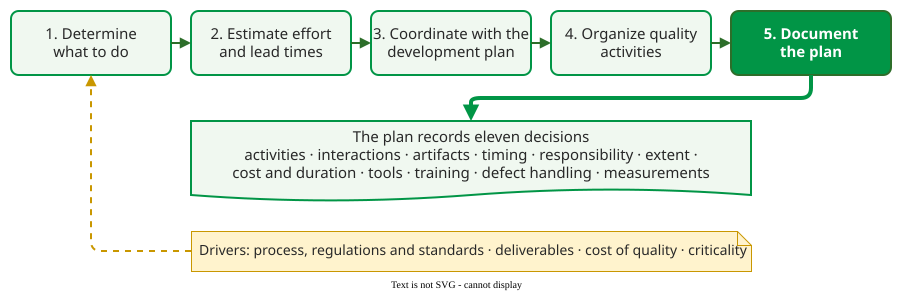

# The Quality Plan

A **quality plan** is a set of documented decisions about quality for one project: which assurance, control and improvement activities will be done, to which work products, when, by whom, to what extent, at what cost, with which tools and training, how defects are handled and what is measured . It exists because, in most projects, quality is otherwise an afterthought: the more development and quality roles are combined, the more the plan must build in checks so that quality work is "not easily tossed aside as deadlines loom" .

## 1. Where the plan sits in quality management

Quality management has four parts :

| Part | What it does |
|---|---|
| Quality planning | identifies the assurance, control and improvement activities, tools and training, and organizes their execution |
| Quality assurance | activities that give confidence a work product **will** meet its quality requirements: is there a defect process, are entry and exit criteria met, are metrics collected |
| Quality control | activities that verify a work product **is** of the required quality, and report deficiencies |
| Quality improvement | making the processes more effective and efficient |

The plan is the output of the first part and the script for the other three.

## 2. The planning process and its eleven decisions

Planning runs in five steps: determine what to do, estimate effort and lead times, coordinate with the development plan, organize the quality activities, and document the plan .

_The quality planning process and the decisions the plan records._ 

The documented plan answers eleven decisions :

1. the assurance, control and improvement **activities** to conduct;
2. their **interactions** with each other and with development;
3. the **artifacts** they apply to;
4. **when** they happen;
5. **by whom**;
6. to what **extent**;
7. their **cost and duration**, up-front and recurring;
8. the **tools** required;
9. the **training** required;
10. how **defects** are handled;
11. the **measurements** that make the process visible.

Four things **drive** the answers: the process, regulations and standards that apply; the deliverables, seen by users (requirements, features, quality attributes) and by producers (modules, builds, documents); the [cost of quality](../01-coq/01-cosq-foundations.md); and the **criticality** of each part, covered on [Criticality and Quality Gates](03-quality-gates-criticality.md) .

## Example: a plan in eleven lines

A four-person team builds a booking web application. Its plan: (1) code review, unit and API tests, static analysis, and a retrospective on escaped defects after each release; (2) review blocks merging; (3) all production code and the API specification; (4) on every pull request, plus a test pass before each release; (5) developers write unit tests, a designated tester owns API tests; (6) 70% line coverage on new code; (7) about 20% of sprint capacity; (8) pytest, a linter, the CI service; (9) one session on writing API tests; (10) every defect logged with severity and origin, severity-1 defects fixed before release; (11) coverage, open defects by severity, escaped defects per release. _(Constructed example.)_

## 3. "We are agile, so we need no quality assurance"

Agile methods assign process checking to roles such as the Scrum Master or the XP coach; they do not remove it . Koopman argues that agile practice is often too light on quality assurance because it trusts developers by design, and "without an external check and balance it is all too easy to have a process failure". He proposes three questions for any team :

1. Show me the written process you are following.
2. How can an external person tell whether you are actually following it?
3. How can an external person tell that the process produces the quality you want?

## When to use it, and when not

- **Write a plan** for any project where quality work competes with feature work for the same people, which is nearly every project.
- **Keep it short** when the team is small; a page that answers the eleven decisions beats a template nobody reads.

## Limitations

- **A plan is not execution.** Its value shows only when its gates are enforced and its measures reported.
- **Early decisions are guesses.** At the start, the team does not yet know which modules will be critical; criteria that can be applied later avoid planning paralysis.

## How solid is this?

- **Where it comes from.** The definition, decisions and process from Miranda's course notes; the agile critique from Koopman .
- **What is contested.** How much assurance an agile team needs; Koopman's view is one practitioner's critique, not a measured result.
- **What we do not hold.** An empirical study of how often quality plans are followed.

---

### References



---

{: .highlight }
**Disclaimer:** AI is used for text summarization, polishing and explaining. Authors have verified all facts and claims. In case of an error, feel free to file an issue.
