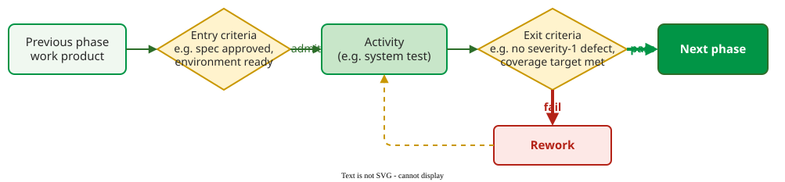

# Criticality and Quality Gates

A **quality gate** is a predefined checkpoint in the life cycle where a work product must meet stated criteria before it may move on: **entry criteria** say when an activity may start, **exit criteria** when it is finished . How strict a gate is should depend on the **criticality** of what passes through it: the harm a failure does to users and the producer's cost of recovering .

_A quality gate as entry and exit criteria around an activity._ 

## 1. Criticality levels from two standards

Regulated domains tie verification effort to criticality levels. Avionics software is classed by the failure condition it could cause :

| DO-178B level | Failure condition | Structural coverage objective |
|---|---|---|
| A | catastrophic | modified condition/decision coverage (MC/DC) |
| B | hazardous or severe | decision coverage |
| C | major | statement coverage |
| D | minor | none required |
| E | no safety effect | none required |

IEEE Std 829-2008 uses four **integrity levels**, 4 catastrophic, 3 critical, 2 marginal, 1 negligible, and scales documentation with them: a master test plan only at levels 4 and 3, and at level 1 level documents only for integration and system testing . [Coverage criteria](../../verif/coverage/index.md) are explained in the verification section.

## 2. Gates by criticality

Early on, nobody knows which modules will be critical, so Miranda writes **unequivocal criteria per criticality class** now and assigns modules later, avoiding planning paralysis . His example uses three classes, labelled A to C in rising criticality (not the DO-178B letters):

| Condition | Class A | Class B | Class C |
|---|---|---|---|
| Coverage | statement | branch | basis paths |
| Code inspections | no | yes | yes |
| Coding standards | yes | yes | yes |
| Combinatorial testing strength | all pairs | all triples | all quadruples |
| Robustness testing | data-input modules only | data-input modules only | all modules |
| Cyclomatic complexity | below 20 | below 20 | below 15 |

_Miranda's example of quality gates by criticality class._ 

Miranda gives no rule for assigning a module to a class; his notes rate harm on IEEE 829's four consequence levels . This handbook assigns a module by its worst plausible failure (our judgement; draw the lines elsewhere if you write them down first):

| Harm | IEEE 829 consequence | Class |
|---|---|---|
| Negligible | minor injury, minor performance impact, operator inconvenience | A |
| Marginal | moderate injury, moderate financial or social loss | A |
| Critical | major permanent injury, partial mission loss, major loss | B |
| Catastrophic | loss of life, mission, safety or security | C |

**Class table and effort table.** Miranda's effort table on [Estimating Test Effort](04-test-effort-estimation.md) sizes the work, used as printed; this one sets what a gate requires. They come from different parts of his notes and are not combined: if a gate asks more than the estimate assumed, record it as an estimation risk. Its criticality labels map, by our judgement, as non-critical = negligible or marginal, critical = critical or catastrophic, uncertain = not yet rated.

## 3. Writing a gate criterion

Uzunova et al. recommend documenting each criterion with four parts: the **metric**, the **desired value**, the **predicate** that compares them, and the **object** of measurement. Their example: cyclomatic complexity, below 10, for any single method, measured by a static analysis tool; a failing method triggers review and refactoring. Tools such as SonarQube enforce such criteria and block a failing build .

## 4. Severity levels for a bug bar

A **bug bar** is an exit criterion on open bugs, stated per severity. Microsoft defines severity 1 as a crash, data loss or a main feature unusable, and a severity-1 bug always blocks release . The lower levels are a course convention:

| Severity | Meaning | Typical bar at release |
|---|---|---|
| 1 | crash, data loss, or a main feature unusable | none open |
| 2 | a main feature broken or degraded, but a workaround exists | a few, each with an owner |
| 3 | minor or cosmetic; no feature lost | may ship, fix planned |

## Example: phasing a gate over milestones

Microsoft raised its code-coverage gate over a product's milestones, 65% at the second milestone, 75% at the third and 80% at release . Phasing implements "good enough" quality within scope, time and cost .

## When to use it, and when not

- **Use gates** at every hand-over (merge, integration, release), each criterion written with all four parts.
- **Do not copy** another domain's levels; a web application is not avionics.

## Limitations

- **A gate measures what it measures.** 80% coverage can be reached with weak tests; pair coverage criteria with reviews.
- **Gates invite gaming** when passing them is rewarded.

## How solid is this?

- **Where it comes from.** Gates from Uzunova et al.; levels from Miranda, RTCA and IEEE 829; the class table from Miranda; milestones from Page et al. .
- **What is contested.** Miranda's thresholds are one teacher's example, not a standard.
- **What we do not hold.** The DO-178B text itself; the coverage objectives are taken from its widely documented Table A-7.

---

### References



---

{: .highlight }
**Disclaimer:** AI is used for text summarization, polishing and explaining. Authors have verified all facts and claims. In case of an error, feel free to file an issue.
