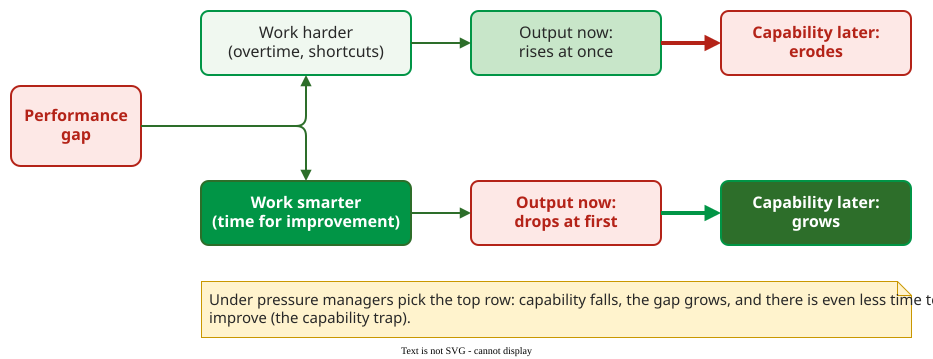

# Change Management

**Change management** in process improvement is the work of getting an organization to adopt a new practice and keep it after the initial enthusiasm fades. Most improvement programs fail here, not in their technical content .

## 1. The one-eighth rule

Jeffrey Pfeffer explains why practices with clear evidence behind them are adopted so rarely: three filters each let through about half of the organizations .

| Filter | Organizations still in |
|---|---|
| Believe that management practices affect business results | 1/2 |
| Of those, try systemic change rather than an isolated fix | 1/2 × 1/2 = 1/4 |
| Of those, persist long enough to see results | 1/4 × 1/2 = **1/8 (12.5%)** |

Each filter suggests its own countermeasure: show evidence from the organization's own data (belief), change structure and incentives together with the practice (systemic change), and protect the program through the first months of lower performance (persistence), the subject of the next section.

## 2. Worse before better

Repenning and Sterman studied improvement programs in a dozen companies and modeled the dynamics . When performance falls short, a manager can push people to **work harder** (overtime, shortcuts), which helps at once, or let them **work smarter** (time for improvement), which first lowers output because that time is taken from production.

_The two responses to a performance gap, redrawn from Repenning and Sterman's causal-loop model (schematic, no data)._ 

Under pressure, managers choose work harder; capability then erodes, problems grow, pressure rises and there is even less time to improve. This is the **capability trap**. It is reinforced by a **self-confirming attribution error**: because pressure does produce a short-term gain, managers conclude that the problem was effort, not the system.

**Example.** At BP's Lima refinery, an improvement program that weathered the early dip raised pumps' mean time between failures from 12 to 58 months; one USD 5,000 fix ended a butane flare-off that cost USD 1.5 million a year, and the program created about USD 43 million a year of value at a cost of about USD 320,000 a year . The authors' title states the difficulty: nobody gets credit for fixing problems that never happened.

## 3. Two levels of change

Andrews and Stalick distinguish two levels that must both change :

- **Operational changes** alter structure, process steps, technology and rewards. They are visible and comparatively easy.
- **Cultural changes** alter mental models, power structures and whether dissent is tolerated, in the lecture's phrase "the rules you have to follow to have a fast-track career". They decide whether the operational changes last.

A team that buys a code-review tool and writes a review policy (operational) while managers still reward the developer who ships fastest (cultural) will see reviews rubber-stamped.

## 4. What predicts success

Surveys of Six Sigma, Lean Six Sigma and ITIL adoption all rank **management commitment** first, followed by culture, training and communication . In a study of CMMI Level 3 adoption in Bangalore, 42% of interview responses named employee resistance as a major challenge, 29% the tension between standard processes and business needs, and 25% insufficient training . Repenning and Sterman's recommendations follow from their model: change mental models from blaming people to examining the system, protect improvement time, let staff experience the dynamics in simulations, and let early champions spread the change.

## When to use this — and when not

Plan for these dynamics whenever an improvement takes people's time before it pays back, which is nearly always. A purely technical change with no effect on how people work (an upgrade of a library, say) does not need this machinery.

## Limitations

- **The one-eighth rule is a rule of thumb,** three halvings, not a measured adoption rate.
- **Success-factor rankings are perceptions** from practitioner surveys, and the CMMI study had 24 participants .

## How solid is this?

- **Where it comes from.** Repenning and Sterman's case studies and system-dynamics model; Pfeffer's and Andrews and Stalick's books as used in the lecture; success-factor surveys .
- **What is contested.** Whether the dip is unavoidable or a sign of a badly run program; the model shows it follows whenever improvement time comes from production time.
- **What we do not hold.** Pfeffer's and Andrews and Stalick's books.

---

### References



---

{: .highlight }
**Disclaimer:** AI is used for text summarization, polishing and explaining. Authors have verified all facts and claims. In case of an error, feel free to file an issue.
