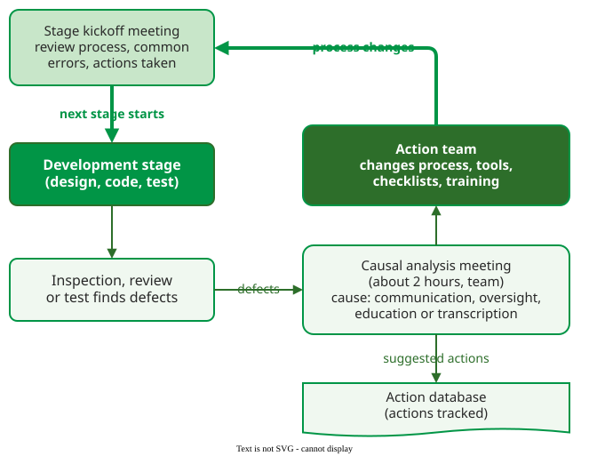

# Defect Prevention Process

The **Defect Prevention Process (DPP)** is IBM's method for removing the causes of defects rather than only the defects: after each development stage the team analyzes the defects it found, names their root causes, and an action team changes the process so that the same kind of defect is not made again . It began at IBM's Communications Programming Laboratory in 1983 and was used in more than 25 IBM organizations by 1990.

## 1. Four elements

DPP adds four elements to an existing development process :

1. **Causal analysis meeting.** After the defects found in a stage (by inspection, review or test) are corrected, the developers meet, usually for two hours, led by a trained causal-analysis leader from the team. For each defect they ask: was the cause *communication* (the developer did not get the information, or got it wrong), *oversight* (a case or condition was not considered), *education* (some aspect of the product or process was not understood) or *transcription* (the developer knew what to do and simply slipped, as in a typo)? How and in which stage was the error made? How can it be prevented, and how can similar defects elsewhere be found?
2. **Action team.** A small group with the skills and authority to change the process implements the proposed actions: a new checklist item, a tool, training, a template.
3. **Stage kickoff meeting.** At the start of each stage the technical lead reviews the process, the common errors and the actions taken, so the next team starts with the lessons.
4. **Data collection and tracking.** Defects, causes and the status of every action are kept in a database, so that actions are not forgotten.

_The DPP feedback loop, redrawn from Mays et al._ 

The meeting is held by the people who made the errors, which is the point: they know how the error happened, and the analysis is about the process, not about blame.

## 2. Example and results

The actions IBM's teams took were small and concrete: a new item on the common-error list or an inspection checklist, a new check in the module-checker tool, a tool to trace how a program used its save areas, a new procedure for fixing errors found in test, or a technical class. The action team was small too: three or four part-time members for an organization of 20 to 50 people, eight to ten for 200 to 250, and an action was not closed until the developers had been told it was done .

The reported results for one product line were a **54% reduction in defects** during development compared with its history, and field defects **60% below** the rate of the eight previous releases. The cost was small: a product area of 150 to 200 people could expect to spend less than one person-year per year on DPP, about **0.5% of its resources** .

## Where the inputs come from

The meeting needs, for each defect, its description, where it was found and the fix (the commit or pull request linked to the ticket); it adds the cause category and the stage the error was made in. In a modern tracker these are fields on the defect ticket, and the action database can be a board column or label for actions, so open actions stay visible.

## When to use it — and when not

Use DPP when the same kinds of defects recur and the team has a defect record to analyze. It needs a team willing to discuss its own errors openly, and an action team with real authority; without the second, causal analysis produces lists that nobody acts on. Do not run it on every defect in a large backlog: IBM's teams analyzed a sample, at times only about a third of the defects.

## Limitations

- **The results are IBM's own reports.** They compare a product with its own history, not with a control group, and other factors (new tools, staff) may have contributed; the authors discuss this.
- **It depends on psychological safety.** Where errors are punished, developers will not explain how they made them.
- **Actions decay.** A checklist item that is never checked is not prevention; the tracking database exists to catch this.

## How solid is this?

- **Where it comes from.** Mays and colleagues' account of six years of DPP at IBM .
- **What is contested.** How far a 1980s process with meetings per stage transfers to teams that release daily; the [retrospective](../05-practice/03-agile-retrospectives.md) is the lighter modern form of the same idea.
- **What we do not hold.** Independent replications of the 54% and 60% figures.

---

### References



---

{: .highlight }
**Disclaimer:** AI is used for text summarization, polishing and explaining. Authors have verified all facts and claims. In case of an error, feel free to file an issue.
