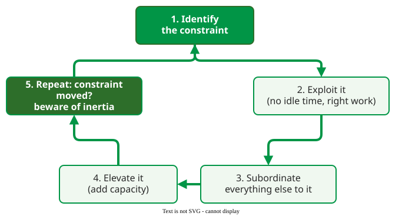

# Theory of Constraints

The **Theory of Constraints (TOC)** is Eliyahu Goldratt's management approach built on one claim: every system has at least one constraint, the step or rule that limits its output, and improving anything other than the constraint does not improve the system . "Otherwise," the argument goes, "a profit-making company would produce unlimited results."

## 1. The five focusing steps

TOC improves a system by repeating five steps :

1. **Identify** the constraint: the physical resource or the policy that limits throughput.
2. **Exploit** it: make sure the constraint never waits and never works on the wrong thing, before spending money.
3. **Subordinate** everything else to it: the other steps work at the constraint's pace, even if they stand idle part of the time.
4. **Elevate** it: if it still limits the system, add capacity to it.
5. **Repeat:** once the constraint moves elsewhere, go back to step 1, and do not let inertia (an old rule kept after its reason has gone) become the new constraint.

_The five focusing steps, redrawn from Rahman's review of TOC._ 

Production planning under TOC uses **drum–buffer–rope**: the constraint is the drum that sets the pace, a buffer of work in front of it keeps it from starving, and the rope releases new work only as fast as the drum can take it.

## 2. Worked example

A team's changes pass through three steps. Per week it can write 12 changes, review 6 (six reviewers, one change each a week) and test 10 (a constructed example).

| Step | Capacity (changes/week) |
|---|---|
| Coding | 12 |
| Review | 6 |
| Testing | 10 |
| **Whole system** | **6**, the minimum |

1. **Identify:** review, at 6 per week. Adding testers or coders changes nothing: the system still delivers 6.
2. **Exploit:** reviewers stop spending time on formatting comments that a linter could catch; if that frees a fifth of their time, review rises to 6 / 0.8 = 7.5 (1.25 per reviewer).
3. **Subordinate:** coders start no more changes than review can take, so the queue in front of review stays short instead of growing by 4.5 a week (12 written, 7.5 reviewed after step 2).
4. **Elevate:** if six reviewers now manage 1.25 changes a week each, training two more adds 2.5, raising review to 10.
5. **Repeat:** coding (12), review (10) and testing (10) now give a system output of 10, and testing has become a constraint too; start again at step 1.

## When to use it — and when not

Use TOC when work flows through stages and one of them visibly has the longest queue: code review, a shared test environment, a release approval. It fits less well when the problem is quality rather than flow, or when the "constraint" is a rule (for example a weekly release window) that needs a policy change rather than capacity.

## Limitations

- **The constraint can be hard to see.** Queues show it in a pipeline; in knowledge work a policy constraint ("only the architect approves designs") is easy to mistake for a capacity one.
- **Local efficiency suffers on purpose.** Subordination leaves non-constraint people idle at times, which managers measured on utilization dislike.
- **Evidence in software is thin.** The TOC literature is mostly from manufacturing and services .

## How solid is this?

- **Where it comes from.** Goldratt's novel *The Goal* (1984), Rahman's review of the TOC literature, and Şimşit and colleagues' history of TOC through five eras, from production scheduling to Critical Chain project management .
- **What is contested.** Rahman notes that the original scheduling algorithms (OPT) were never fully published, and that TOC's Thinking Processes are rarely used in practice .

---

### References



---

{: .highlight }
**Disclaimer:** AI is used for text summarization, polishing and explaining. Authors have verified all facts and claims. In case of an error, feel free to file an issue.
