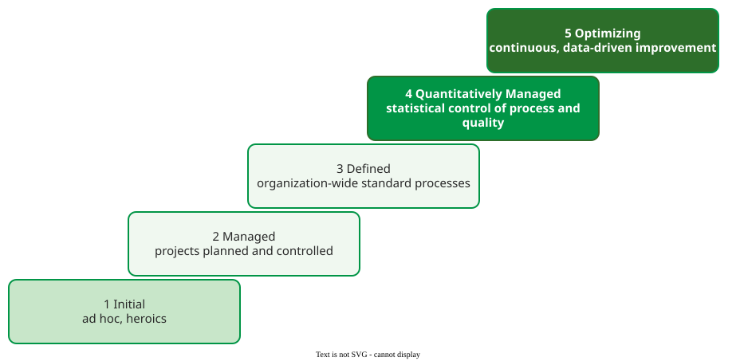

# CMMI Overview

**Capability Maturity Model Integration (CMMI)** is a process-improvement framework from the Software Engineering Institute (SEI) that describes *what* an organization's development processes should achieve, grouped into process areas and ordered into five maturity levels; it does not prescribe *how* . It descends from Humphrey's Capability Maturity Model and is the most studied approach in the SPI literature: 170 of 769 SPI publications in one mapping study deal with it .

## 1. Structure

CMMI for Development, version 1.3, has 22 **process areas (PAs)**, each a cluster of related practices :

- **Specific goals and specific practices** belong to one PA; for Project Planning, for example, establishing estimates and developing a plan.
- **Generic goals and generic practices** apply to every PA. They *institutionalize* a process (policy, resources, training, responsibility, measurement) so it survives deadlines and staff changes: generic goal 2 for a *managed* process, generic goal 3 for a *defined* one.

CMMI can be used in two **representations**. The **staged** representation rates the whole organization at a maturity level (1–5) by the PAs it satisfies; the **continuous** representation rates each PA separately at a capability level (0–3), so an organization can improve, say, configuration management alone.

## 2. Five maturity levels

_The five maturity levels of the staged representation, redrawn from CMMI-DEV v1.3._ 

| Level | Name | What it means | Process areas added |
|---|---|---|---|
| 1 | Initial | ad hoc; success depends on individual heroics | none |
| 2 | Managed | each project plans, tracks and controls its work; the discipline holds under stress | REQM, PP, PMC, SAM, MA, PPQA, CM (7) |
| 3 | Defined | the organization has standard processes, tailored per project | RD, TS, PI, VER, VAL, OPF, OPD, OT, IPM, RSKM, DAR (11) |
| 4 | Quantitatively Managed | quality and process performance are managed with statistical data | OPP, QPM (2) |
| 5 | Optimizing | improvement is continuous, based on quantitative understanding of variation | OPM, CAR (2) |

The counts add to 7 + 11 + 2 + 2 = 22. Each level includes all lower ones, so Level 3 means 18 PAs.

Each PA also belongs to one of four **categories**, independently of its level: Process Management (OPF, OPD, OT, OPP, OPM), Project Management (PP, PMC, SAM, IPM, RSKM, QPM, REQM), Engineering (RD, TS, PI, VER, VAL) and Support (CM, PPQA, MA, DAR, CAR). Configuration Management, for example, is a Level 2 PA in the Support category.

| Abbr. | Process area | Abbr. | Process area |
|---|---|---|---|
| REQM | Requirements Management | OPF | Organizational Process Focus |
| PP | Project Planning | OPD | Organizational Process Definition |
| PMC | Project Monitoring and Control | OT | Organizational Training |
| SAM | Supplier Agreement Management | IPM | Integrated Project Management |
| MA | Measurement and Analysis | RSKM | Risk Management |
| PPQA | Process and Product Quality Assurance | DAR | Decision Analysis and Resolution |
| CM | Configuration Management | OPP | Organizational Process Performance |
| RD | Requirements Development | QPM | Quantitative Project Management |
| TS | Technical Solution | OPM | Organizational Performance Management |
| PI | Product Integration | CAR | Causal Analysis and Resolution |
| VER, VAL | Verification, Validation | | |

## 3. Example: from Level 1 to Level 2

A team at Level 1 estimates from memory, keeps requirements in e-mail and builds releases from a developer's machine. To reach Level 2 it does not need a new methodology but evidence of seven practices: requirements tracked to the work (REQM), a written plan with estimates (PP) checked against progress (PMC), measures collected (MA), an independent check that the process was followed (PPQA), baselines under version control (CM), and supplier management where suppliers exist (SAM). Scrum covers much of PP and PMC; CM, the gap an Agile–CMMI review names, needs adding . (A constructed example.)

## 4. Version 2.0

CMMI v2.0 (2018) comes from the CMMI Institute. It speaks of *practice areas* instead of process areas and integrates the practices of the three v1.3 models (development, acquisition and services) and of the People Capability Maturity Model into one . Its use alongside Agile methods is covered in [CMMI Adoption](02-cmmi-adoption-integration.md).

## When to use it — and when not

Use CMMI when an organization needs a recognized roadmap or an appraisal (often required in government and defense contracts). It is a poor fit for a small team that wants to improve one practice; a retrospective is cheaper.

## Limitations

- **It describes what, not how,** so two Level 3 organizations can work very differently.
- **The appraisal can become the goal,** producing documents for the appraiser rather than better projects; see [CMMI Adoption](02-cmmi-adoption-integration.md).
- **Its cost is high for small companies,** which is one reason for the many tailored SPI models in the literature .

## How solid is this?

- **Where it comes from.** The SEI's CMMI-DEV v1.3 technical report and the mapping study of SPI research .
- **What we do not hold.** The CMMI specification itself is cited from the lecture; the area's review holds no copy, and none of v2.0, which is not freely available.

---

### References



---

{: .highlight }
**Disclaimer:** AI is used for text summarization, polishing and explaining. Authors have verified all facts and claims. In case of an error, feel free to file an issue.
